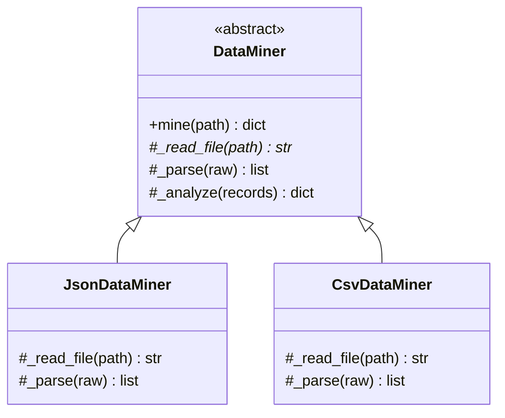
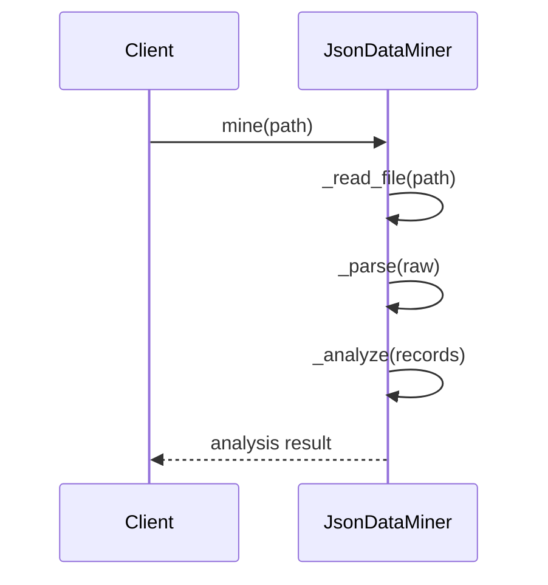
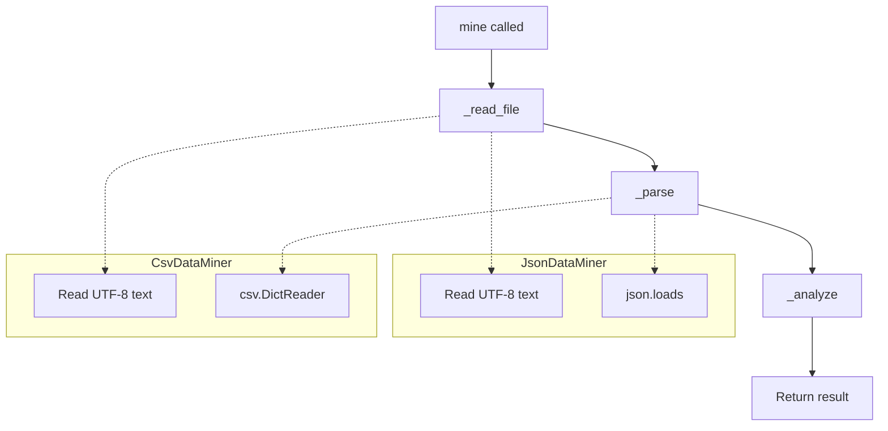

# Template Method

## Intent

Define the skeleton of an algorithm in an operation, deferring some steps to subclasses. Template Method lets subclasses redefine certain steps of an algorithm without changing the algorithm's structure.

This demo provides a **DataMiner** template with **JSON** and **CSV** subclasses that customize reading and parsing steps.

## Run

```bash
python3 behavioral/template_method/demo.py
```

## Class Diagram



## Sequence Diagram



## Flowchart



## Pros and Cons

| Pros | Cons |
| ---- | ---- |
| Reuses common algorithm structure | Inheritance can be rigid |
| Controls extension points via hooks | Subclasses limited by parent skeleton |
| Reduces duplication across similar workflows | Can violate Liskov if hooks misused |

## Distributed Environments

Template Method appears in **ETL pipelines** and **batch processing frameworks**:

- **Apache Spark** jobs follow read → transform → write templates with format-specific readers/writers.
- **CI/CD pipelines** (GitHub Actions, GitLab CI) define shared stages with customizable steps.
- **Data ingestion** services share validation and enrichment steps while swapping source parsers.

In distributed batch jobs, keep the template orchestration in a **coordinator** (Airflow DAG, Prefect flow) and delegate format-specific steps to worker tasks. Ensure idempotent `_analyze` steps for safe retries.

## References

- [Template Method — Refactoring.Guru](https://refactoring.guru/design-patterns/template-method)
- [Template method pattern — Wikipedia](https://en.wikipedia.org/wiki/Template_method_pattern)
