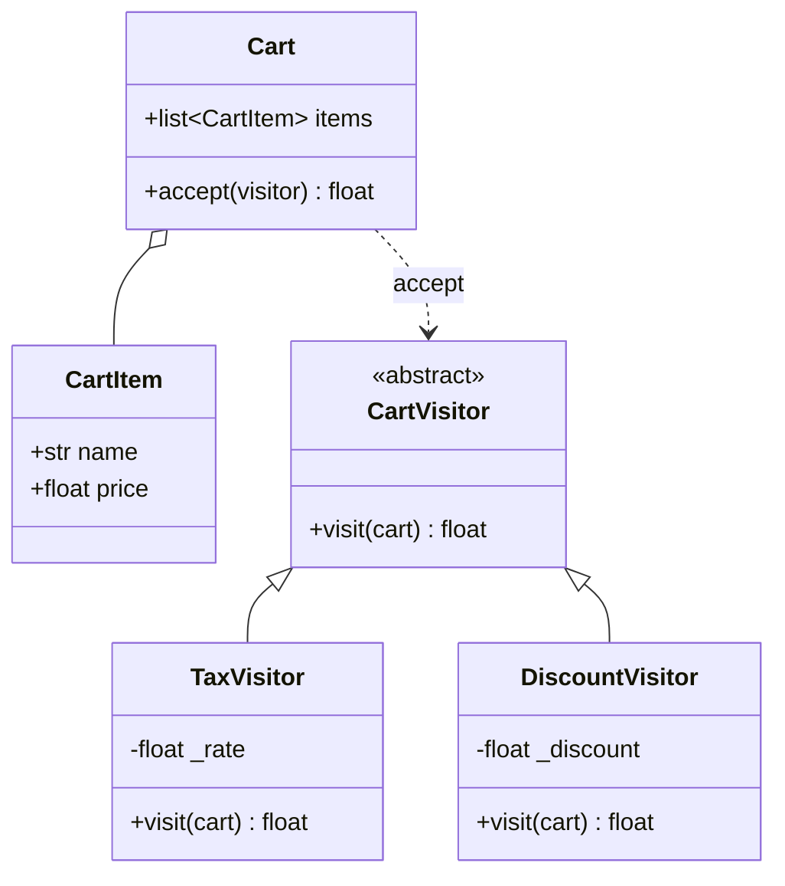
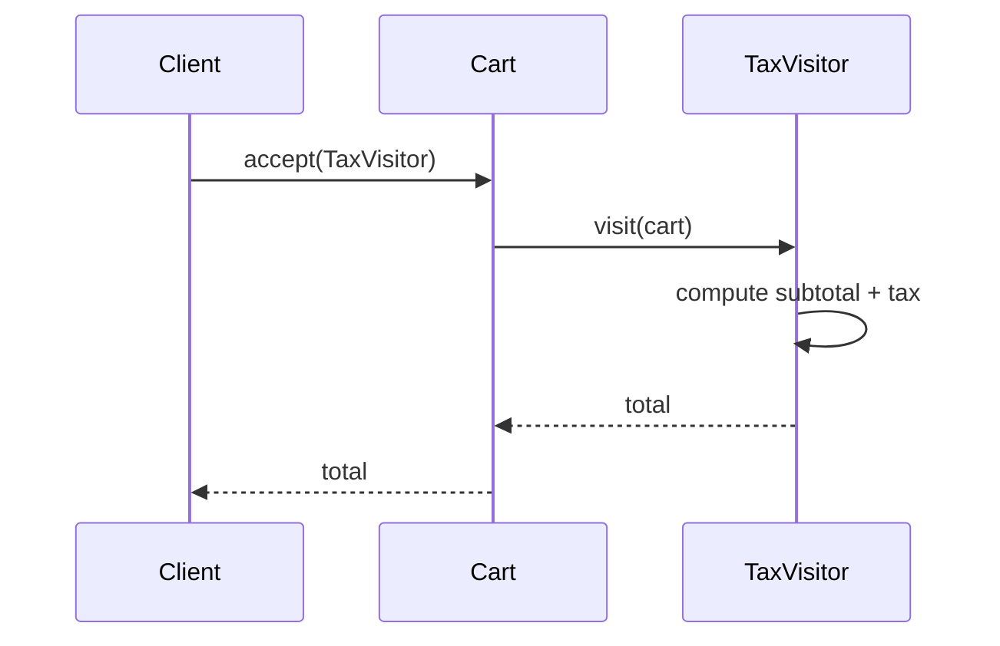
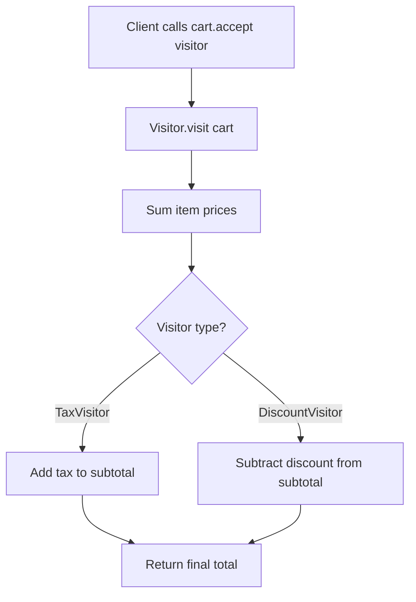

# Visitor

## Intent

Represent an operation to be performed on the elements of an object structure. Visitor lets you define a new operation without changing the classes of the elements on which it operates.

This demo applies **tax** and **discount** visitors to a **shopping cart**.

## Run

```bash
python3 behavioral/visitor/demo.py
```

## Class Diagram



## Sequence Diagram



## Flowchart



## Pros and Cons

| Pros | Cons |
| ---- | ---- |
| Add new operations without changing element classes | Must update all visitors when elements change |
| Groups related operations in one visitor class | Breaks encapsulation of element internals |
| Useful for complex object structures | Not ideal when element hierarchy changes often |

## Distributed Environments

Visitor pattern maps to **cross-cutting analytics** and **reporting pipelines**:

- **Billing systems** run tax, discount, and loyalty visitors over order graphs.
- **Static analysis tools** (linters, compilers) visit AST nodes with different check visitors.
- **OpenTelemetry collectors** apply processor visitors to telemetry batches.

In microservices, visitors often run as **sidecar processors** or **stream transforms** (Flink, Spark) over serialized object trees. Version visitor contracts alongside element schemas to avoid breaking downstream processors.

## References

- [Visitor — Refactoring.Guru](https://refactoring.guru/design-patterns/visitor)
- [Visitor pattern — Wikipedia](https://en.wikipedia.org/wiki/Visitor_pattern)
