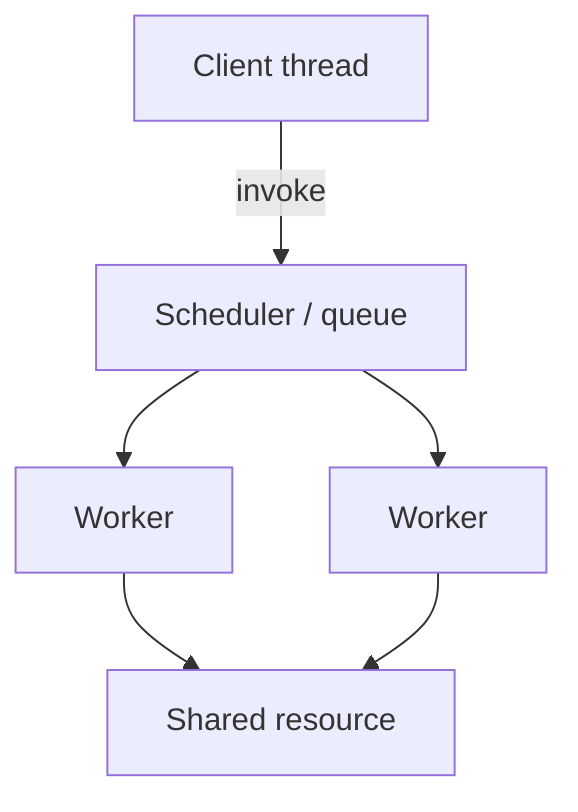

# Concurrency Patterns

Threading and synchronization patterns from [Concurrency pattern (Wikipedia)](https://en.wikipedia.org/wiki/Concurrency_pattern) and the extended [Software design pattern — Concurrency](https://en.wikipedia.org/wiki/Software_design_pattern#Concurrency) table. Part of [PyPatterns](../README.md) — **21 patterns**, each with `demo.py` + `README.md`.

## Intent

Concurrency patterns answer: *how do threads, tasks, or async workers coordinate safely?*



## Wikipedia Concurrency pattern catalog

Patterns listed on the [Concurrency pattern](https://en.wikipedia.org/wiki/Concurrency_pattern) page:

| Pattern | Folder | Details |
| ------- | ------ | ------- |
| Active Object | [active_object/](active_object/README.md) | Async invocation via scheduler thread |
| Balking | [balking/](balking/README.md) | Skip if object in wrong state |
| Barrier | [barrier/](barrier/README.md) | Rendezvous synchronization |
| Double-checked locking | [double_checked_locking/](double_checked_locking/README.md) | Lazy init with lock hint |
| Guarded suspension | [guarded_suspension/](guarded_suspension/README.md) | Wait until precondition true |
| Monitor object | [monitor_object/](monitor_object/README.md) | Mutual exclusion on methods |
| Nuclear reaction | [nuclear_reaction/](nuclear_reaction/README.md) | Fission (1→N) and fusion (N→1) |
| Reactor | [reactor/](reactor/README.md) | Event demux and dispatch |
| Readers–writer lock | [read_write_lock/](read_write_lock/README.md) | Concurrent reads, exclusive writes |
| Scheduler | [scheduler/](scheduler/README.md) | Serialize job execution |
| Thread pool | [thread_pool/](thread_pool/README.md) | Fixed workers + task queue |
| Thread-local storage | [thread_specific_storage/](thread_specific_storage/README.md) | Per-thread context |

## Extended concurrency patterns

Additional patterns from the [Software design pattern](https://en.wikipedia.org/wiki/Software_design_pattern#Concurrency) table:

| Pattern | Folder |
| ------- | ------ |
| Binding properties | [binding_properties/](binding_properties/README.md) |
| Compute kernel | [compute_kernel/](compute_kernel/README.md) |
| Event-based asynchronous | [event_based_asynchronous/](event_based_asynchronous/README.md) |
| Join | [join_pattern/](join_pattern/README.md) |
| Lock | [lock/](lock/README.md) |
| Messaging (MDP) | [messaging/](messaging/README.md) |
| Service handler | [service_handler/](service_handler/README.md) |
| Thread-specific storage | [thread_specific_storage/](thread_specific_storage/README.md) |
| Exclusive ownership | [exclusive_ownership/](exclusive_ownership/README.md) |
| Atomic operation | [atomic_operation/](atomic_operation/README.md) |

## Run

```bash
just run concurrency/barrier
just run concurrency/thread_pool
python3 concurrency/nuclear_reaction/demo.py
just run-all-concurrency    # all 21 demos
```

## Overlap with GoF patterns

| GoF pattern | Location | Tie-in |
| ----------- | -------- | ------ |
| Singleton | [creational/singleton](../creational/singleton/README.md) | Double-checked locking |
| Proxy | [structural/proxy](../structural/proxy/README.md) | Lazy initialization |
| Command | [behavioral/command](../behavioral/command/README.md) | Queued execution |
| Observer | [behavioral/observer](../behavioral/observer/README.md) | Event dispatch |

## Distributed environments

| Local pattern | Distributed analogue |
| ------------- | -------------------- |
| Thread pool | Celery, SQS consumers, K8s job workers |
| Active Object | Actor model, async gRPC handlers |
| Reactor | asyncio, Kafka consumers, Nginx |
| Monitor / Lock | Distributed locks (Redis, etcd) — use sparingly |
| Barrier | Workflow checkpoints, map-reduce shuffle |

## See also

- [Architecture patterns](../architecture/README.md) — system-level styles and patterns
- [Creational](../creational/README.md) · [Structural](../structural/README.md) · [Behavioral](../behavioral/README.md)

## References

- [Concurrency pattern — Wikipedia](https://en.wikipedia.org/wiki/Concurrency_pattern)
- [Software design pattern — Concurrency](https://en.wikipedia.org/wiki/Software_design_pattern#Concurrency)
- [Python threading](https://docs.python.org/3/library/threading.html) · [asyncio](https://docs.python.org/3/library/asyncio.html)
