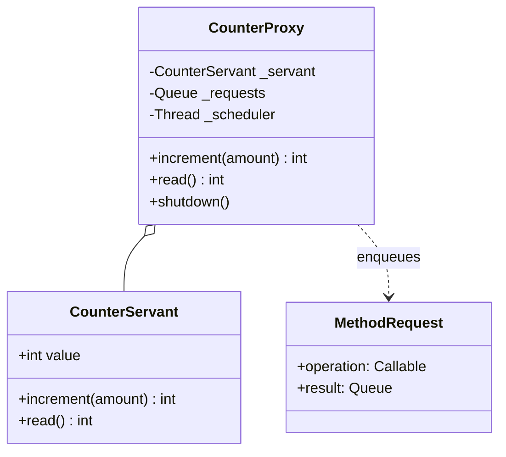
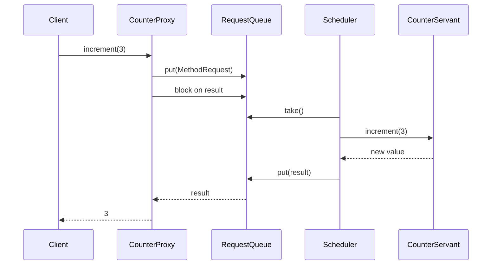
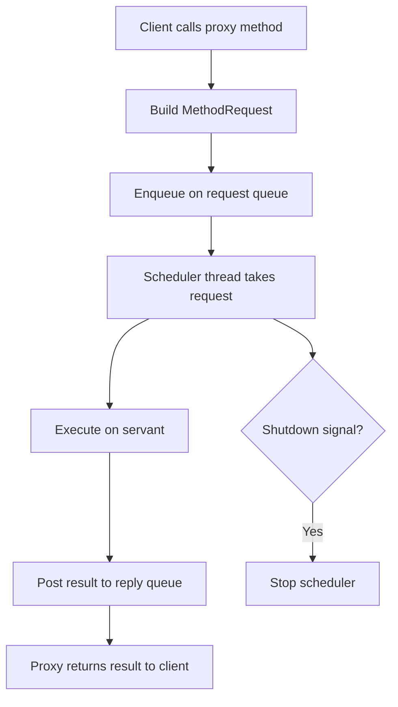

# Active Object Pattern

## Intent

Decouple method execution from method invocation for objects that reside in their own thread of control. Clients call a proxy; requests are queued and a scheduler thread executes them on the real servant, serializing access without blocking callers on the work itself.

This demo uses a **CounterProxy** that enqueues increment/read requests for a **CounterServant** running on a dedicated scheduler thread.

## Class Diagram



## Sequence Diagram



## Flowchart



## Run Instructions

```bash
cd PyPatterns
python3 concurrency/active_object/demo.py
```

Expected output shows five concurrent increments serialized through the scheduler, ending with `Final counter value (via proxy): 15`.

## Pros / Cons

| Pros | Cons |
| ---- | ---- |
| Serializes access to the servant without client-side locking | Adds latency — every call waits for queue + execution |
| Clear separation between invocation and execution | Scheduler thread is a single point of failure |
| Natural fit for actor-style message passing | More moving parts than direct synchronized methods |

## Distributed Environments

The active object pattern maps directly to **message-driven actors** and **async RPC handlers**:

- **Akka / Orleans actors** receive messages on a mailbox and process them one at a time per actor instance.
- **gRPC async handlers** accept requests, enqueue work, and reply when a worker finishes.
- **SQS / Kafka consumers** deserialize messages and dispatch them to a single-threaded handler per partition key.

In microservices, treat each service instance as an active object: HTTP requests are proxied invocations, an internal queue absorbs bursts, and a worker pool (scheduler) executes business logic without exposing raw shared mutable state to callers.

## References

- [Active Object — POSA2](https://www.dre.vanderbilt.edu/~schmidt/POSA/POSA2/)
- [Active object — Wikipedia](https://en.wikipedia.org/wiki/Active_object)
