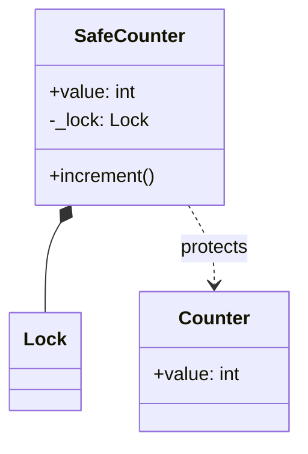
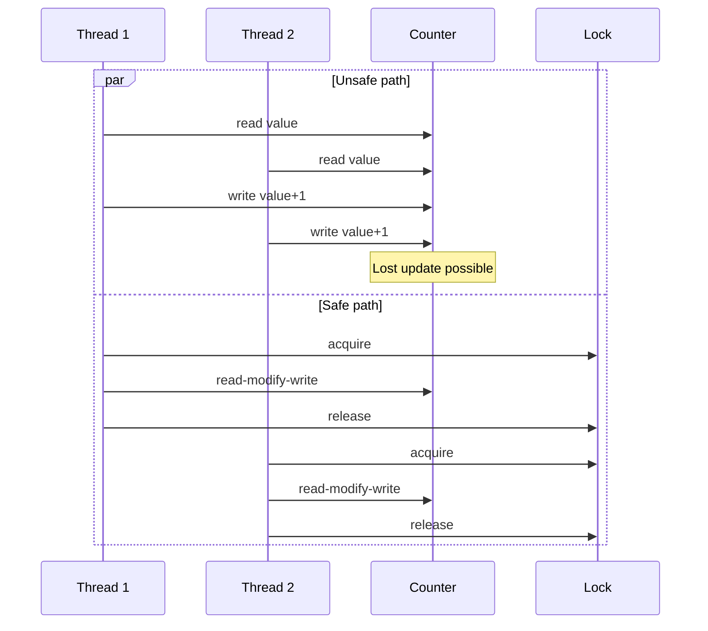
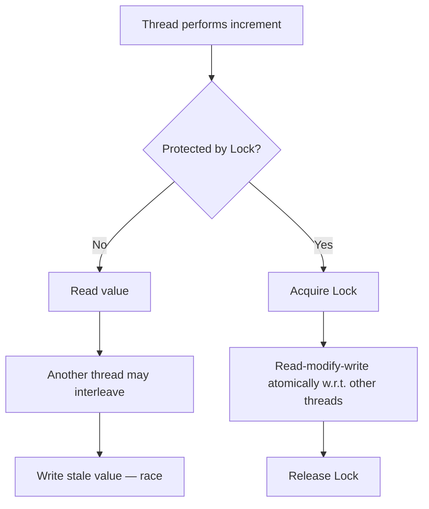

# Atomic Operation Pattern

## Intent

Perform read-modify-write updates safely under concurrent access. Hardware exposes atomic CPU instructions; in Python, the GIL serializes bytecode but **does not** make compound operations like `counter += 1` atomic — use `threading.Lock` (or ownership transfer) for correctness.

This demo runs eight threads each incrementing a shared counter 2,000 times with an explicit read–yield–write sequence, comparing unsafe updates against Lock-protected updates.

## Class Diagram



## Sequence Diagram



## Flowchart



## Run Instructions

```bash
cd PyPatterns
python3 concurrency/atomic_operation/demo.py
```

Expected output shows the unsafe counter below `16000` while the Lock-protected counter matches the expected total.

## Pros / Cons

| Pros | Cons |
| ---- | ---- |
| Lock gives correct compound updates in CPython | Locks add contention under heavy parallelism |
| Mirrors hardware atomic / CAS concepts | GIL limits true CPU parallelism for CPU-bound Python |
| Simple to apply to small critical sections | Fine-grained locking is harder to design |

## Distributed Environments

Atomic updates appear at every layer of distributed systems:

- **Database transactions** — `UPDATE ... SET count = count + 1` with row-level locking.
- **Redis INCR / INCRBY** — single-key atomic operations.
- **Compare-and-swap (CAS)** — optimistic concurrency in DynamoDB conditional writes, etcd revisions.
- **Distributed counters** — often sharded or approximated (HyperLogLog) to avoid a single hot lock.

CPython's GIL is **not** a substitute for application-level synchronization when correctness matters; likewise, never assume cross-service reads and writes are atomic without explicit transactional boundaries. For counter-heavy hot paths, consider [exclusive_ownership](../exclusive_ownership/README.md) via partitioned queues instead of one shared variable.

## References

- [Linearizability — Wikipedia](https://en.wikipedia.org/wiki/Linearizability)
- [Compare-and-swap — Wikipedia](https://en.wikipedia.org/wiki/Compare-and-swap)
- [Python threading.Lock](https://docs.python.org/3/library/threading.html#lock-objects)
- [The Global Interpreter Lock — Python docs FAQ](https://docs.python.org/3/faq/library.html#what-kinds-of-global-value-mutation-are-thread-safe)
