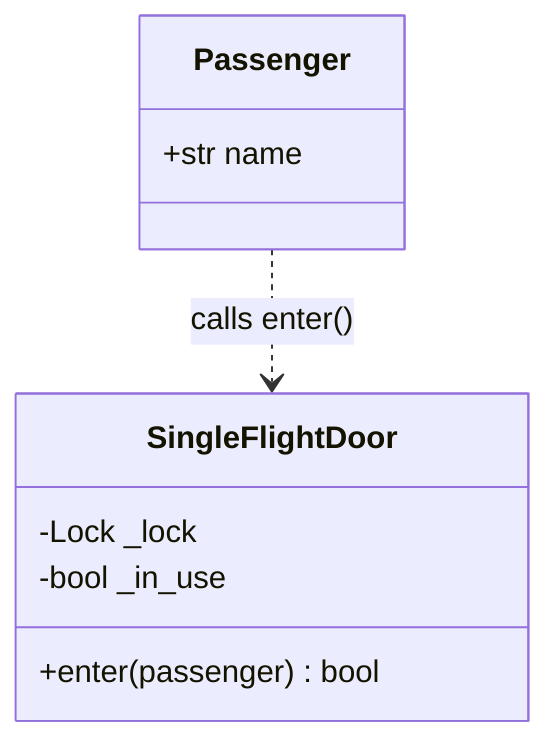
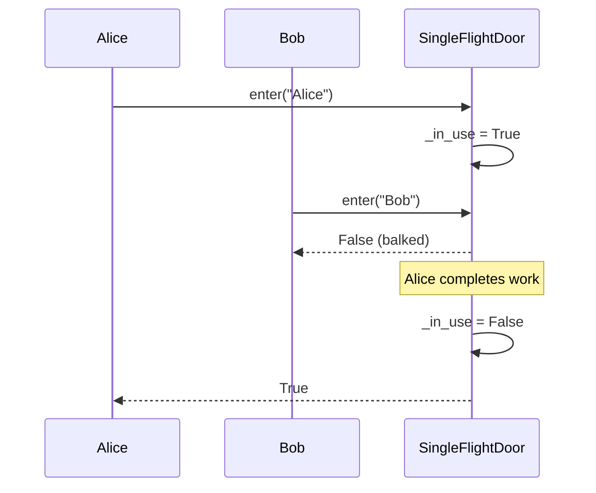
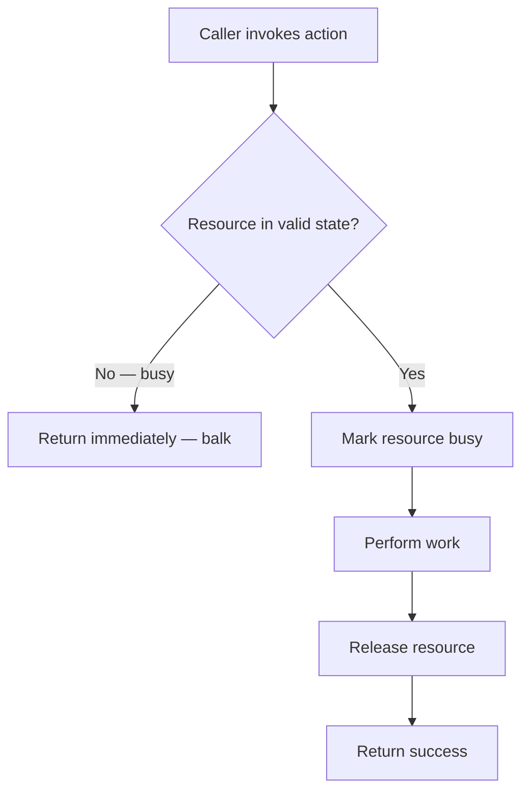

# Balking Pattern

## Intent

Only execute an action on an object when the object is in a particular state. If the precondition is not met (e.g., a resource is busy), the method returns immediately without blocking — it "balks" rather than waiting.

This demo models a **SingleFlightDoor**: only one passenger may enter at a time; concurrent callers get `False` instantly if the door is already in use.

## Class Diagram



## Sequence Diagram



## Flowchart



## Run Instructions

```bash
cd PyPatterns
python3 concurrency/balking/demo.py
```

Expected output shows one passenger entering while others balk, then subsequent attempts succeeding once the door is free.

## Pros / Cons

| Pros | Cons |
| ---- | ---- |
| Avoids blocking when the resource is temporarily unavailable | Callers must handle rejection and retry logic |
| Simple guard with a lock and state flag | Easy to misuse for indefinite waits — prefer guarded suspension instead |
| Low overhead — no queue or condition variables | Some consider it an anti-pattern if the API should block or queue |

## Distributed Environments

Balking appears wherever systems **fail fast** instead of queueing:

- **HTTP 503 / 429 responses** when a service or rate limiter is saturated.
- **Optimistic locking** — if a version mismatch is detected, reject the write rather than blocking.
- **Leader election** — only the current leader processes requests; followers balk immediately.
- **Circuit breakers** in the open state reject calls without waiting for a timeout.

Use balking when the expected busy period is short and callers can cheaply retry or take an alternate path. For longer waits, prefer guarded suspension or queuing.

## References

- [Balking pattern — Wikipedia](https://en.wikipedia.org/wiki/Balking_pattern)
