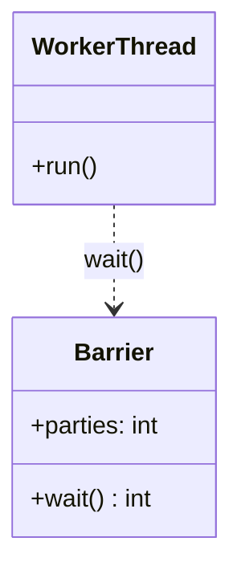
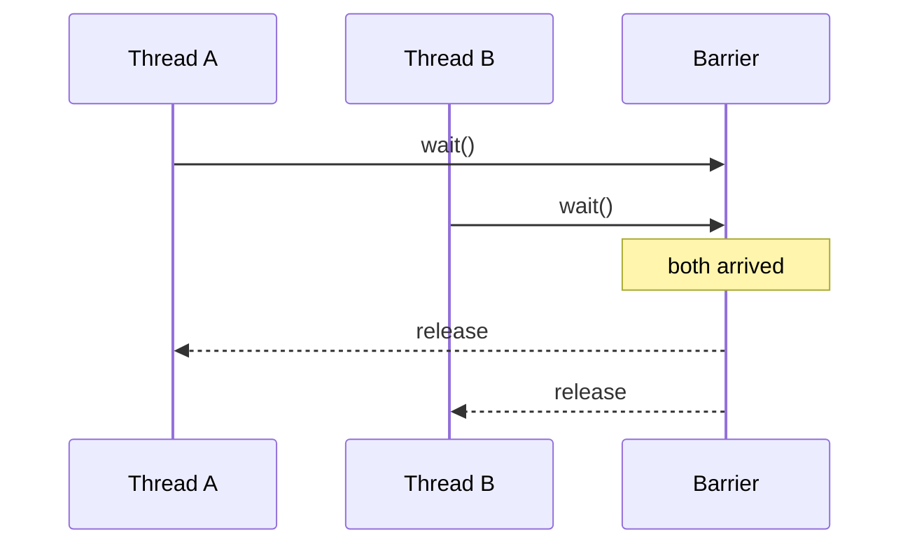
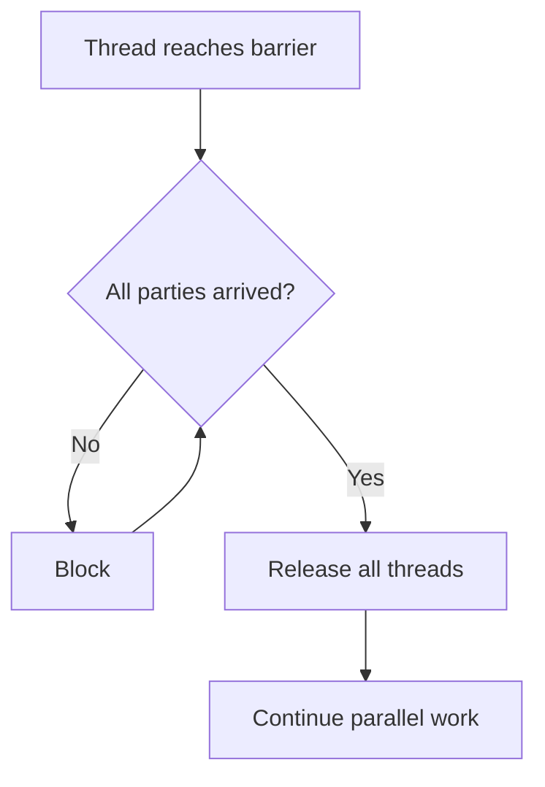

# Barrier

## Intent

A **barrier** synchronizes a fixed group of threads at a rendezvous point. Each thread blocks until all participants arrive, then all proceed together — useful for phased parallel algorithms.

## Class Diagram



## Sequence Diagram



## Flowchart



## Run Instructions

```bash
cd PyPatterns
python3 concurrency/barrier/demo.py
```

## Pros / Cons

| Pros | Cons |
| ---- | ---- |
| Simple phased synchronization | Fixed party count at creation |
| Built into Python (`threading.Barrier`) | Deadlock if a thread never arrives |
| Predictable batch boundaries | Not suitable for dynamic worker counts |

## Distributed Environments

Barriers appear as **coordination checkpoints** in distributed workflows:

- MapReduce **shuffle barriers** between map and reduce phases
- **Distributed barriers** (ZooKeeper, etcd) for multi-node pipeline stages
- **Choreography sagas** waiting for all participant acknowledgments before the next step

In microservices, prefer explicit workflow engines (Temporal, Step Functions) over ad-hoc distributed barriers.

## References

- [Concurrency pattern — Wikipedia](https://en.wikipedia.org/wiki/Concurrency_pattern)
- [Python threading.Barrier](https://docs.python.org/3/library/threading.html#barrier-objects)
