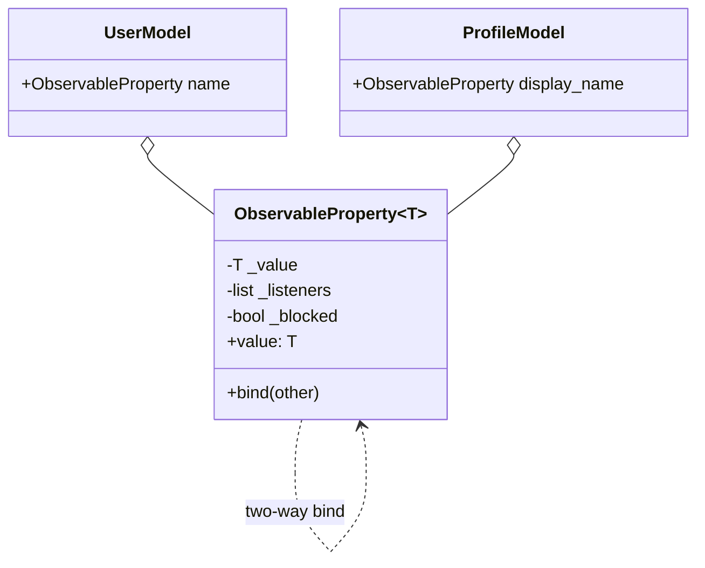
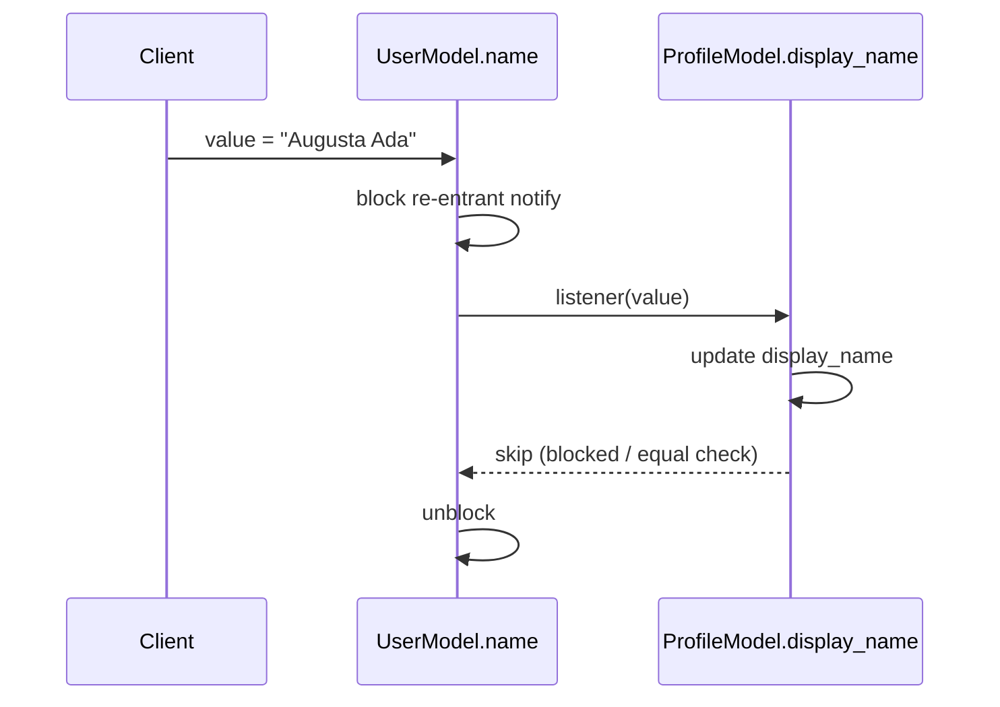
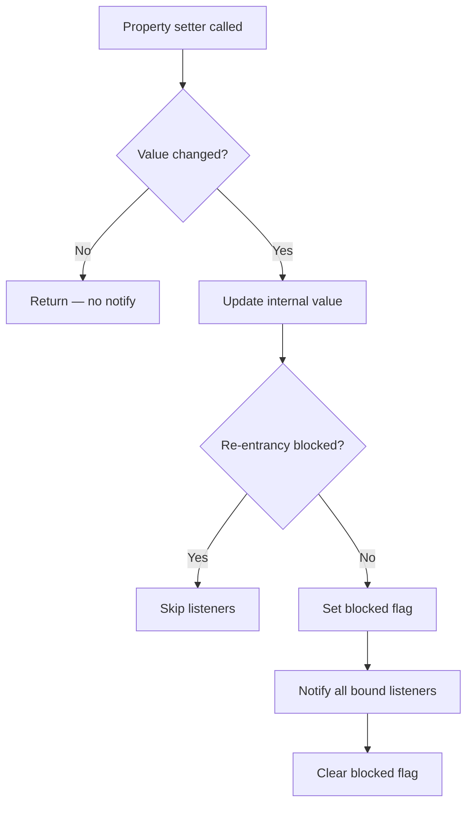

# Binding Properties Pattern

## Intent

Combine multiple observers so that properties in different objects stay synchronized or coordinated. When one bound property changes, listeners propagate the new value to its partners — enabling two-way data binding without manual sync code at every call site.

This demo binds **UserModel.name** and **ProfileModel.display_name** so updates in either model mirror instantly in the other.

## Class Diagram



## Sequence Diagram



## Flowchart



## Run Instructions

```bash
cd PyPatterns
python3 concurrency/binding_properties/demo.py
```

Expected output shows both models staying in sync after updates from either side.

## Pros / Cons

| Pros | Cons |
| ---- | ---- |
| Eliminates scattered sync code between related models | Infinite update loops if re-entrancy is not blocked |
| Keeps UI and domain models consistent automatically | Binding graph can become hard to debug |
| Natural extension of the Observer pattern | Performance cost from notification chains on every write |

## Distributed Environments

Binding properties extend to **reactive data pipelines** across services:

- **Frontend state management** (React, Vue, MobX) binds component props to a shared store.
- **Event sourcing projections** keep read-model fields synchronized with write-model events.
- **Config watchers** (Kubernetes informers, etcd watches) propagate cluster state to local caches.
- **CDC (Change Data Capture)** streams database column changes to downstream search indexes.

In distributed systems, prefer **explicit event contracts** over tight two-way binding — use one-way data flow with version vectors or CRDTs when replicas can diverge temporarily.

## References

- [Binding properties pattern — Wikipedia](https://en.wikipedia.org/wiki/Binding_properties_pattern)
