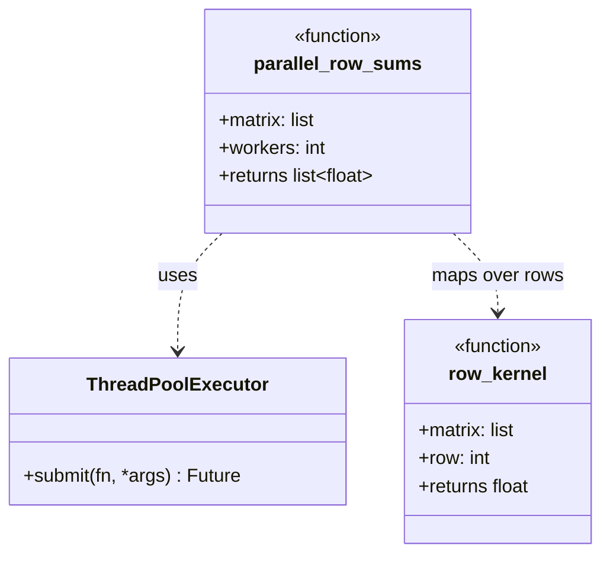
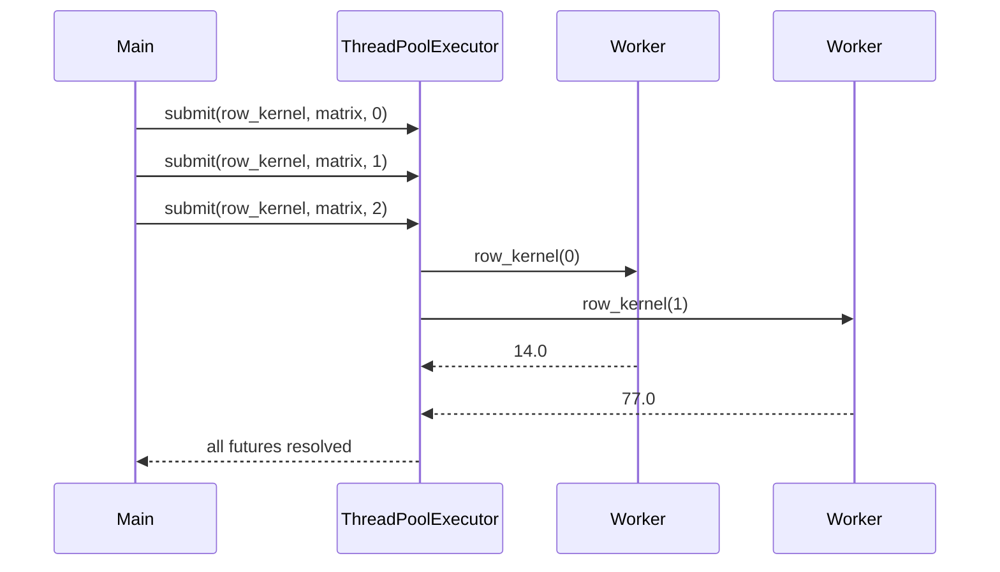

# Compute Kernel Pattern

## Intent

Apply the same calculation many times in parallel, differing only by an integer index parameter. Each invocation is independent (embarrassingly parallel), making it ideal for SIMD GPUs, thread pools, and map-reduce workloads.

This demo uses **ThreadPoolExecutor** to run a row-wise sum-of-squares kernel over a small matrix — one future per row index.

## Class Diagram



## Sequence Diagram



## Flowchart

```mermaid
flowchart TD
    A[Input data + index range] --> B[Create worker pool]
    B --> C[For each index i]
    C --> D[Submit kernel(data, i)]
    D --> E{More indices?}
    E -->|Yes| C
    E -->|No| F[Collect all results]
    F --> G[Return result vector]
```

## Run Instructions

```bash
cd PyPatterns
python3 concurrency/compute_kernel/demo.py
```

Expected output prints sum-of-squares per row and a grand total.

## Pros / Cons

| Pros | Cons |
| ---- | ---- |
| Near-linear speedup on CPU-bound, independent work | Thread overhead can dominate for tiny inputs |
| Same kernel code runs on CPU threads or GPU blocks | Requires non-branching, index-parameterized logic |
| Maps cleanly to map-reduce and parallel for-loops | Shared mutable state between kernels breaks the model |

## Distributed Environments

Compute kernels scale from a laptop thread pool to **cluster-wide parallel jobs**:

- **CUDA / OpenCL kernels** launch one thread block per matrix row or image tile.
- **Spark / Dask map** applies the same function to each partition of a dataset.
- **AWS Lambda fan-out** invokes one function per S3 object key or queue message.
- **NumPy / Numba vectorization** compiles index loops into SIMD or GPU code.

Design kernels to be **pure functions of (data, index)** with no cross-index dependencies. Aggregate results in a separate reduction phase when needed.

## References

- [Software design pattern — Concurrency (Compute kernel)](https://en.wikipedia.org/wiki/Software_design_pattern#Concurrency)
