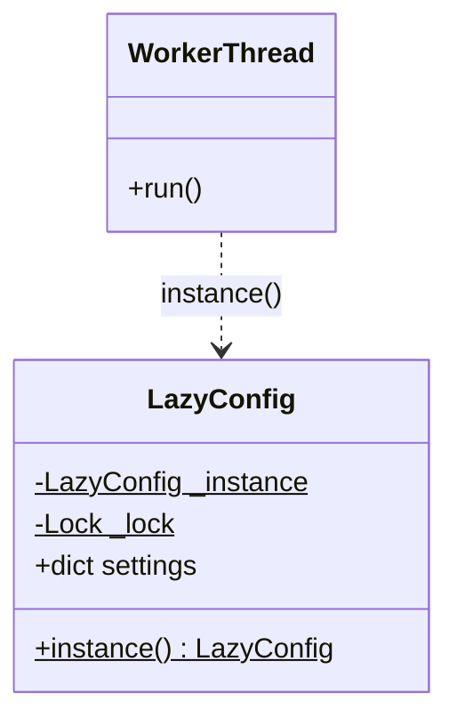
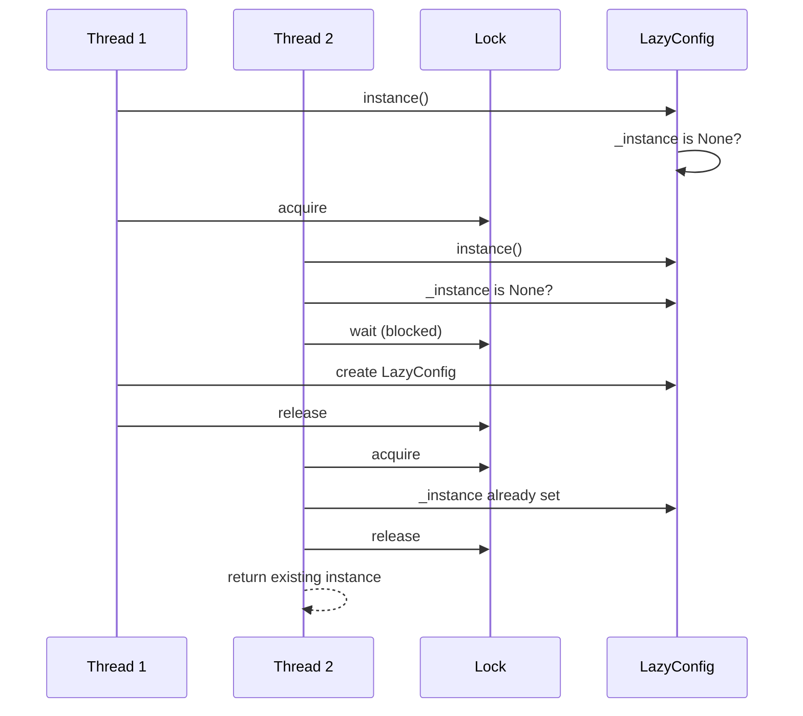
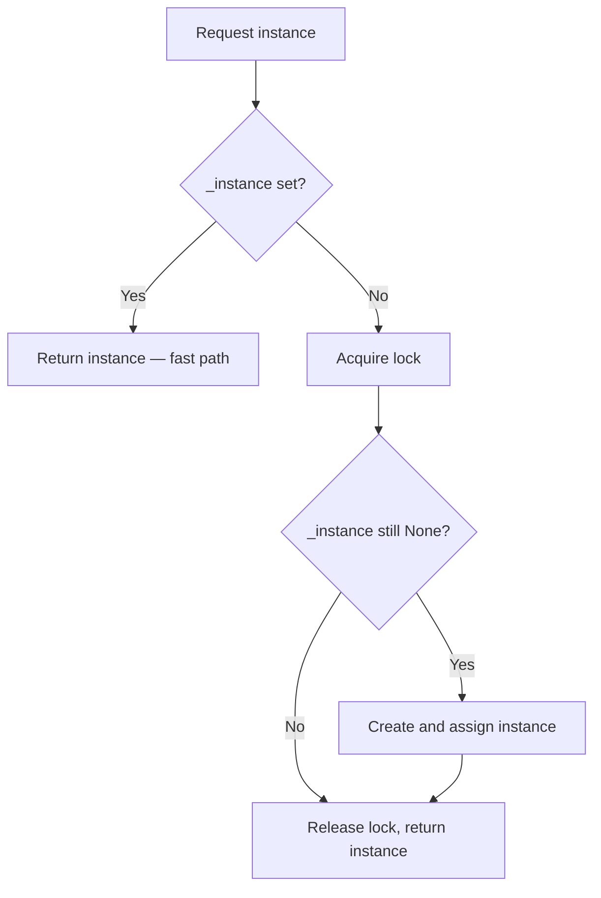

# Double-Checked Locking Pattern

## Intent

Reduce the overhead of acquiring a lock by testing the locking criterion (the "lock hint") before synchronizing. Lock only when the guarded resource might not yet be initialized — a common technique for thread-safe lazy initialization.

This demo implements **LazyConfig.instance()**: the fast path reads `_instance` without a lock; the slow path acquires the lock and initializes once.

## Class Diagram



## Sequence Diagram



## Flowchart



## Run Instructions

```bash
cd PyPatterns
python3 concurrency/double_checked_locking/demo.py
```

Expected output confirms all threads see the same object id and shared settings.

## Pros / Cons

| Pros | Cons |
| ---- | ---- |
| Avoids lock contention after initialization | Historically buggy on some language/memory-model combinations |
| Fast read path for hot singleton access | Easy to implement incorrectly without proper memory barriers |
| Standard idiom for lazy one-time setup | Python's GIL makes simpler patterns often sufficient |

## Distributed Environments

Double-checked locking has distributed analogues for **one-time initialization under contention**:

- **Distributed locks (Redis Redlock, etcd)** guard first-time resource creation (schema migration, cache warm-up).
- **Compare-and-swap (CAS)** in DynamoDB or Consul avoids full locks when creating a key if-not-exists.
- **Kubernetes init containers** ensure setup runs once before the main pod starts serving traffic.

In Python 3.12, prefer `threading.Lock` with a simple check or `functools.cache` for process-local singletons. For cross-process singletons, use file locks or a coordination service rather than in-memory double-checked locking.

## References

- [Double-checked locking — Wikipedia](https://en.wikipedia.org/wiki/Double-checked_locking)
