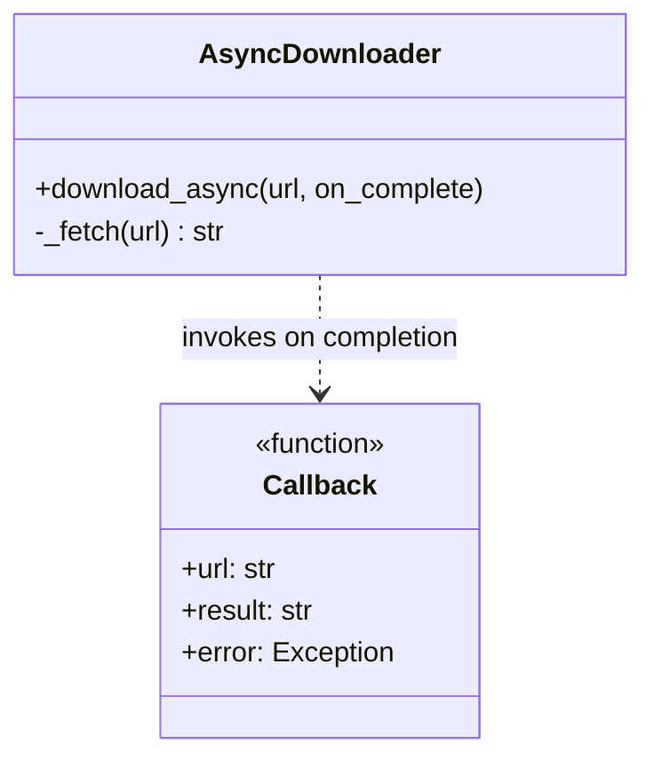
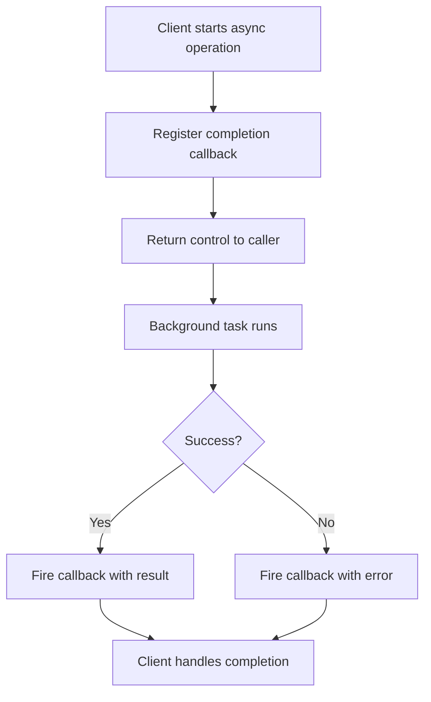

# Event-Based Asynchronous Pattern

## Intent

Start a potentially long-running operation asynchronously and receive the result through a completion callback or event, rather than blocking the caller. This decouples invocation from completion and fits UI and component models where callers cannot afford to wait.

This demo uses **asyncio** to start downloads via `download_async()`; each completion fires an `on_complete` callback with the result or error.

## Class Diagram



## Sequence Diagram

```mermaid
sequenceDiagram
    participant Client
    participant Downloader as AsyncDownloader
    participant Loop as asyncio loop
    participant Fetch as _fetch

    Client->>Downloader: download_async(url, callback)
    Downloader->>Loop: create_task(_fetch)
    Note over Client: continues immediately
    Fetch->>Fetch: await sleep (I/O)
    Fetch-->>Downloader: payload
    Downloader->>Client: callback(url, result, None)
```

## Flowchart



## Run Instructions

```bash
cd PyPatterns
python3 concurrency/event_based_asynchronous/demo.py
```

Expected output shows three downloads completing via callbacks and a summary line `Downloads finished: 3/3`.

## Pros / Cons

| Pros | Cons |
| ---- | ---- |
| Caller is not blocked during I/O or long work | Callback chains ("callback hell") without discipline |
| Natural fit for event loops and reactive UIs | Error handling scattered across callbacks |
| Enables concurrent outstanding operations | Harder to reason about than async/await linear flow |

## Distributed Environments

Event-based async is the default model for **non-blocking distributed I/O**:

- **Webhooks** — POST a URL when a batch job, payment, or build completes.
- **Message queues with ack callbacks** — SQS, RabbitMQ consumers process messages and ack on success.
- **GraphQL subscriptions / WebSockets** push completion events to clients.
- **Kubernetes watch API** fires ADD/UPDATE/DELETE events as cluster state changes.

Modern Python services often prefer **async/await (TAP)** over raw callbacks, but the underlying pattern is the same: start work, continue, handle completion via an event or future.

## References

- [Event-Based Asynchronous Pattern — Wikipedia](https://en.wikipedia.org/wiki/Event-Based_Asynchronous_Pattern)
