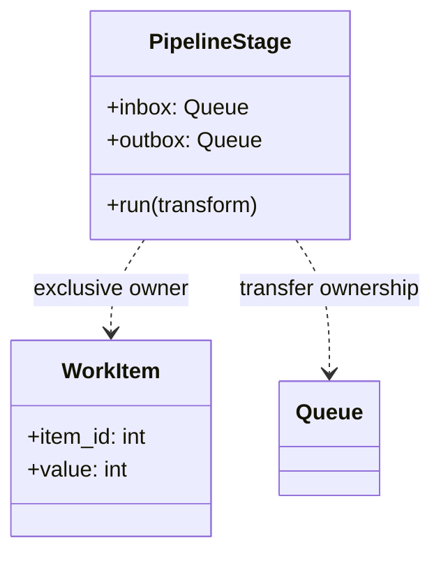
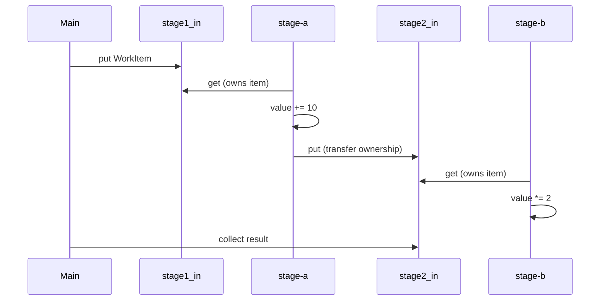
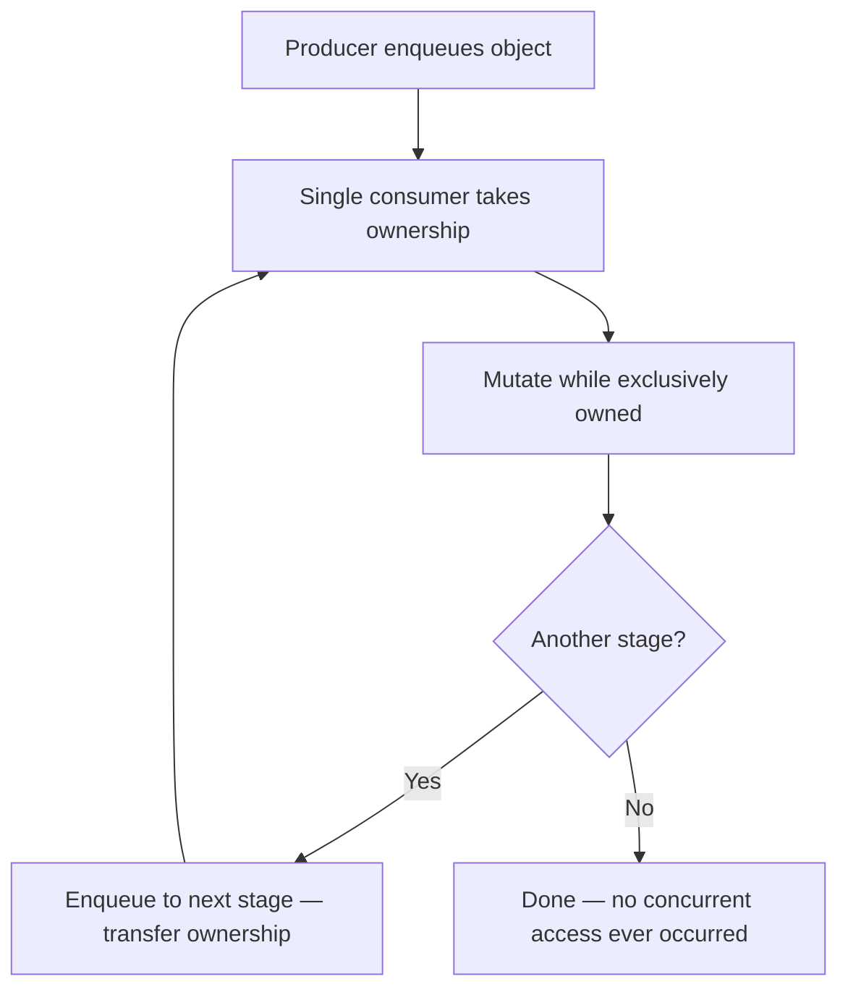

# Exclusive Ownership Pattern

## Intent

Eliminate data races by ensuring only one thread owns a mutable object at any time. Ownership transfers through queues — workers never read or write shared state concurrently.

This demo pipes `WorkItem` objects through two pipeline stages; each stage exclusively owns an item while transforming it, then hands it off via a queue.

## Class Diagram



## Sequence Diagram



## Flowchart



## Run Instructions

```bash
cd PyPatterns
python3 concurrency/exclusive_ownership/demo.py
```

Expected output shows each stage logging sole ownership, then five items with final values `(id+10)*2` — e.g. item 0 → 20, item 1 → 22.

## Pros / Cons

| Pros | Cons |
| ---- | ---- |
| No locks on shared mutable state | Ownership transfer adds queue latency |
| Easier to reason about invariants | Object must not be referenced elsewhere |
| Scales to pipeline / actor architectures | Deep copies may be needed if aliases exist |

## Distributed Environments

Exclusive ownership is the foundation of **message-passing concurrency**:

- **Kafka partition consumption** — one consumer group member owns a partition at a time.
- **Actor models** (Erlang, Akka) — messages transfer state; actors never share memory.
- **S3 object workflows** — lambdas receive an object key, process, write a new key (immutable hand-off).

Prefer queues and immutable messages over shared databases with row locks when crossing service boundaries. See also [atomic_operation](../atomic_operation/README.md) for when shared counters require explicit synchronization instead.

## References

- [Ownership semantics — Rust book (concept)](https://doc.rust-lang.org/book/ch04-00-understanding-ownership.html)
- [Message passing — Wikipedia](https://en.wikipedia.org/wiki/Message_passing)
- [Python queue — thread-safe transfers](https://docs.python.org/3/library/queue.html)
