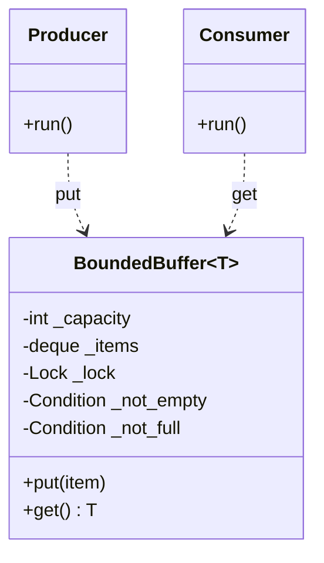
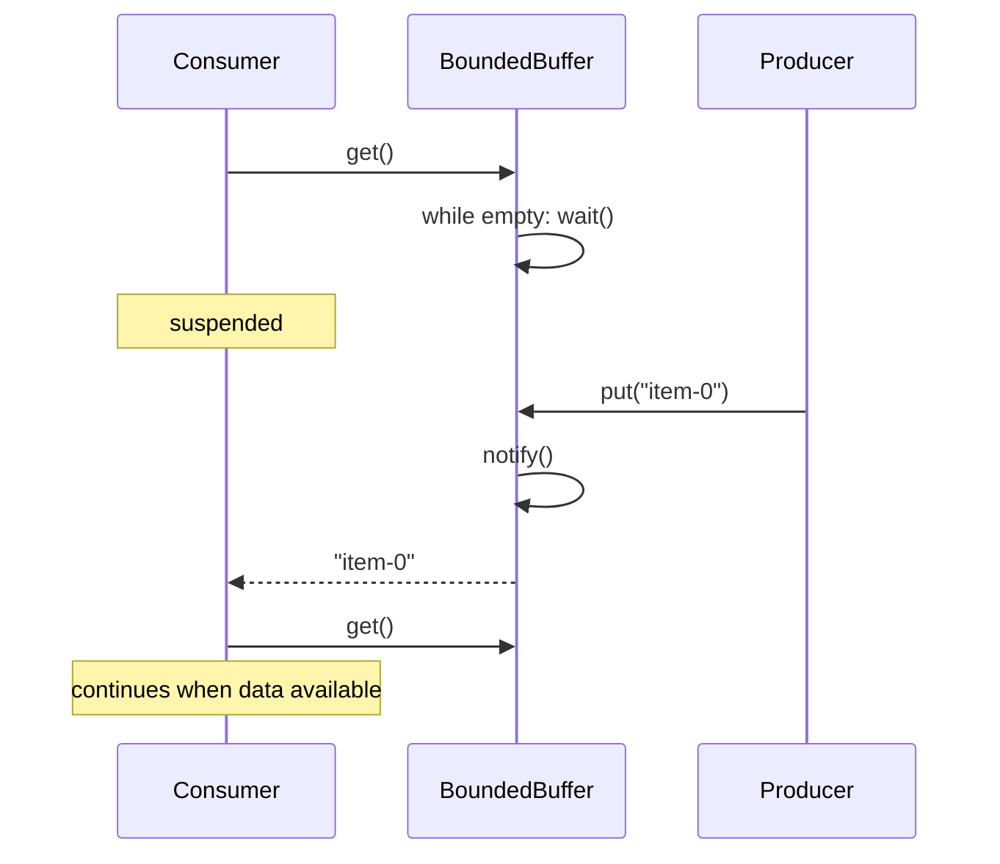
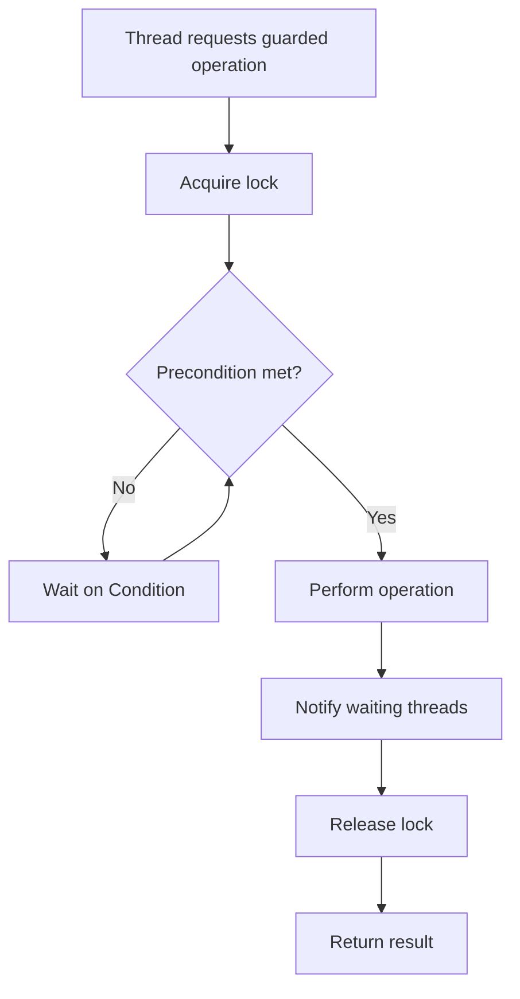

# Guarded Suspension Pattern

## Intent

Manage operations that require both a lock and a precondition to be satisfied before execution. If the precondition is false (e.g., buffer empty), the calling thread suspends on a condition variable until another thread makes progress and notifies waiters.

This demo uses a **BoundedBuffer**: consumers call `get()` and wait on a `Condition` until producers `put()` items and notify.

## Class Diagram



## Sequence Diagram



## Flowchart



## Run Instructions

```bash
cd PyPatterns
python3 concurrency/guarded_suspension/demo.py
```

Expected output shows the consumer waiting until items arrive, then consuming all four in order.

## Pros / Cons

| Pros | Cons |
| ---- | ---- |
| Correct blocking when a resource is temporarily unavailable | Threads suspended too long reduce throughput |
| Avoids busy-wait polling | Requires careful notify/wait pairing to prevent lost signals |
| Standard building block for producer–consumer queues | Deadlock risk if lock ordering is inconsistent |

## Distributed Environments

Guarded suspension extends to **backpressure and flow control** in distributed systems:

- **Kafka consumer lag** — consumers block (or pause partition fetch) when downstream processing is saturated.
- **gRPC streaming** — server waits for client readiness or buffer space before sending the next message.
- **Database connection pools** — threads block until a connection is returned to the pool.
- **Reactive streams (Project Reactor, RxJava)** — `request(n)` gates how many items a publisher emits.

Unlike balking (fail fast), guarded suspension assumes the wait will be **finite and acceptable**. For unbounded waits, add timeouts, circuit breakers, or dead-letter queues.

## References

- [Guarded suspension — Wikipedia](https://en.wikipedia.org/wiki/Guarded_suspension)
