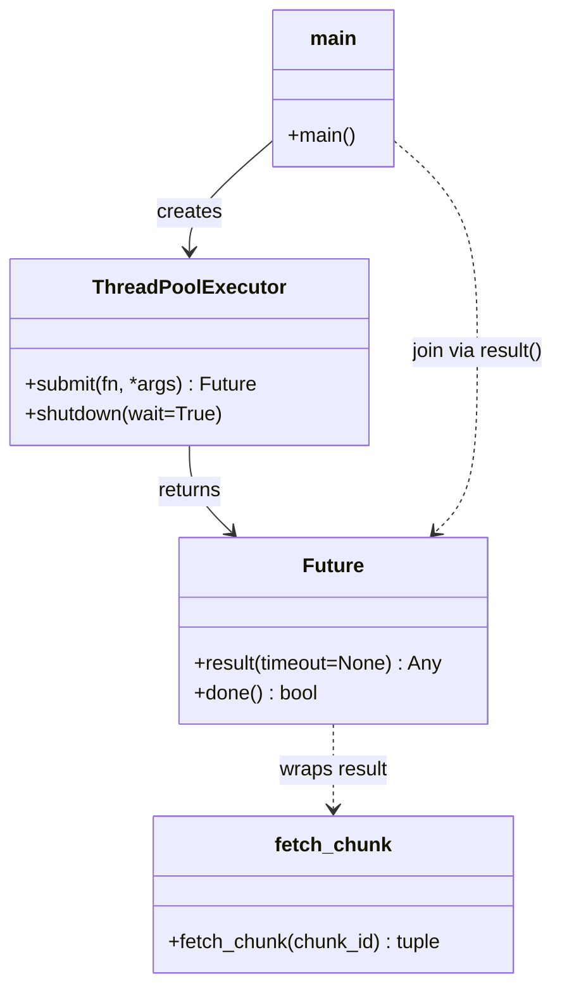
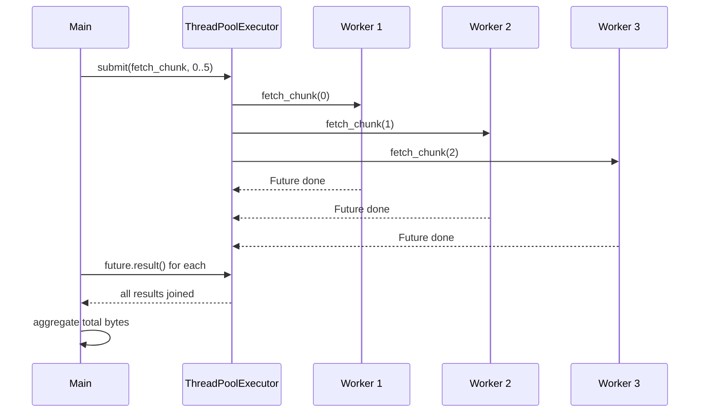
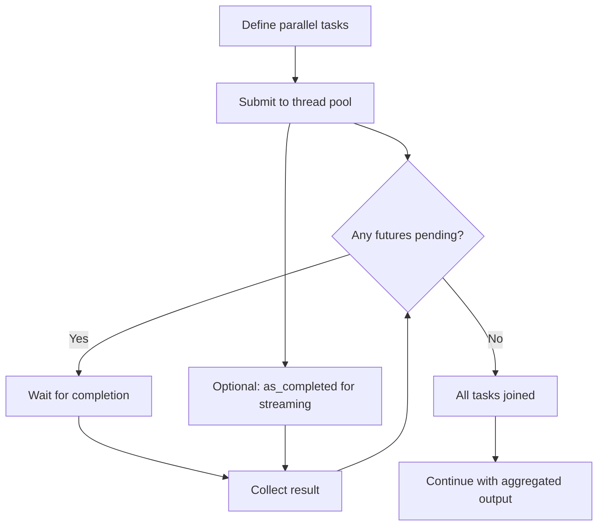

# Join Pattern

## Intent

Spawn multiple independent tasks in parallel, then **join** (wait) until every task completes before continuing. The join pattern separates *fork* (start work) from *join* (collect results), giving structured parallelism without manual thread lifecycle management.

This demo uses `concurrent.futures.ThreadPoolExecutor` to fetch six data chunks concurrently, then aggregates results once all futures resolve.

## Class Diagram



## Sequence Diagram



## Flowchart



## Run Instructions

```bash
cd PyPatterns
python3 concurrency/join_pattern/demo.py
```

Expected output lists six chunk results sorted by ID and reports the total byte count after all parallel fetches complete (~0.3 s).

## Pros / Cons

| Pros | Cons |
| ---- | ---- |
| Simple structured parallelism with clear join point | Thread overhead for CPU-bound work (GIL limits speedup) |
| `concurrent.futures` handles thread lifecycle | Blocking `result()` can stall if one task hangs |
| Works well for I/O-bound fan-out (HTTP, disk, DB) | Error propagation requires inspecting each Future |
| Composable with `as_completed` for progressive results | No built-in cancellation semantics across all tasks |

## Distributed Environments

The join pattern maps directly to **scatter-gather** and **map-reduce** workflows:

- **Microservice fan-out**: an API gateway calls N downstream services in parallel, then joins responses into one payload.
- **Batch pipelines**: Spark/Dask tasks run partitions concurrently; the driver joins partition outputs.
- **Cloud functions**: Step Functions *Parallel* state runs branches concurrently and waits for all before the next step.
- **Kubernetes Jobs**: `completions` and `parallelism` fields express "start N workers, join when all finish."

Prefer async I/O (`asyncio.gather`) or message queues when crossing process or machine boundaries; the join semantics remain the same.

## References

- [Join pattern — Wikipedia (parallel computing)](https://en.wikipedia.org/wiki/Fork%E2%80%93join_model)
- [concurrent.futures — Python docs](https://docs.python.org/3/library/concurrent.futures.html)
- [POSA2 — Pattern-Oriented Software Architecture, Volume 2](https://en.wikipedia.org/wiki/Pattern-Oriented_Software_Architecture)
