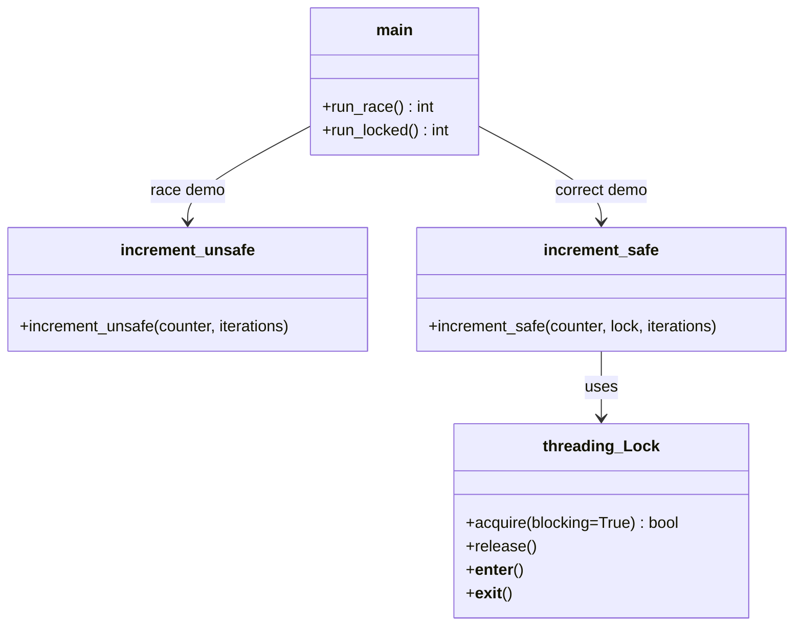
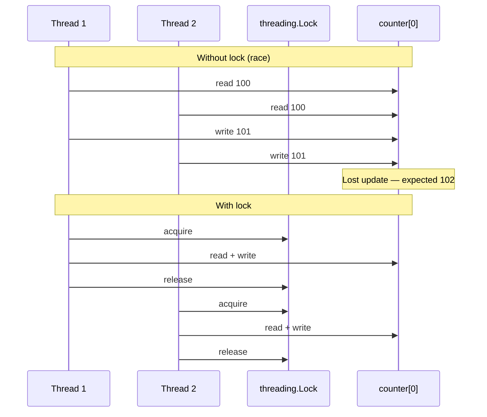
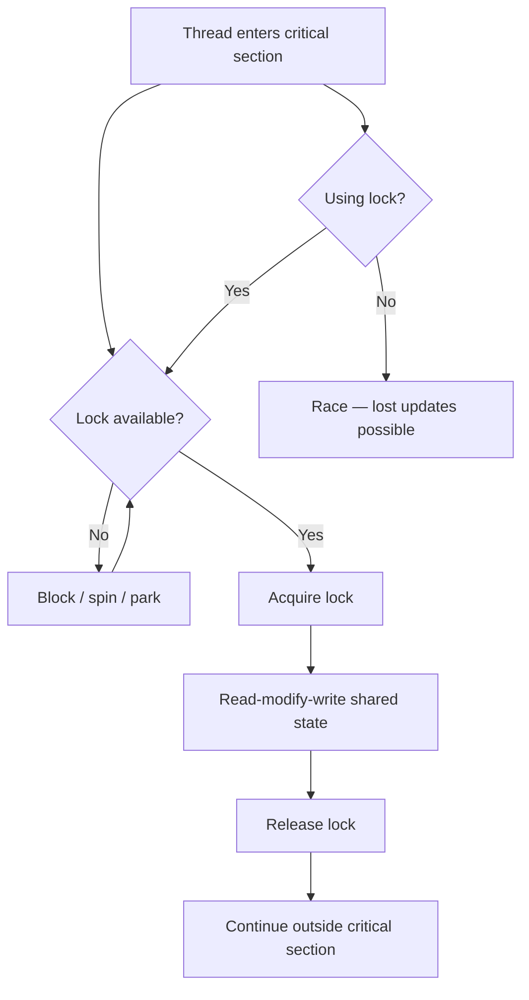

# Lock Pattern

## Intent

Use a **mutex (mutual exclusion lock)** to serialize access to shared mutable state so only one thread executes a critical section at a time. Without a lock, interleaved reads and writes cause **race conditions** and lost updates.

This demo increments a shared counter from four threads — first without synchronization (incorrect total), then with `threading.Lock` (correct total).

## Class Diagram



## Sequence Diagram



## Flowchart



## Run Instructions

```bash
cd PyPatterns
python3 concurrency/lock/demo.py
```

Expected output shows expected total 2000, an incorrect lower value without the lock, and exactly 2000 with the lock.

## Pros / Cons

| Pros | Cons |
| ---- | ---- |
| Simple, well-understood correctness guarantee | Deadlock risk when locks are nested or ordered poorly |
| Available in stdlib (`threading.Lock`, `RLock`) | Contention reduces throughput under heavy load |
| Minimal overhead for short critical sections | Easy to forget — one unprotected access breaks invariants |
| Context manager (`with lock:`) prevents leaks | Does not scale across machines (needs distributed lock) |

## Distributed Environments

Local mutexes do not cross process boundaries. Distributed systems use analogous mechanisms:

- **Distributed locks**: Redis Redlock, etcd leases, ZooKeeper ephemeral nodes — coordinate exclusive access to a shared resource (leader election, migration gates).
- **Database row locks**: `SELECT … FOR UPDATE` serializes concurrent transactions on the same row.
- **Optimistic concurrency**: version columns or ETags avoid locks until commit time — preferred when conflicts are rare.
- **Partitioning**: design so each shard owns its data — reduces lock scope entirely.

Use distributed locks sparingly; prefer idempotent operations, queues, or CRDTs when possible.

## References

- [Lock (computer science) — Wikipedia](https://en.wikipedia.org/wiki/Lock_(computer_science))
- [Mutex — Wikipedia](https://en.wikipedia.org/wiki/Mutual_exclusion)
- [threading.Lock — Python docs](https://docs.python.org/3/library/threading.html#lock-objects)
