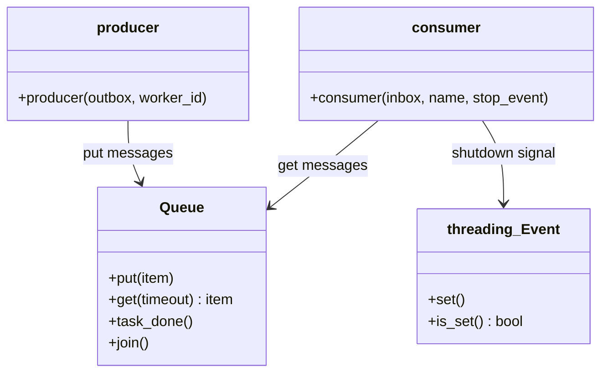
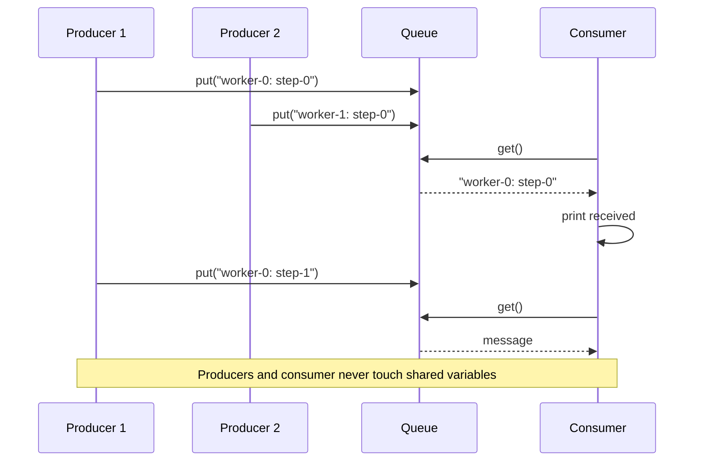
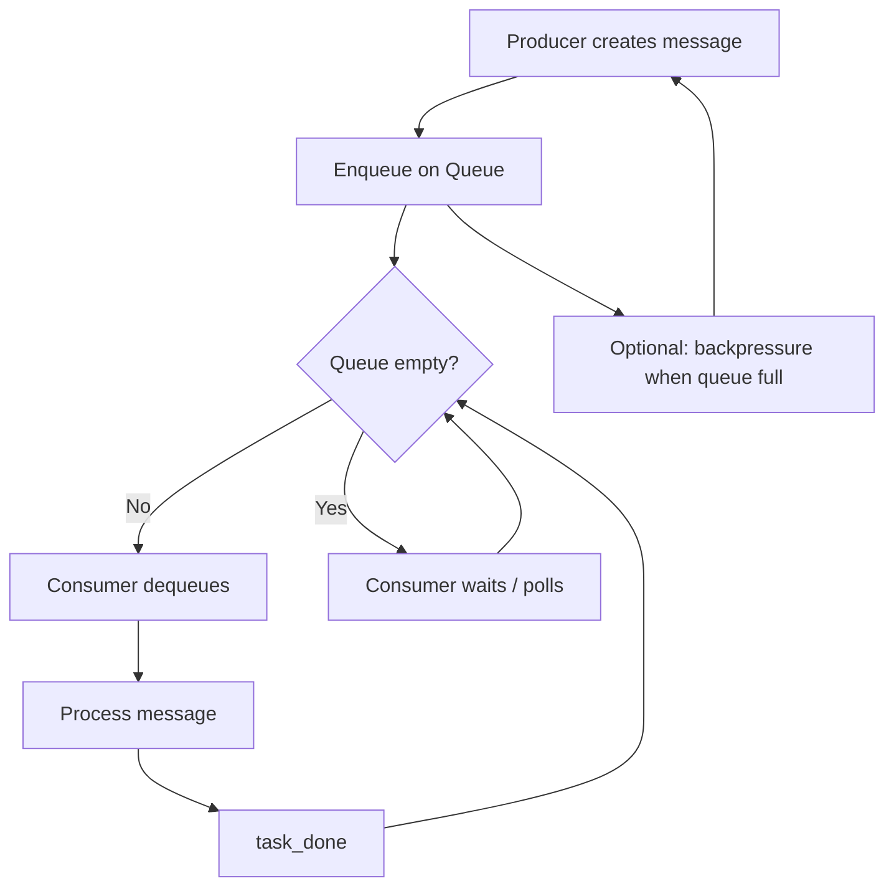

# Messaging Pattern

## Intent

Coordinate concurrent workers by **passing messages** through a queue rather than sharing mutable state. Producers enqueue work; consumers dequeue and process — decoupling sender and receiver in time and space.

This demo runs three producer threads and one dispatcher consumer connected by a `queue.Queue`.

## Class Diagram



## Sequence Diagram



## Flowchart



## Run Instructions

```bash
cd PyPatterns
python3 concurrency/messaging/demo.py
```

Expected output shows nine messages (3 workers × 3 steps) received by the dispatcher, then a completion line.

## Pros / Cons

| Pros | Cons |
| ---- | ---- |
| No shared mutable state between threads | Queue can grow unbounded without backpressure |
| Natural decoupling — producers need not wait for consumers | Message ordering guarantees depend on queue type |
| Easy to extend to multiple consumers | Serialization overhead for large payloads |
| Same pattern scales to processes and networks | Debugging async message flows can be harder |

## Distributed Environments

Message passing is the **dominant coordination model** across services:

- **Message brokers**: RabbitMQ, Amazon SQS, Google Pub/Sub, Kafka — durable queues between microservices.
- **Event-driven architecture**: domain events published to a bus; subscribers react asynchronously (see behavioral [Observer](../../behavioral/observer/README.md)).
- **Actor model**: Akka, Erlang processes — each actor has a mailbox; no shared memory.
- **Celery / RQ**: task queues serialize job execution across worker pools.

Prefer at-least-once delivery with idempotent handlers; use dead-letter queues for poison messages.

## References

- [Message passing — Wikipedia](https://en.wikipedia.org/wiki/Message_passing)
- [Producer–consumer problem — Wikipedia](https://en.wikipedia.org/wiki/Producer%E2%80%93consumer_problem)
- [queue — Python docs](https://docs.python.org/3/library/queue.html)
