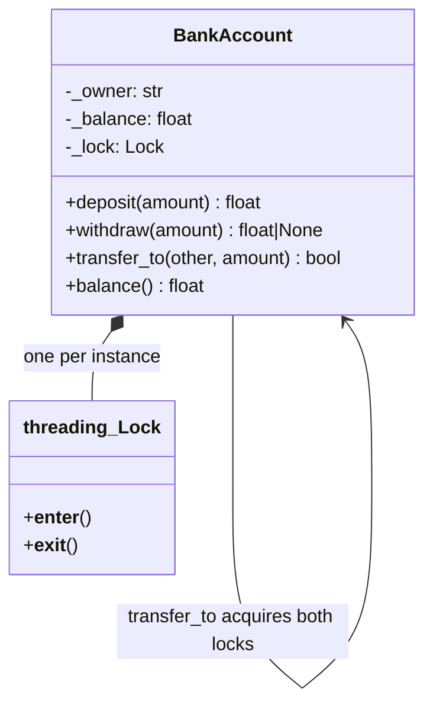
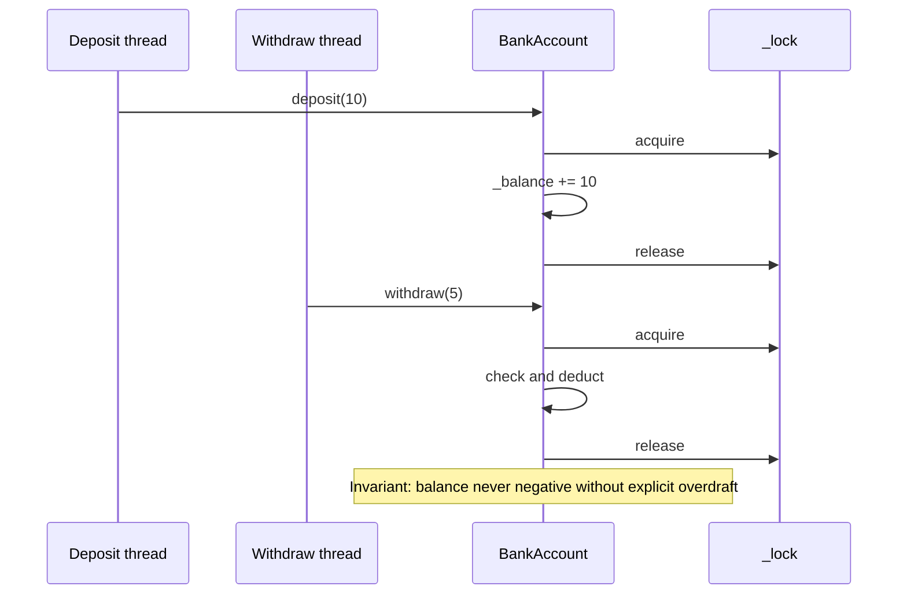
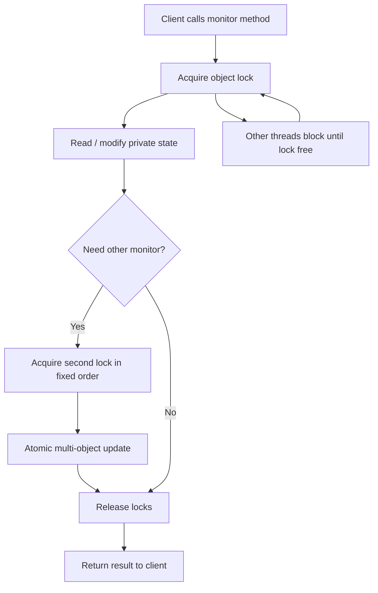

# Monitor Object Pattern

## Intent

Encapsulate shared state inside an object where **every public method acquires the same lock** before accessing that state. The object itself is the monitor — callers never manage the mutex; invariants are enforced automatically.

This demo implements a `BankAccount` monitor with deposit, withdraw, transfer, and balance methods, all synchronized under one lock.

## Class Diagram



## Sequence Diagram



## Flowchart



## Run Instructions

```bash
cd PyPatterns
python3 concurrency/monitor_object/demo.py
```

Expected output shows consistent Alice and Bob balances after concurrent deposits, withdrawals, and transfers.

## Pros / Cons

| Pros | Cons |
| ---- | ---- |
| Encapsulation — lock details hidden from callers | Coarse-grained lock can limit concurrency |
| Invariants enforced at object boundary | Deadlock if multi-object locks ordered inconsistently |
| Matches how Java `synchronized` methods work | Every method pays lock cost, even read-only ones |
| Easier to reason about than scattered lock calls | Consider read-write lock for read-heavy monitors |

## Distributed Environments

The monitor abstraction does not cross network boundaries, but the idea persists:

- **Service-owned state**: each microservice is the sole writer to its database — external callers use APIs, not direct table access (bounded context in DDD).
- **Entity actors**: a single actor or shard owner serializes all mutations for one aggregate ID (e.g., one bank account partition key).
- **Stored procedures / transactional outbox**: database-side monitors enforce invariants atomically within one transaction.
- **Read replicas**: separate read paths from the write monitor — analogous to read-write locks.

For cross-service transfers, use **sagas** or **two-phase commit** rather than holding locks across HTTP calls.

## References

- [Monitor (synchronization) — Wikipedia](https://en.wikipedia.org/wiki/Monitor_(synchronization))
- [Hoare's monitor concept — original paper context](https://en.wikipedia.org/wiki/C._A._R._Hoare)
- [threading — Python docs](https://docs.python.org/3/library/threading.html)
