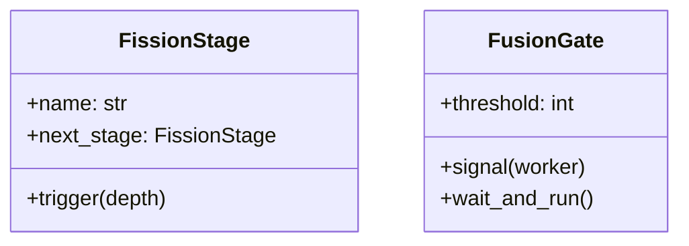
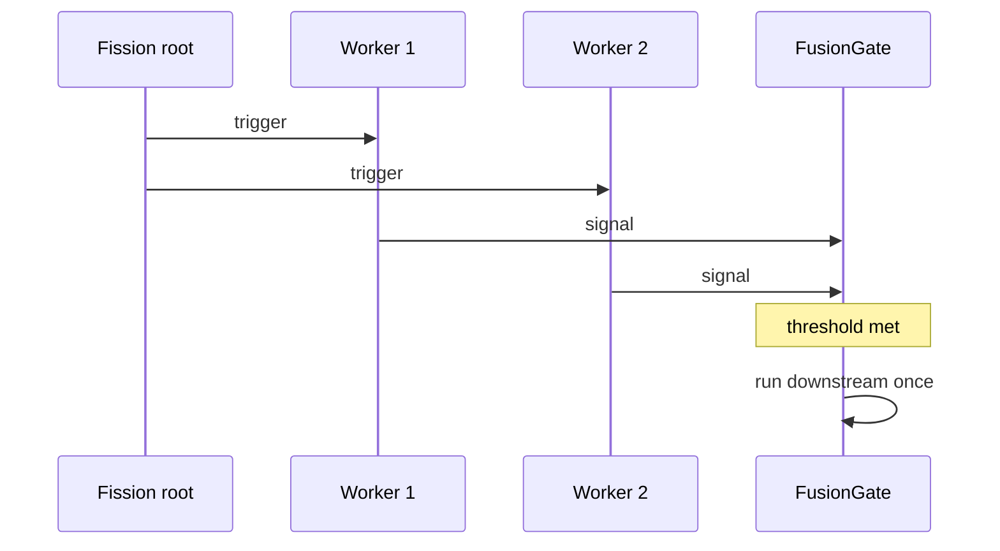
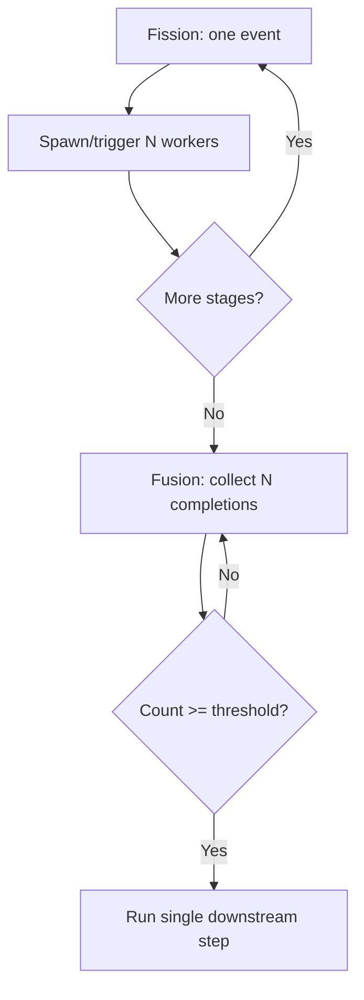

# Nuclear Reaction

## Intent

The **nuclear reaction** concurrency pattern models **fission** (one thread spawns or triggers many) and **fusion** (many threads converge to trigger one). It supports parallel chain reactions and threshold-triggered aggregation — related to [nuclear computation](https://en.wikipedia.org/wiki/Nuclear_computation).

## Class Diagram



## Sequence Diagram



## Flowchart



## Run Instructions

```bash
cd PyPatterns
python3 concurrency/nuclear_reaction/demo.py
```

## Pros / Cons

| Pros | Cons |
| ---- | ---- |
| Natural model for fan-out / fan-in pipelines | Risk of resource exhaustion in deep fission chains |
| Fusion enables barrier-like aggregation with threshold | Hard to debug unordered chain reactions |
| Low coupling between stages | Requires careful backpressure in production |

## Distributed Environments

Maps to **map-reduce**, **fork-join**, and **scatter-gather** in distributed systems:

- **Fission** — API gateway fan-out to multiple services, Kafka partition consumption
- **Fusion** — reduce step, quorum writes, or “wait for N acknowledgments” in sagas
- Use **bounded queues** and **rate limits** to prevent runaway chain reactions across nodes

See also [join_pattern](../join_pattern/README.md) and [barrier](../barrier/README.md).

## References

- [Concurrency pattern — Wikipedia](https://en.wikipedia.org/wiki/Concurrency_pattern)
- [Nuclear computation — Wikipedia](https://en.wikipedia.org/wiki/Nuclear_computation)
