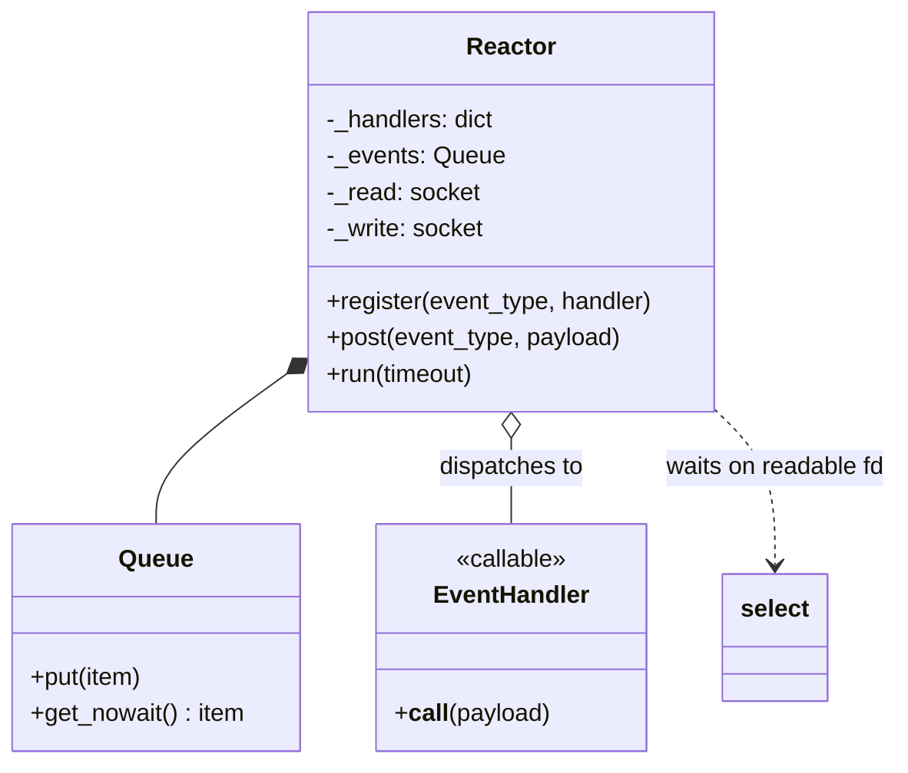
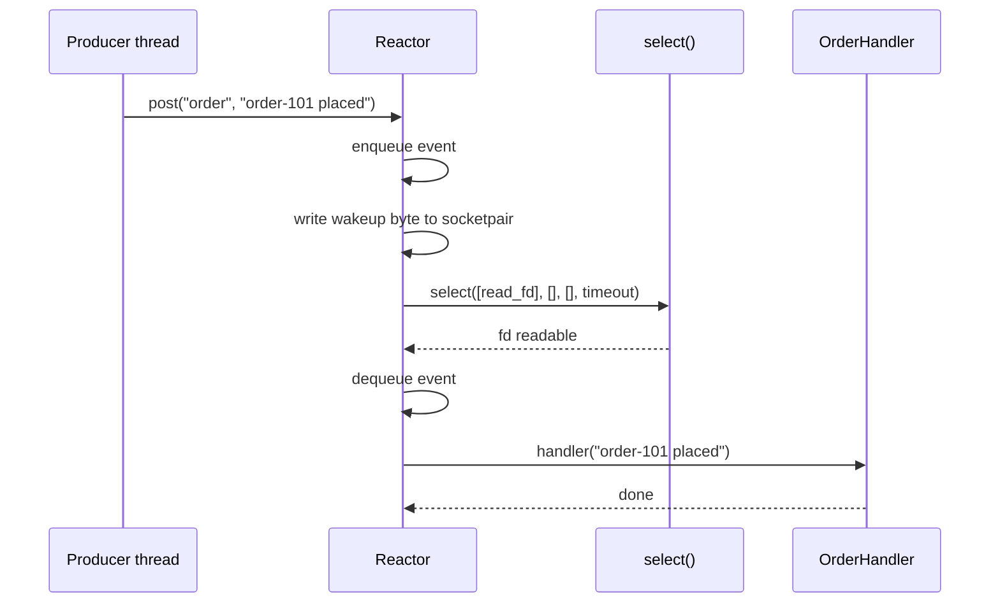
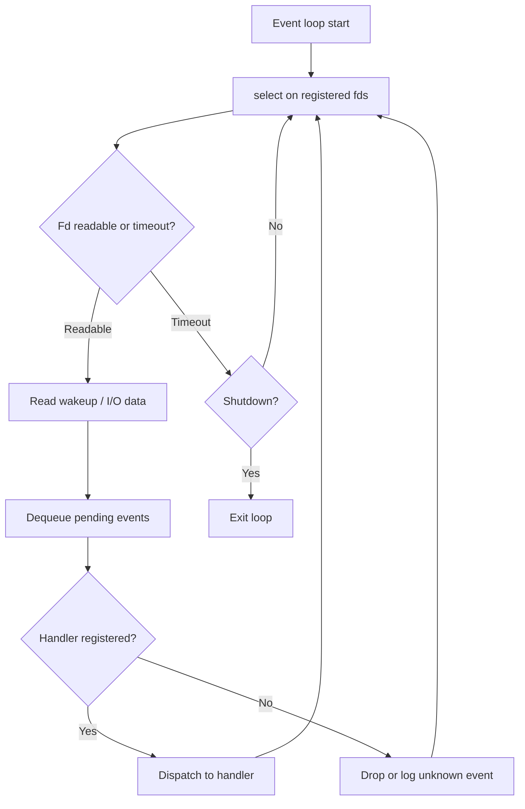

# Reactor Pattern

## Intent

Handle many concurrent I/O sources on **one thread** by demultiplexing readiness events (via `select`, epoll, kqueue) and dispatching each event to a registered handler. The reactor turns synchronous blocking resources into a structured, non-blocking event loop.

This demo posts typed events to a queue, wakes the loop through a `socketpair` + `select`, and dispatches to order/inventory handlers.

## Class Diagram



## Sequence Diagram



## Flowchart



## Run Instructions

```bash
cd PyPatterns
python3 concurrency/reactor/demo.py
```

Expected output shows three events dispatched to OrderHandler and InventoryHandler within ~1 s, then a completion line.

## Pros / Cons

| Pros | Cons |
| ---- | ---- |
| Single thread — no locks for handler state | Handler must not block (stalls entire loop) |
| Scales to many idle connections cheaply | Complex error handling and backpressure |
| Foundation of asyncio, Node.js, Nginx event model | CPU-bound work needs thread/process offload |
| Clear registration/dispatch separation | Debugging callback chains can be difficult |

## Distributed Environments

Reactor semantics appear wherever **event demux + dispatch** drives throughput:

- **API gateways & proxies**: Nginx, Envoy, HAProxy — epoll/kqueue on thousands of idle connections.
- **Stream processors**: Kafka consumers poll partitions and dispatch records to handlers.
- **asyncio / Trio**: Python async runtimes are reactor-style loops over sockets and timers.
- **Serverless triggers**: S3 upload → Lambda dispatch; CloudWatch Events → target function.

At scale, combine reactors on each node with message queues for cross-node work; never block the reactor on remote RPC.

## References

- [Reactor pattern — Wikipedia](https://en.wikipedia.org/wiki/Reactor_pattern)
- [Reactor pattern — POSA2](https://en.wikipedia.org/wiki/Pattern-Oriented_Software_Architecture)
- [select — Python docs](https://docs.python.org/3/library/select.html)
