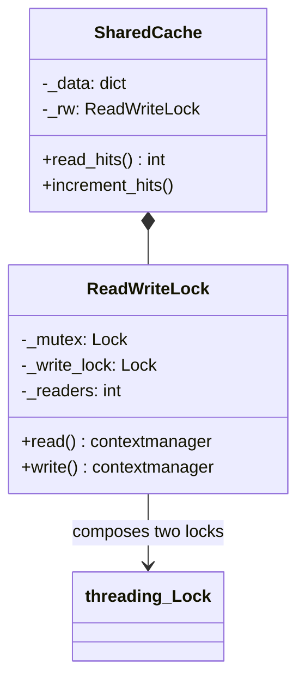
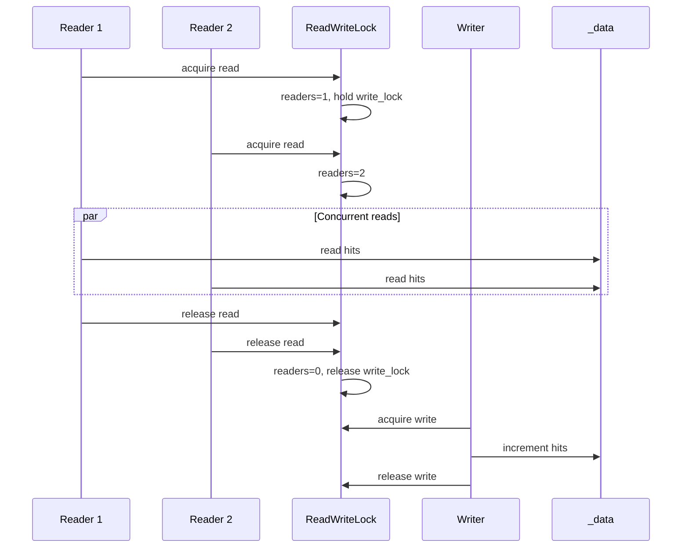
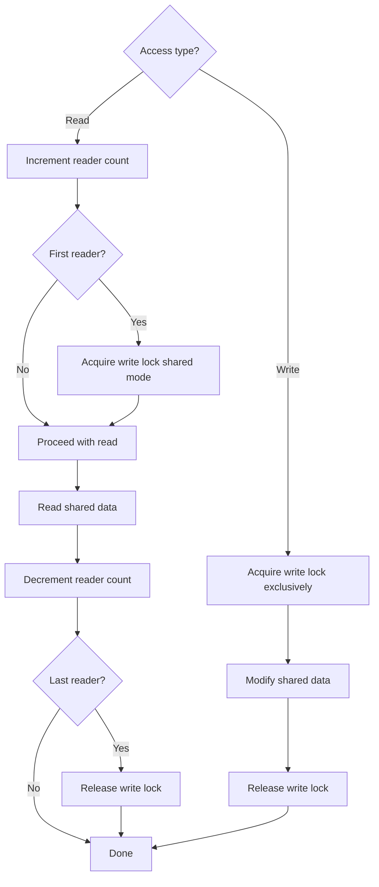

# Read-Write Lock Pattern

## Intent

Allow **multiple concurrent readers** OR **one exclusive writer** — optimizing read-heavy workloads where shared data is read often but mutated rarely. Readers share access; writers block all readers and other writers.

This demo implements a simple `ReadWriteLock` and uses it in a `SharedCache` where four reader threads run concurrently, then a writer updates exclusively.

## Class Diagram



## Sequence Diagram



## Flowchart



## Run Instructions

```bash
cd PyPatterns
python3 concurrency/read_write_lock/demo.py
```

Expected output shows four readers completing in ~0.02 s each concurrently (total ~0.05 s), then writer increment, final hits = 2.

## Pros / Cons

| Pros | Cons |
| ---- | ---- |
| Higher read throughput than a plain mutex | Writer starvation if readers arrive continuously |
| Fits caches, config snapshots, registries | More complex than a single lock — harder to prove correct |
| Readers do not block each other | Python stdlib has no built-in RW lock (unlike Java) |
| Natural fit for read-heavy service data | Incorrect implementation risks deadlocks or torn reads |

## Distributed Environments

Read-write semantics appear in replicated and cached systems:

- **Database replicas**: primary accepts writes; replicas serve read-only queries (eventual consistency trade-offs).
- **CDN / edge caches**: many edge readers, rare origin writes — invalidation is the "write lock."
- **etcd / Consul**: consistent reads vs transactional writes with revision checks.
- **Copy-on-write structures**: immutable snapshots let readers proceed without locks (functional approach to RW semantics).

For cross-node consistency, pair read replicas with version vectors or lease-based staleness bounds rather than a local RW lock.

## References

- [Readers–writer lock — Wikipedia](https://en.wikipedia.org/wiki/Readers%E2%80%93writer_lock)
- [Read-write lock variants — POSIX rwlock](https://en.wikipedia.org/wiki/POSIX_Threads)
- [threading — Python docs](https://docs.python.org/3/library/threading.html)
