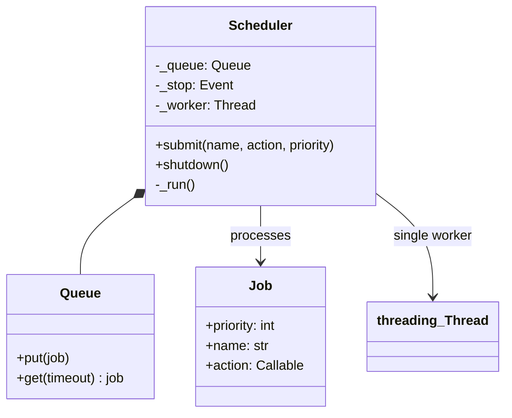
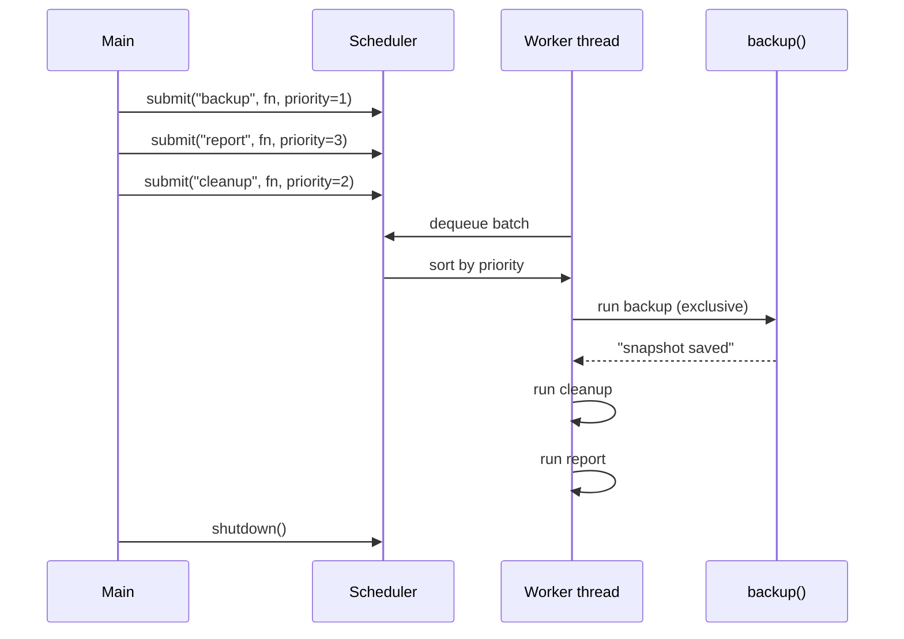
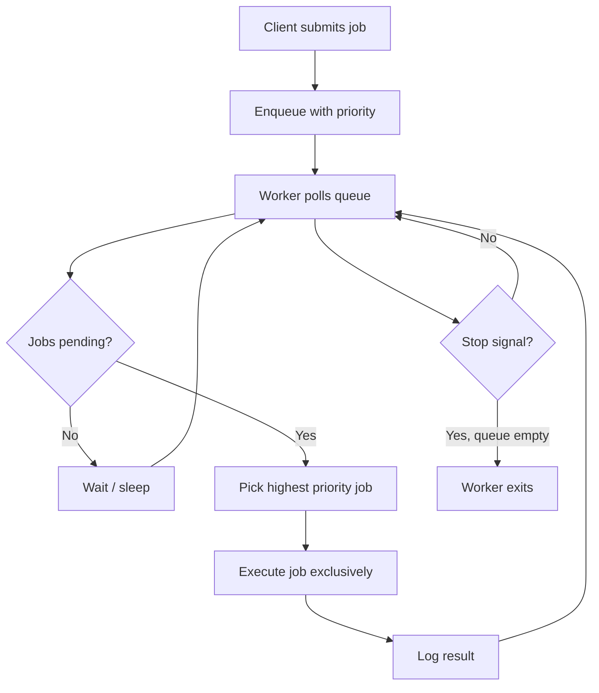

# Scheduler Pattern

## Intent

**Serialize execution** of jobs through a single worker gate so tasks never overlap, even when many producers submit work concurrently. The scheduler accepts submissions, orders them (optionally by priority), and runs them one at a time.

This demo uses a background worker thread draining a priority queue — backup, cleanup, and report jobs run strictly sequentially.

## Class Diagram



## Sequence Diagram



## Flowchart



## Run Instructions

```bash
cd PyPatterns
python3 concurrency/scheduler/demo.py
```

Expected output shows jobs starting and finishing in priority order (backup → cleanup → report), then shutdown confirmation (~0.5 s).

## Pros / Cons

| Pros | Cons |
| ---- | ---- |
| Prevents resource contention from overlapping jobs | Throughput limited to one job at a time |
| Priority ordering for critical work first | Single worker is a single point of failure |
| Producers fire-and-forget — decoupled from execution | Long jobs delay all queued work (head-of-line blocking) |
| Same pattern extends to cron, delayed, and retry queues | Needs backpressure when queue grows without bound |

## Distributed Environments

Schedulers orchestrate work across clusters and clouds:

- **Cron / systemd timers**: OS-level single-threaded job triggers on a schedule.
- **Celery Beat, Sidekiq Scheduler**: distributed cron enqueueing tasks to worker pools.
- **Kubernetes CronJob**: cluster scheduler runs pod jobs on a timetable.
- **Workflow engines**: Airflow DAG scheduler ensures dependency order — one runnable task gate at a time per slot.
- **Database advisory locks**: serialize migrations or batch ETL across app instances.

For high throughput, use a **pool** of workers with partitioned queues rather than one global gate; the scheduler pattern remains the serialization primitive per partition.

## References

- [Scheduling (computing) — Wikipedia](https://en.wikipedia.org/wiki/Scheduling_(computing))
- [Job scheduler — Wikipedia](https://en.wikipedia.org/wiki/Job_scheduler)
- [queue — Python docs](https://docs.python.org/3/library/queue.html)
