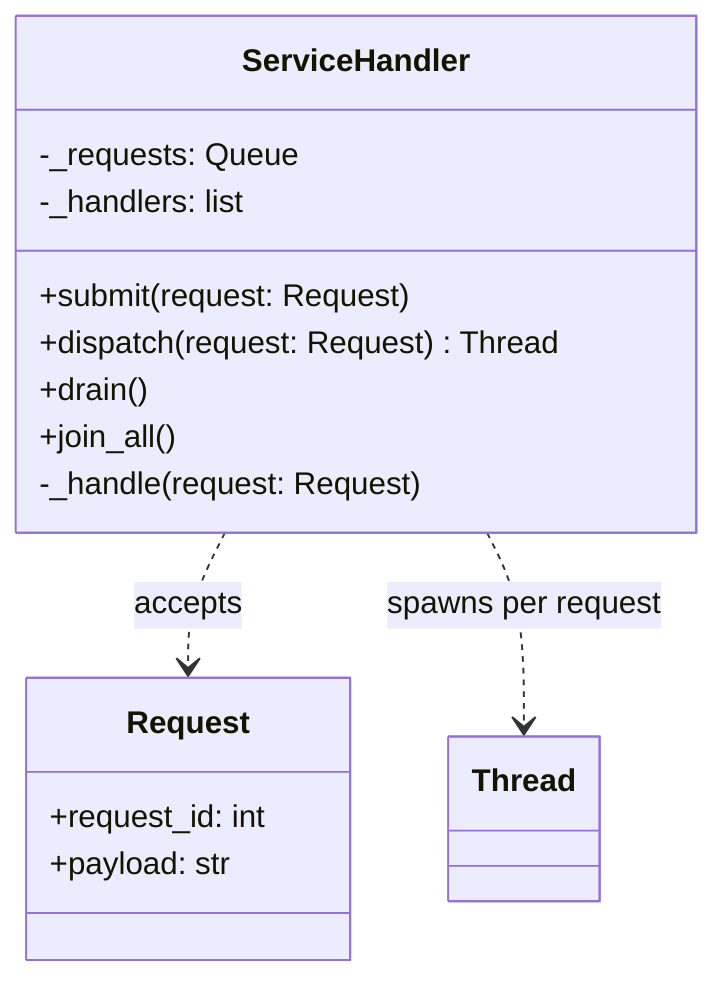
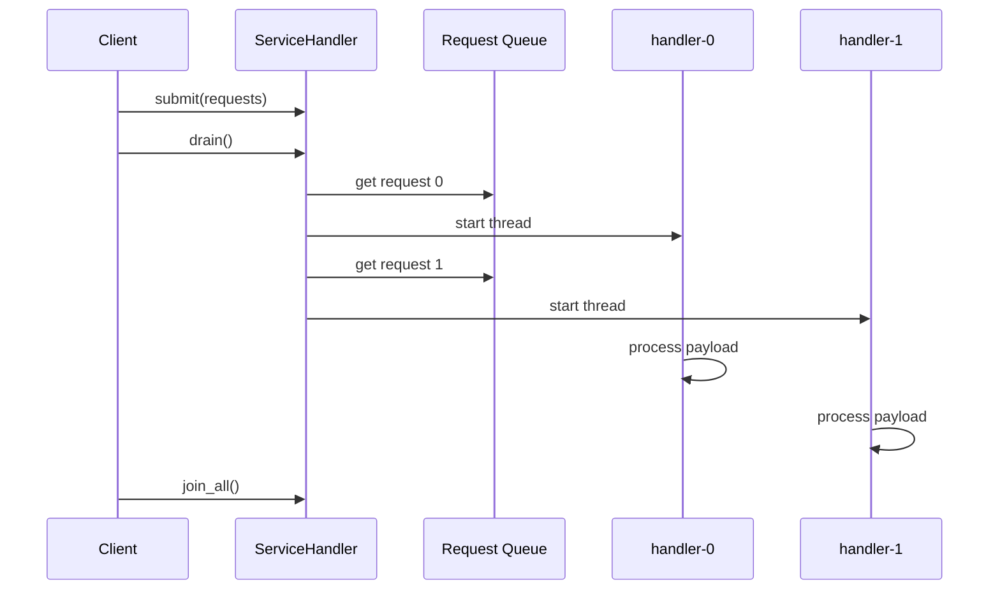
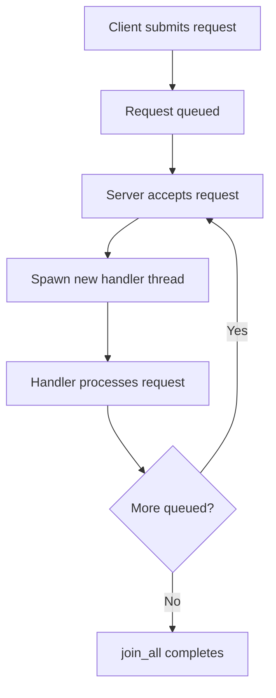

# Service Handler Pattern

## Intent

Handle each incoming request on its own thread. A server accepts tasks and spawns a dedicated handler thread per request, isolating work without a shared worker pool.

This demo models a small task server that dispatches five requests, each processed by a separately named handler thread.

## Class Diagram



## Sequence Diagram



## Flowchart



## Run Instructions

```bash
cd PyPatterns
python3 concurrency/service_handler/demo.py
```

Expected output shows five requests each handled by a distinct `handler-N` thread.

## Pros / Cons

| Pros | Cons |
| ---- | ---- |
| Simple mental model — one thread per unit of work | Thread creation overhead at high request rates |
| Fault isolation between requests | Unbounded threads can exhaust memory under load |
| No pool sizing or queue backpressure logic | Context switching cost grows with concurrency |

## Distributed Environments

Thread-per-request maps to **process-per-request** or **container-per-invocation** models in distributed systems:

- **Serverless functions** (AWS Lambda, Cloud Functions) spin up an isolated execution environment per invocation.
- **CGI / early Apache modules** forked or threaded per HTTP request before pools became standard.
- **Sidecar handlers** in service meshes can dedicate a worker to a single RPC stream.

At scale, teams usually migrate to **thread pools**, **async event loops**, or **worker queues** (see [thread_pool](../thread_pool/README.md)) to cap resource use while keeping the same request/handler separation at the API boundary.

## References

- [Thread-per-request — Wikipedia (concurrency patterns)](https://en.wikipedia.org/wiki/Software_design_pattern#Concurrency)
- [Python threading](https://docs.python.org/3/library/threading.html)
