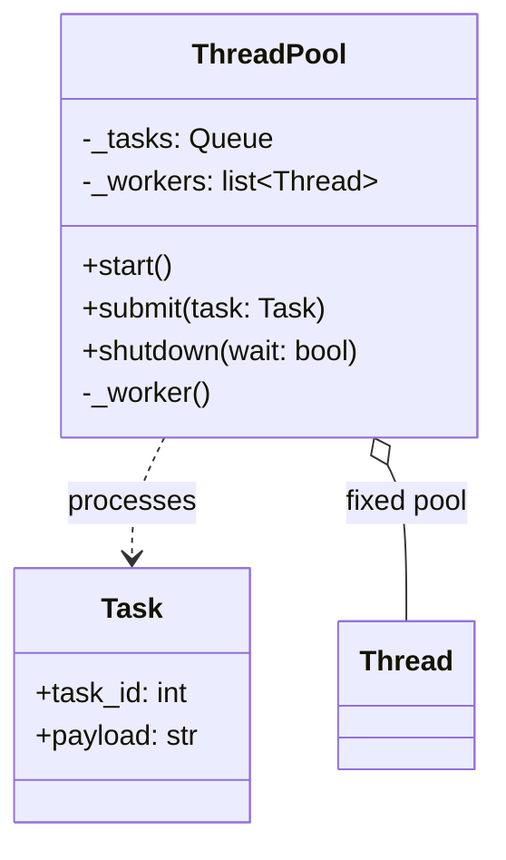
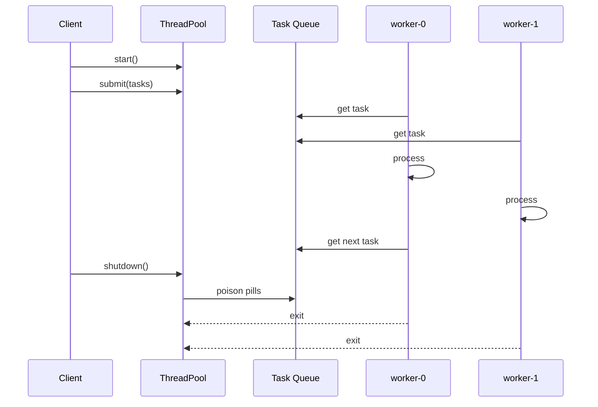
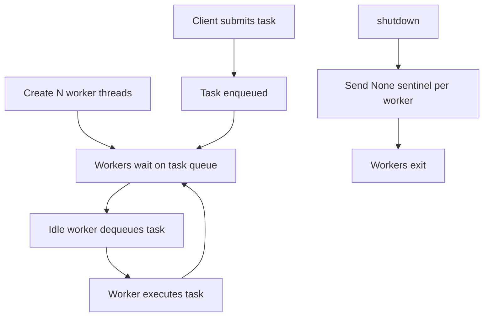

# Thread Pool Pattern

## Intent

Reuse a fixed set of worker threads to process many tasks from a shared queue. Avoids the cost of spawning a thread per request while still parallelizing CPU-bound or blocking work.

This demo runs eight tasks through a pool of three workers that pull from a central task queue until shutdown.

## Class Diagram



## Sequence Diagram



## Flowchart



## Run Instructions

```bash
cd PyPatterns
python3 concurrency/thread_pool/demo.py
```

Expected output interleaves task processing across `worker-0`, `worker-1`, and `worker-2`.

## Pros / Cons

| Pros | Cons |
| ---- | ---- |
| Amortizes thread creation cost | Pool size must be tuned to workload |
| Bounds concurrent threads | Queue can grow unbounded if producers outpace workers |
| Natural backpressure hook via queue size limits | Shared queue can become a contention point |

## Distributed Environments

Thread pools have direct analogues in distributed job processing:

- **Celery / RQ workers** — fixed consumer processes pulling from Redis or RabbitMQ.
- **Kubernetes Deployments** — replica count defines parallel pod workers.
- **SQS / Pub/Sub consumers** — long-polling workers with configurable concurrency.

Compare with [service_handler](../service_handler/README.md): pools trade isolation per task for predictable resource ceilings — the standard choice for web servers (Tomcat, gunicorn sync workers) and batch pipelines.

## References

- [Thread pool — Wikipedia](https://en.wikipedia.org/wiki/Thread_pool)
- [concurrent.futures.ThreadPoolExecutor](https://docs.python.org/3/library/concurrent.futures.html#threadpoolexecutor)
- [Python threading](https://docs.python.org/3/library/threading.html)
