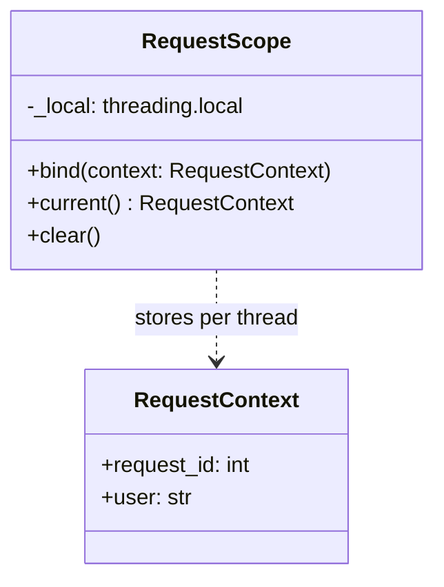
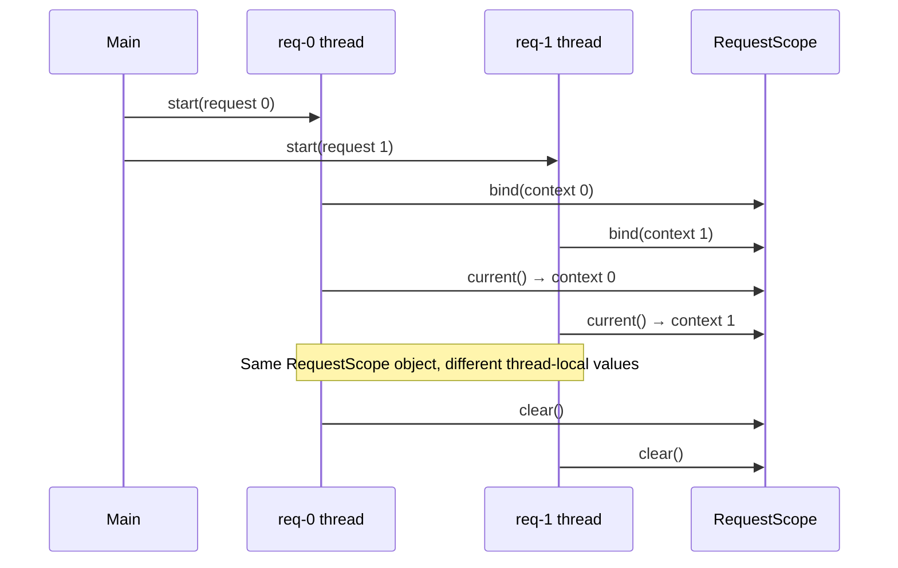
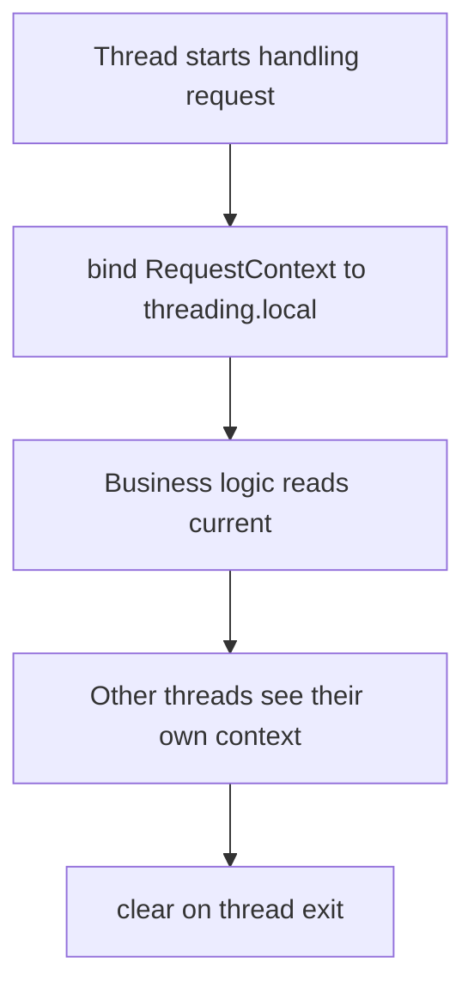

# Thread-Specific Storage Pattern

## Intent

Give each thread its own isolated storage for context data so concurrent handlers never overwrite each other's state. In Python, `threading.local()` provides this per-thread namespace.

This demo binds a `RequestContext` (request id and user) on each handler thread and proves contexts do not leak across threads.

## Class Diagram



## Sequence Diagram



## Flowchart



## Run Instructions

```bash
cd PyPatterns
python3 concurrency/thread_specific_storage/demo.py
```

Expected output lists five lines — each thread reporting its own `request_id` and `user`.

## Pros / Cons

| Pros | Cons |
| ---- | ---- |
| Avoids passing context through every call frame | Implicit magic — hard to trace without discipline |
| No locks needed for thread-private data | Not shared across async tasks on one thread (use `contextvars` instead) |
| Matches per-request servlet / middleware models | Must clear bindings to avoid leaks in pooled threads |

## Distributed Environments

Thread-local context becomes **request-scoped metadata** at service boundaries:

- **HTTP headers / JWT claims** propagated as implicit context in gateways.
- **OpenTelemetry trace IDs** attached to spans and log MDC fields.
- **Database session per request** in ORMs (SQLAlchemy scoped sessions).

In async Python (`asyncio`), prefer **`contextvars.ContextVar`** over `threading.local()` because many coroutines may share one thread. In thread-pool servers, reset thread-local state when returning a worker to the pool to prevent **context bleed** between unrelated requests.

## References

- [Thread-specific storage — Wikipedia](https://en.wikipedia.org/wiki/Thread-local_storage)
- [threading.local — Python docs](https://docs.python.org/3/library/threading.html#thread-local-data)
- [contextvars — Python docs](https://docs.python.org/3/library/contextvars.html)
