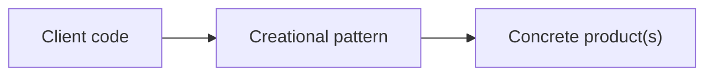

# Creational Patterns

Object-creation mechanisms that decouple client code from concrete classes. Part of the [PyPatterns](../README.md) catalog — **5 of 23** Gang of Four (GoF) patterns.

## Intent

Creational patterns answer: *how should objects be instantiated?* They hide construction details, support families of related products, and let you swap creation logic without rewriting callers.



## When to use this category

| Situation | Consider |
| --------- | -------- |
| Construction has many optional steps | [Builder](builder/README.md) |
| You need matching families of objects | [Abstract Factory](abstract_factory/README.md) |
| Subclasses should pick the concrete type | [Factory Method](factory_method/README.md) |
| Cloning is cheaper than rebuilding | [Prototype](prototype/README.md) |
| Exactly one shared instance is required | [Singleton](singleton/README.md) — prefer DI in distributed systems |

## Patterns in this folder

| Pattern | Demo | Details |
| ------- | ---- | ------- |
| Abstract Factory | `python3 creational/abstract_factory/demo.py` | [README](abstract_factory/README.md) |
| Builder | `python3 creational/builder/demo.py` | [README](builder/README.md) |
| Factory Method | `python3 creational/factory_method/demo.py` | [README](factory_method/README.md) |
| Prototype | `python3 creational/prototype/demo.py` | [README](prototype/README.md) |
| Singleton | `python3 creational/singleton/demo.py` | [README](singleton/README.md) |

Run from **PyPatterns/** with Just:

```bash
just abstract-factory
just builder
just factory-method
just prototype
just singleton
```

## Distributed environments

Category-level guidance — each pattern README has specific notes.

- **Avoid process-wide Singletons** in microservices; use dependency injection, config services, or shared stores (Redis, etcd).
- **Factories** map well to plugin registries and service discovery — register creators at startup, resolve by name or contract.
- **Builder** suits assembling complex API payloads, K8s manifests, or multi-step deployment pipelines.
- **Prototype / cloning** is risky across service boundaries; prefer explicit DTOs and schema versioning over deep-copying live objects.

## See also

- [Structural patterns](../structural/README.md) — compose created objects
- [Behavioral patterns](../behavioral/README.md) — coordinate object behavior
- [Concurrency patterns](../concurrency/README.md) — threading overlap (e.g. Singleton locking)
- [Architecture patterns](../architecture/README.md) — system-level structure

## References

- [GoF — Creational patterns (Wikipedia)](https://en.wikipedia.org/wiki/Creational_pattern)
- [Refactoring.Guru — Creational](https://refactoring.guru/design-patterns/creational-patterns)
