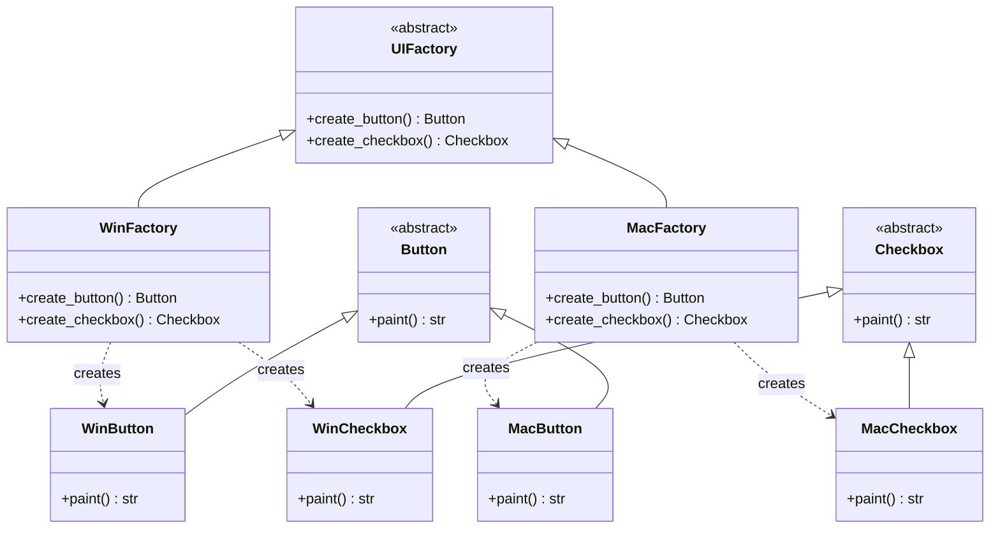
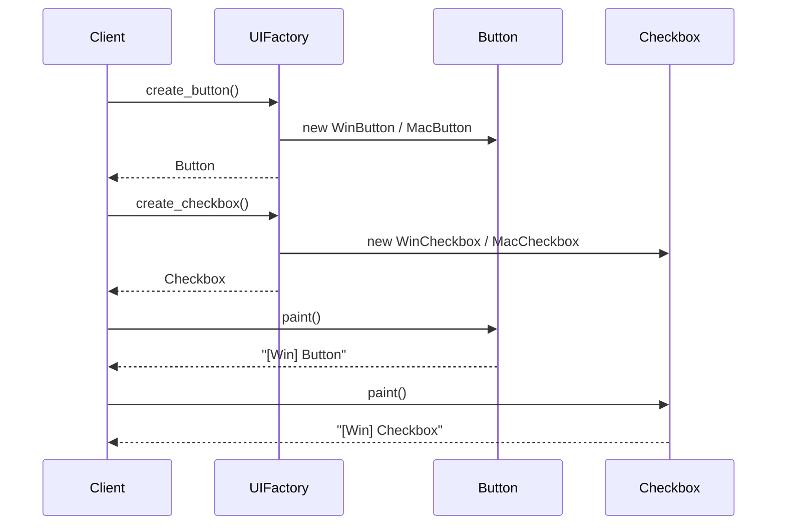
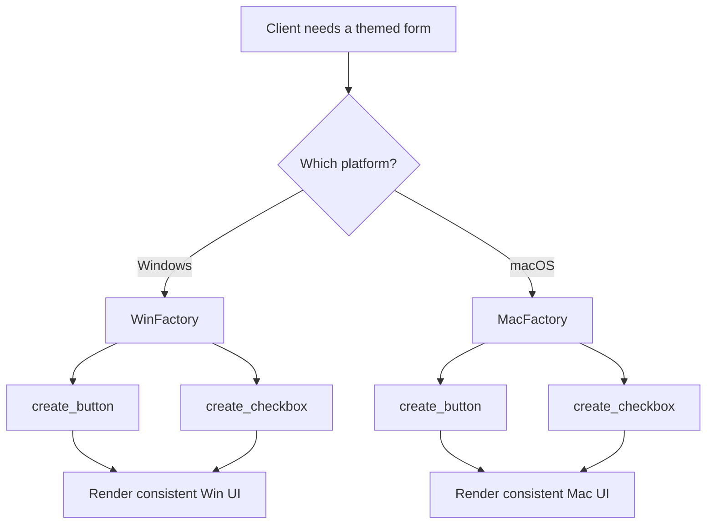

# Abstract Factory

## Intent & Problem Solved

The **Abstract Factory** pattern provides an interface for creating families of related objects without specifying their concrete classes. It solves the problem of building a UI (or any product line) that must stay visually consistent: when you pick a Windows theme, every widget — buttons, checkboxes, dialogs — must look and behave like Windows widgets, not a mix of Windows and macOS.

Without this pattern, client code branches on platform strings everywhere (`if os == "win": ... elif os == "mac": ...`), which is brittle and hard to extend when you add Linux or a new widget type.

## Class Diagram



## Sequence Diagram



## Flowchart



## How to Run

From the `PyPatterns/` directory:

```bash
python3 creational/abstract_factory/demo.py
```

Expected output shows Windows- and macOS-styled button and checkbox labels.

## Pros and Cons

| Pros | Cons |
| ---- | ---- |
| Guarantees product families stay consistent | Adding a new product type requires changing every factory |
| Isolates concrete classes from client code | Many small classes increase codebase size |
| Easy to swap entire families at runtime | Can be overkill for a single product type |
| Follows Open/Closed Principle for new families | Parallel class hierarchies can be hard to navigate |

## Distributed Environments

In microservices and Kubernetes deployments, Abstract Factory maps well to **environment-aware configuration** rather than in-process widget creation:

- **Theme / skin selection** — A config service or feature flag (`UI_THEME=mac`) selects which factory implementation a frontend BFF or desktop shell loads at startup.
- **Cloud provider adapters** — Use one abstract factory per vendor (AWS, GCP, Azure) to create matching clients: object storage, queue, and secrets backends that belong to the same provider family.
- **Multi-tenant SaaS** — Each tenant tier (basic vs enterprise) can map to a factory that provisions the correct bundle of integrations (CRM, billing, analytics) without scattering `if tenant.tier` checks.
- **Service mesh / sidecars** — Factories can wrap gRPC or HTTP client creation so observability, retry, and auth middleware stay consistent per deployment profile.
- **Testing** — Provide a `FakeFactory` in integration tests that returns in-memory doubles for every product in the family, keeping test doubles aligned.

Avoid using Abstract Factory across network boundaries as a remote API; keep it as a local composition root that reads remote config.

## References

- [Refactoring Guru — Abstract Factory](https://refactoring.guru/design-patterns/abstract-factory)
- [Wikipedia — Abstract factory pattern](https://en.wikipedia.org/wiki/Abstract_factory_pattern)
