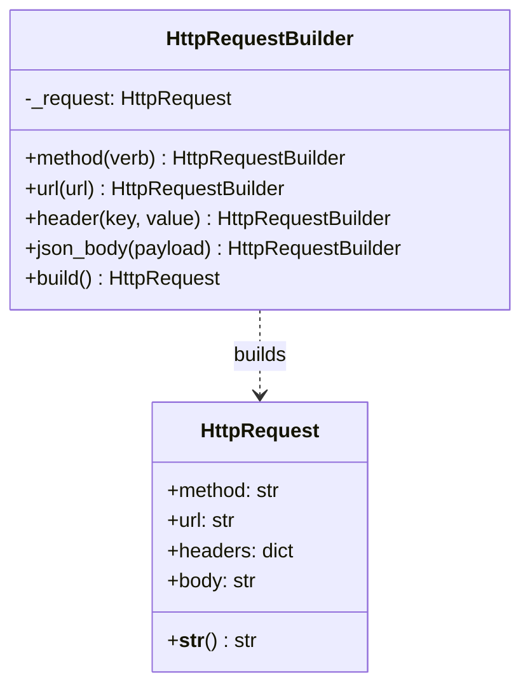
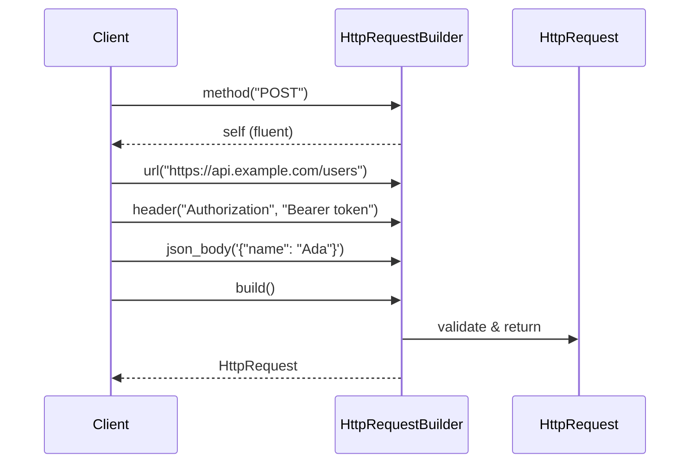
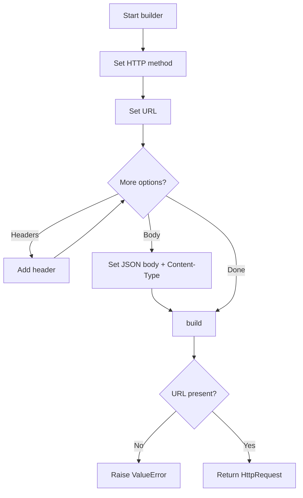

# Builder

## Intent & Problem Solved

The **Builder** pattern separates the construction of a complex object from its representation, allowing the same construction process to create different configurations. It solves "constructor telescoping" — when an object has many optional fields and constructors become unreadable.

This demo builds HTTP requests step by step (method, URL, headers, body) instead of passing ten arguments to a single constructor.

## Class Diagram



## Sequence Diagram



## Flowchart



## How to Run

From the `PyPatterns/` directory:

```bash
python3 creational/builder/demo.py
```

Prints formatted GET and POST request examples.

## Pros and Cons

| Pros | Cons |
| ---- | ---- |
| Readable, step-by-step assembly | More classes than a plain dataclass constructor |
| Fluent chaining improves ergonomics | Must remember to call `build()` |
| Validation can be centralized in `build()` | Not ideal when only one or two fields vary |
| Same builder can produce many variants | Mutable builder state if reused without reset |
| Hides internal object structure from clients | Director pattern adds another layer if needed |

## Distributed Environments

Builder shines when constructing **outbound calls, messages, and infrastructure specs** in distributed systems:

- **HTTP/gRPC clients** — BFFs and API gateways use builders to assemble requests with tracing headers (`traceparent`), auth tokens, and idempotency keys before hitting downstream services.
- **Kubernetes manifests** — CI pipelines build Deployment/Service YAML programmatically (replicas, probes, resource limits) from a shared builder rather than copy-pasting templates.
- **Event payloads** — Message producers build CloudEvents or Kafka records with consistent metadata (tenant ID, correlation ID, schema version).
- **Database queries** — Query builders (similar spirit) compose SQL or ORM filters safely; the builder validates required filters before execution.
- **Terraform/CDK** — Infrastructure-as-code modules often expose builder-style fluent APIs for composing stacks.

In microservices, prefer **immutable built objects**: once `build()` returns, the request should not change. Reset or create a new builder per request to avoid cross-request leakage in pooled workers (e.g., Celery, K8s pods handling concurrent jobs).

## References

- [Refactoring Guru — Builder](https://refactoring.guru/design-patterns/builder)
- [Wikipedia — Builder pattern](https://en.wikipedia.org/wiki/Builder_pattern)
