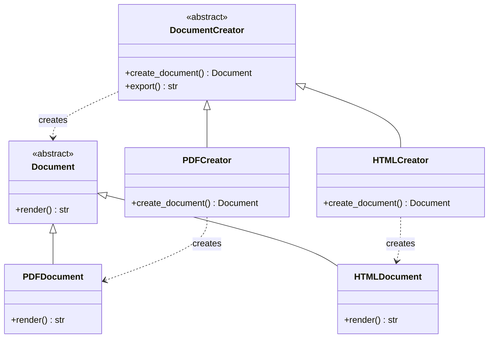
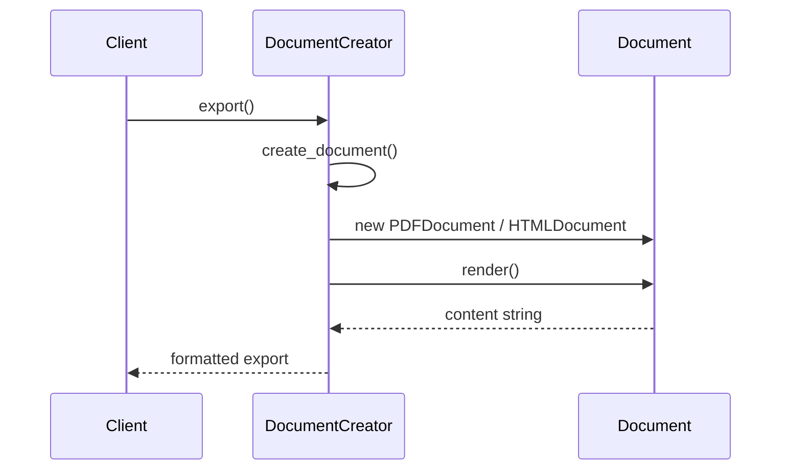
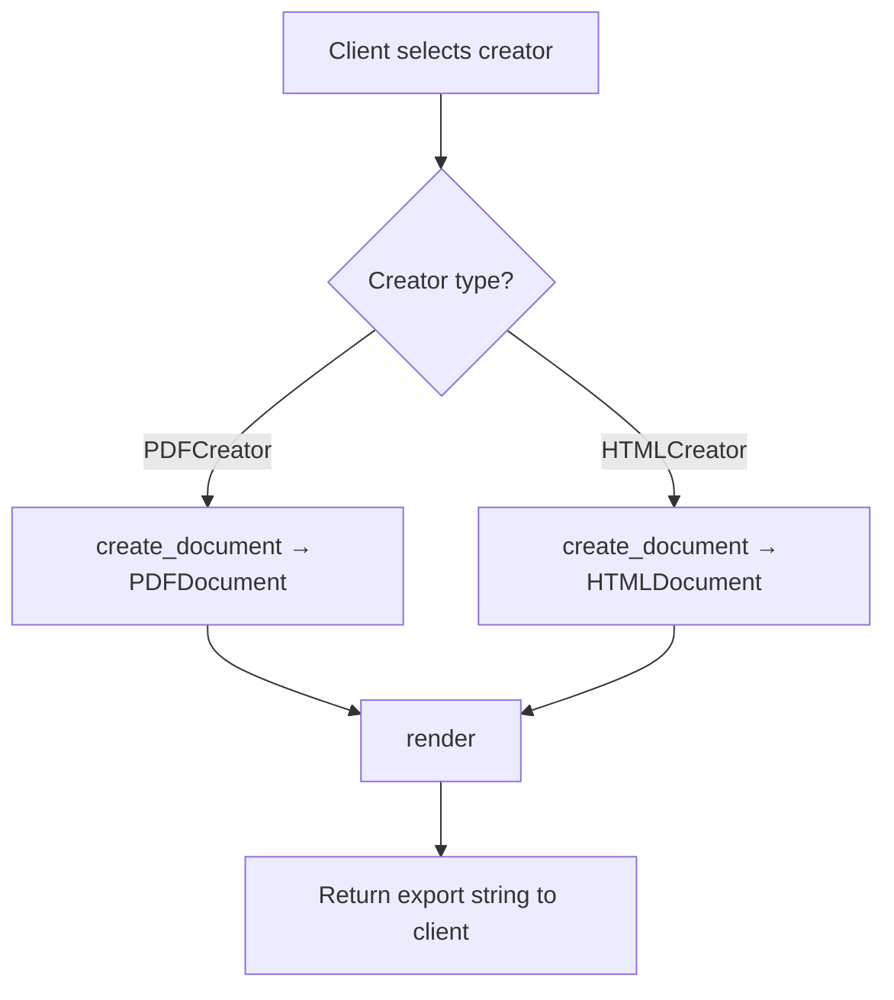

# Factory Method

## Intent & Problem Solved

The **Factory Method** pattern defines an interface for creating an object, but lets subclasses decide which class to instantiate. It solves the problem of a framework that knows *when* to create something but should not hard-code *what* gets created.

This demo uses a document export pipeline: `DocumentCreator` defines `export()`, while `PDFCreator` and `HTMLCreator` each supply their own document type.

## Class Diagram



## Sequence Diagram



## Flowchart



## How to Run

From the `PyPatterns/` directory:

```bash
python3 creational/factory_method/demo.py
```

Runs PDF and HTML export pipelines and prints rendered output.

## Pros and Cons

| Pros | Cons |
| ---- | ---- |
| Decouples product creation from business logic | Requires subclass per product type |
| Single place (`export`) for creation workflow | Can lead to many parallel class hierarchies |
| Open/Closed: add products via new creators | Less flexible than Abstract Factory for product *families* |
| Aligns with framework extension points | Simple cases may only need a function, not a class |

## Distributed Environments

Factory Method appears throughout service-oriented architectures as **pluggable creation hooks**:

- **Notification services** — A base `Notifier` defines `send()`; subclasses implement `create_channel()` returning Email, SMS, or Slack adapters based on user preferences loaded from a config service.
- **Export workers** — A Celery/Kubernetes Job base class defines the workflow; concrete workers override `create_writer()` to emit CSV, Parquet, or PDF without duplicating orchestration logic.
- **Payment gateways** — Stripe vs PayPal creators share settlement and retry logic but instantiate different gateway clients.
- **Plugin architectures** — API servers discover creator classes via entry points or DI containers (`report_format=pdf` → `PDFCreator`).
- **Multi-region deployments** — Subclasses select storage backends (S3 vs GCS) while the parent handles encryption and audit logging uniformly.

In Kubernetes, combine Factory Method with **dependency injection at the pod level**: environment variables or mounted config select the concrete creator implementation when the container starts, keeping the core workflow identical across environments.

## References

- [Refactoring Guru — Factory Method](https://refactoring.guru/design-patterns/factory-method)
- [Wikipedia — Factory method pattern](https://en.wikipedia.org/wiki/Factory_method_pattern)
