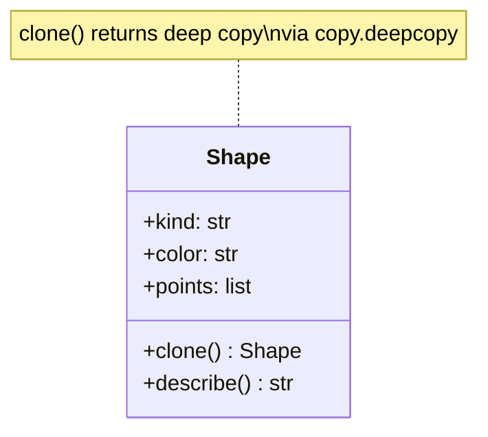
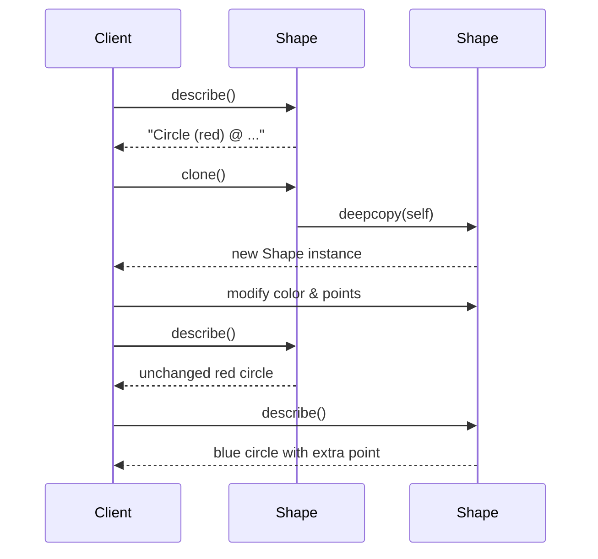
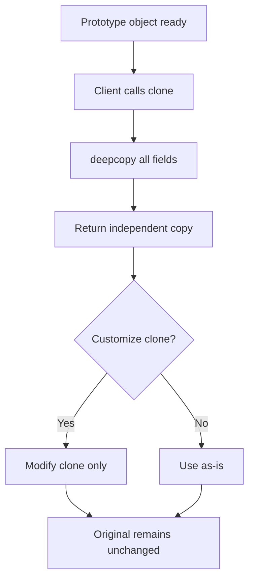

# Prototype

## Intent & Problem Solved

The **Prototype** pattern creates new objects by copying an existing instance rather than building from scratch. It solves expensive or complex initialization: when constructing an object requires parsing config, loading templates, or computing defaults, cloning a pre-configured prototype is cheaper and simpler.

This demo clones `Shape` objects with `copy.deepcopy` so nested mutable state (`points`) is not shared between original and clone.

## Class Diagram



## Sequence Diagram



## Flowchart



## How to Run

From the `PyPatterns/` directory:

```bash
python3 creational/prototype/demo.py
```

Shows that modifying a clone does not affect the original.

## Pros and Cons

| Pros | Cons |
| ---- | ---- |
| Hides complex creation behind a copy | Deep copy can be slow for large graphs |
| Pre-configured templates reduce boilerplate | Must implement copy correctly for every field |
| Runtime composition of new variants | Circular references need careful handling |
| Avoids subclass explosion for similar objects | Shallow copy bugs if nested mutables are missed |

## Distributed Environments

Prototype maps to **template-and-fork** workflows more than literal in-memory cloning across machines:

- **Configuration snapshots** — Store a golden pod spec, VM image, or database schema as a prototype; new tenants or environments clone and tweak a few fields (name, secrets, quotas).
- **Feature flag defaults** — A baseline flag set is cloned per experiment cohort; only deltas are changed, preserving consistency with the control group template.
- **Document generation** — Report or contract templates (Word/HTML) are cloned before mail-merge; each instance gets unique customer data without rebuilding layout from scratch.
- **Caching warm objects** — In-process caches keep heavy parsed objects (regex sets, ML feature maps); workers clone them per request to avoid shared mutable state under concurrency.
- **Database seeding** — ORM fixtures or snapshot restores copy a known-good row set into new integration-test databases.

For **cross-service** cloning, serialize the prototype (JSON, protobuf) and deserialize in another pod — the pattern is the same (copy from exemplar), but the mechanism is messaging or object storage, not `copy.deepcopy`. In Kubernetes, **PersistentVolume snapshots** and **custom resource templates** are infrastructure-level prototypes.

Watch for **shared references** in distributed caches (Redis): storing mutable blobs without copying can cause one consumer to mutate data visible to others — always treat cached prototypes as read-only or deep-copy on read.

## References

- [Refactoring Guru — Prototype](https://refactoring.guru/design-patterns/prototype)
- [Wikipedia — Prototype pattern](https://en.wikipedia.org/wiki/Prototype_pattern)
