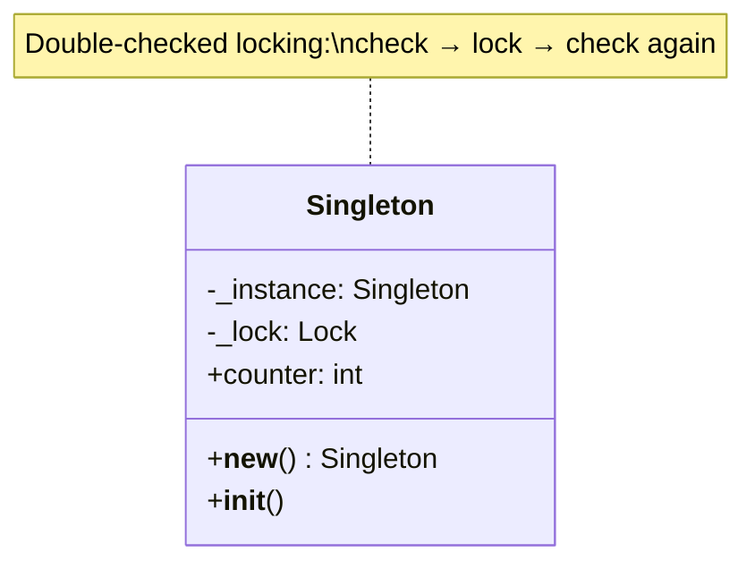
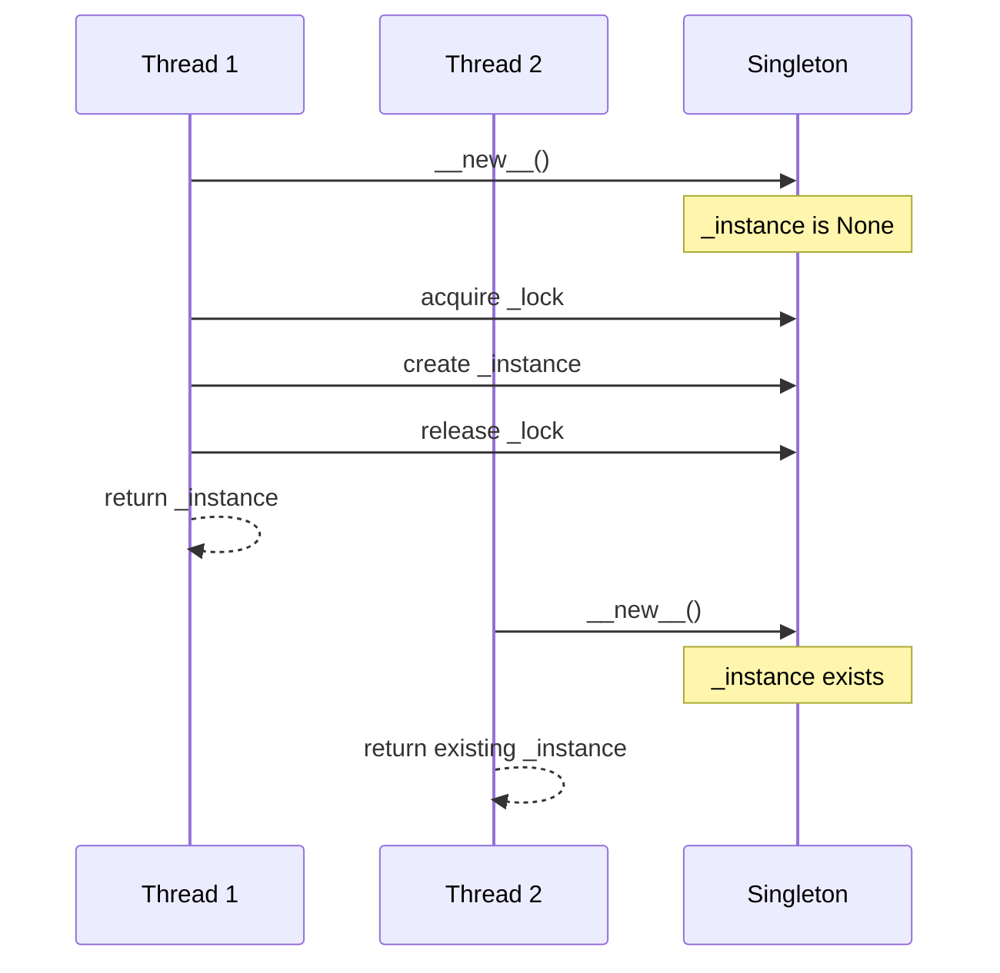
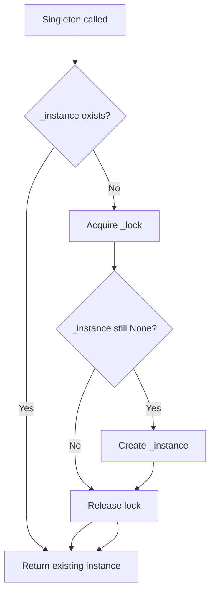

# Singleton

## Intent & Problem Solved

The **Singleton** pattern ensures a class has only one instance and provides a global access point to it. It solves coordination problems where exactly one object should own shared state — configuration registries, connection pools, or counters — though global singletons are often replaced by dependency injection in larger applications.

This demo uses **thread-safe double-checked locking** in `__new__` so concurrent threads cannot create multiple instances.

## Class Diagram



## Sequence Diagram



## Flowchart



## How to Run

From the `PyPatterns/` directory:

```bash
python3 creational/singleton/demo.py
```

Verifies identity equality, shared mutable state, and that five concurrent threads observe the same instance ID.

## Pros and Cons

| Pros | Cons |
| ---- | ---- |
| Controlled access to sole instance | Global state complicates testing |
| Lazy initialization possible | Hidden dependencies via implicit access |
| Can coordinate shared resources | Violates Single Responsibility Principle |
| Thread-safe variant avoids race bugs | Anti-pattern in many modern DI frameworks |
| Saves memory for heavy objects | Subclassing and serialization need extra care |

## Distributed Environments

A process-local Singleton does **not** automatically become a cluster-wide singleton. In microservices and Kubernetes:

- **One instance per process** — Each pod has its own Singleton (e.g., in-memory cache). Do not assume cross-pod uniqueness; use distributed locks (Redis Redlock, etcd, DynamoDB conditional writes) when cluster-wide exclusivity is required.
- **Prefer external coordination** — Leader election (Kubernetes Lease API, Consul) for background jobs ensures only one worker runs a cron task, replacing in-app Singleton semantics at scale.
- **Configuration** — Use ConfigMaps, Secrets, or a config service instead of a Singleton config object; pods reload on deploy without code-level globals.
- **Connection pools** — A Singleton pool per worker is fine; size pools for `(replicas × pool_size)` against database `max_connections`.
- **Testing** — Reset or inject fakes; module-level singletons make parallel tests flaky. Consider `@lru_cache` on factory functions or explicit DI containers instead.
- **Python specifics** — Modules are already singletons; often `settings = load_settings()` in a module is simpler than a Singleton class.

For truly global resources (license servers, hardware devices), combine a local Singleton gateway with remote service discovery rather than duplicating connection logic in every caller.

## References

- [Refactoring Guru — Singleton](https://refactoring.guru/design-patterns/singleton)
- [Wikipedia — Singleton pattern](https://en.wikipedia.org/wiki/Singleton_pattern)
