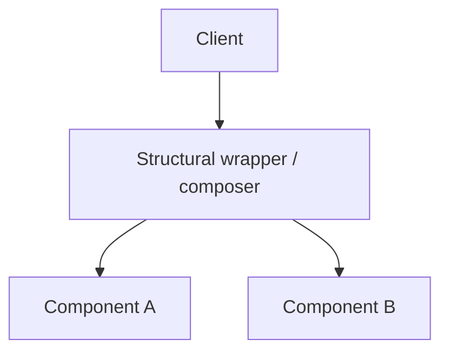

# Structural Patterns

Ways to compose classes and objects into larger structures while keeping interfaces clean. Part of the [PyPatterns](../README.md) catalog — **7 of 23** GoF patterns.

## Intent

Structural patterns answer: *how should pieces fit together?* They help incompatible interfaces cooperate, add behavior without subclass explosion, and simplify complex subsystems.



## When to use this category

| Situation | Consider |
| --------- | -------- |
| Existing class doesn't match your interface | [Adapter](adapter/README.md) |
| Abstraction and implementation evolve separately | [Bridge](bridge/README.md) |
| Tree structures with uniform treatment | [Composite](composite/README.md) |
| Add responsibilities dynamically | [Decorator](decorator/README.md) |
| Subsystem is too complex for clients | [Facade](facade/README.md) |
| Many similar objects share intrinsic state | [Flyweight](flyweight/README.md) |
| Control access or defer expensive work | [Proxy](proxy/README.md) |

## Patterns in this folder

| Pattern | Demo | Details |
| ------- | ---- | ------- |
| Adapter | `python3 structural/adapter/demo.py` | [README](adapter/README.md) |
| Bridge | `python3 structural/bridge/demo.py` | [README](bridge/README.md) |
| Composite | `python3 structural/composite/demo.py` | [README](composite/README.md) |
| Decorator | `python3 structural/decorator/demo.py` | [README](decorator/README.md) |
| Facade | `python3 structural/facade/demo.py` | [README](facade/README.md) |
| Flyweight | `python3 structural/flyweight/demo.py` | [README](flyweight/README.md) |
| Proxy | `python3 structural/proxy/demo.py` | [README](proxy/README.md) |

Run from **PyPatterns/** with Just:

```bash
just adapter
just bridge
just composite
just decorator
just facade
just flyweight
just proxy
```

## Distributed environments

Category-level guidance — each pattern README has specific notes.

- **Adapter** is the integration pattern for legacy APIs, gRPC-to-REST bridges, and third-party SDK wrappers.
- **Facade** appears as BFF (Backend-for-Frontend) layers and aggregated GraphQL resolvers.
- **Proxy** maps to API gateways, service meshes (Envoy sidecars), and caching/CDN edge nodes.
- **Decorator** parallels middleware chains (HTTP filters, Kafka interceptors) — order matters.
- **Flyweight** applies to shared config/metadata in memory; in distributed caches use explicit key design instead of implicit object pools.

## See also

- [Creational patterns](../creational/README.md) — how objects are built
- [Behavioral patterns](../behavioral/README.md) — how objects communicate
- [Concurrency patterns](../concurrency/README.md) — async proxies and reactors
- [Architecture patterns](../architecture/README.md) — API gateways, BFF, layered systems

## References

- [GoF — Structural patterns (Wikipedia)](https://en.wikipedia.org/wiki/Structural_pattern)
- [Refactoring.Guru — Structural](https://refactoring.guru/design-patterns/structural-patterns)
