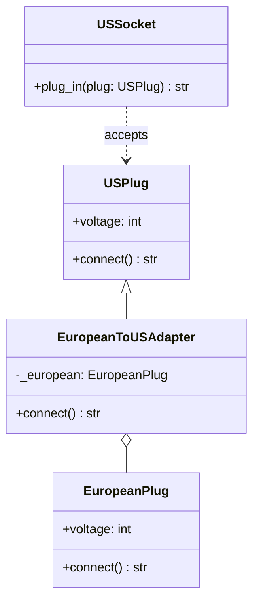
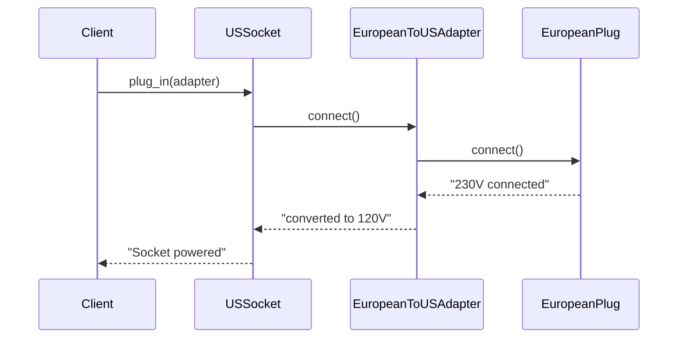
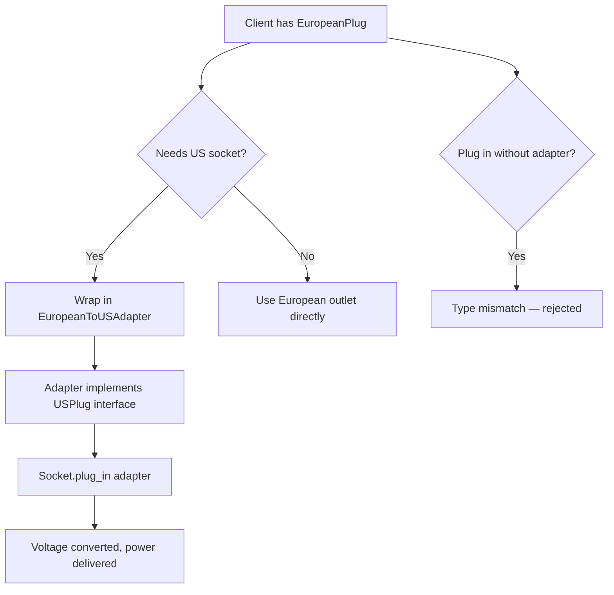

# Adapter Pattern

## Intent

Convert the interface of a class into another interface clients expect. Adapter lets classes work together that could not otherwise because of incompatible interfaces.

This demo adapts a **EuropeanPlug** (230 V, round pins) so it can be used with a **USSocket** that only accepts **USPlug** connectors.

## Class Diagram



## Sequence Diagram



## Flowchart



## Run Instructions

```bash
cd PyPatterns
python3 structural/adapter/demo.py
```

Expected output shows a native US plug working, an adapted EU plug working, and a direct EU plug being rejected.

## Pros / Cons

| Pros | Cons |
| ---- | ---- |
| Integrates legacy or third-party code without modifying it | Adds a layer of indirection |
| Follows Single Responsibility — conversion logic is isolated | Multiple adapters for many incompatible types can clutter the codebase |
| Open/Closed — new adapters can be added without changing the socket | Object adapter (composition) vs class adapter (inheritance) trade-offs |

## Distributed Environments

In microservices and polyglot systems, adapters appear at **protocol boundaries**:

- **API gateways** translate REST requests into gRPC or message-queue payloads.
- **Anti-corruption layers** (DDD) wrap external domain models so internal services stay consistent.
- **SDK wrappers** adapt vendor-specific cloud APIs (S3, Azure Blob, GCS) to a unified storage interface.

When a European billing service must talk to a US payment processor, an adapter service normalizes currency, date formats, and error codes at the network edge rather than leaking foreign semantics into core business logic.

## References

- [Adapter — Refactoring.Guru](https://refactoring.guru/design-patterns/adapter)
- [Adapter pattern — Wikipedia](https://en.wikipedia.org/wiki/Adapter_pattern)
