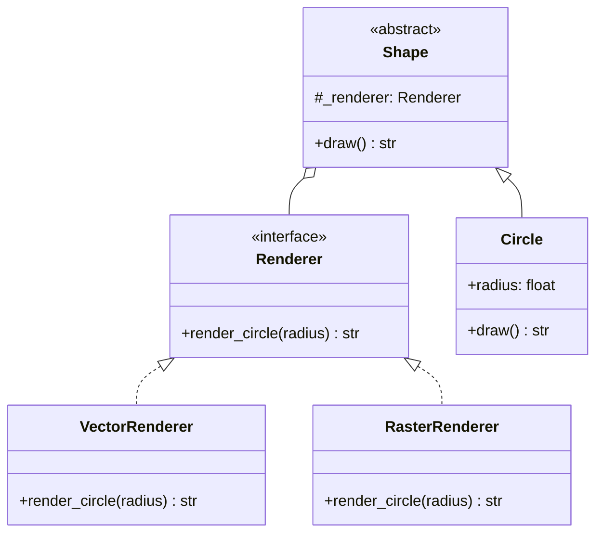
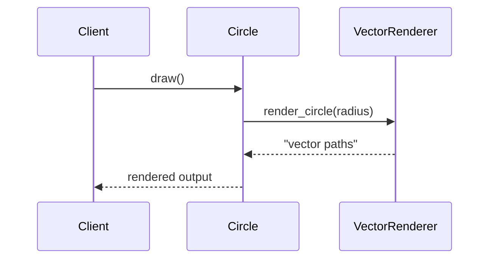
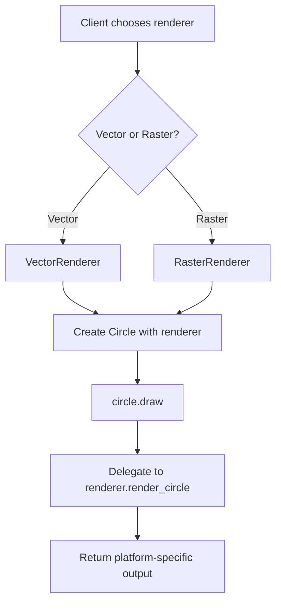

# Bridge Pattern

## Intent

Decouple an abstraction from its implementation so that the two can vary independently.

This demo separates **Shape** (abstraction) from **Renderer** (implementation). A **Circle** can be drawn with either **VectorRenderer** or **RasterRenderer** without subclass explosion (`VectorCircle`, `RasterCircle`, etc.).

## Class Diagram



## Sequence Diagram



## Flowchart



## Run Instructions

```bash
cd PyPatterns
python3 structural/bridge/demo.py
```

Prints three circles — some vector, some raster — demonstrating independent variation of shape and rendering strategy.

## Pros / Cons

| Pros | Cons |
| ---- | ---- |
| Avoids cartesian product of abstractions × implementations | Increases initial design complexity |
| Runtime binding of implementation | Indirection on every delegated call |
| Open/Closed — add renderers or shapes without touching existing code | Can be overkill when only one implementation exists |

## Distributed Environments

Bridge maps naturally to **pluggable backends** in distributed systems:

- A **notification service** abstraction bridged to email, SMS, Slack, or push implementations selected at runtime.
- **Storage drivers** behind a unified blob interface (local disk vs S3 vs MinIO).
- **Event publishers** with Kafka, RabbitMQ, or SNS implementations swapped via configuration.

In Kubernetes, the abstraction lives in your application code while the implementation is injected through environment-specific sidecars or SDK bindings — the same deployment artifact renders differently per cluster without recompilation.

## References

- [Bridge — Refactoring.Guru](https://refactoring.guru/design-patterns/bridge)
- [Bridge pattern — Wikipedia](https://en.wikipedia.org/wiki/Bridge_pattern)
