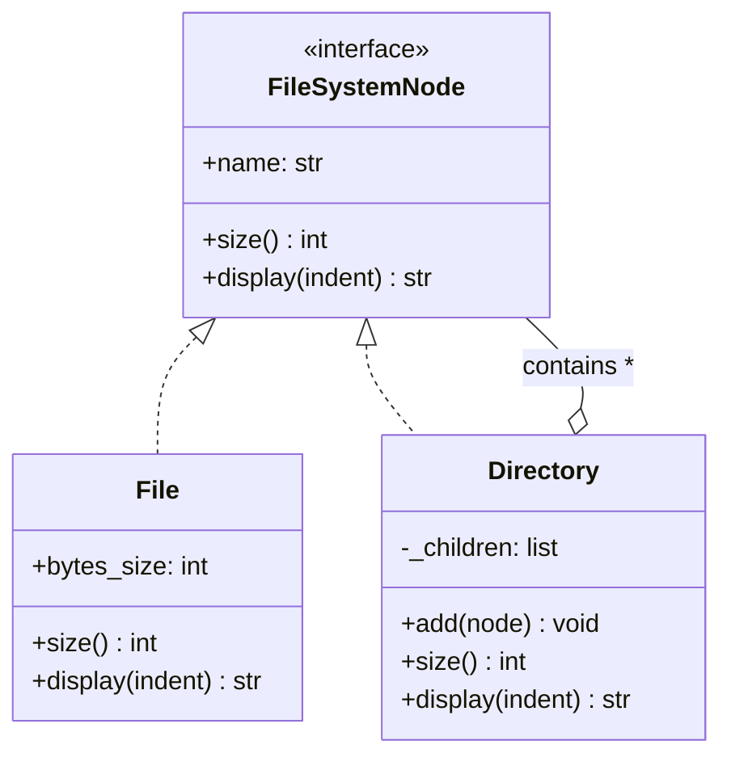
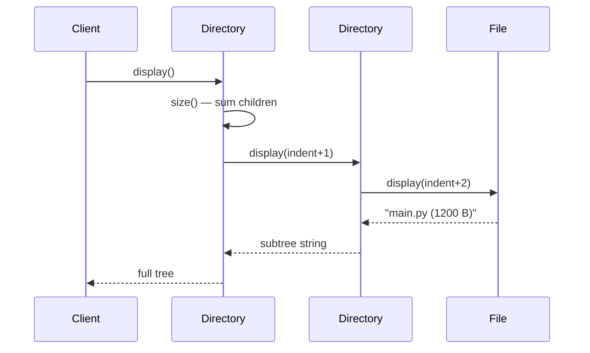
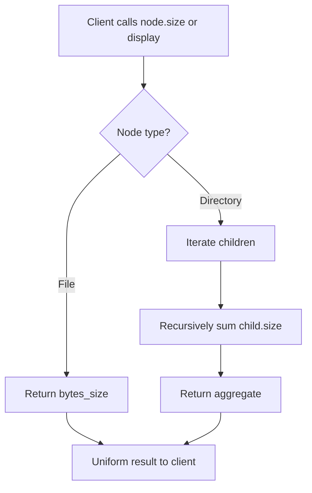

# Composite Pattern

## Intent

Compose objects into tree structures to represent part-whole hierarchies. Composite lets clients treat individual objects and compositions uniformly.

This demo models a **file system**: **File** (leaf) and **Directory** (composite) both implement **FileSystemNode**, so size and display work the same whether you query a single file or an entire project tree.

## Class Diagram



## Sequence Diagram



## Flowchart



## Run Instructions

```bash
cd PyPatterns
python3 structural/composite/demo.py
```

Prints an indented directory tree and total project size computed recursively.

## Pros / Cons

| Pros | Cons |
| ---- | ---- |
| Uniform API for leaves and composites | Hard to restrict which operations belong on leaves vs composites |
| Easy to add new component types | Can make type safety weaker (everything is `FileSystemNode`) |
| Simplifies client code — no special cases for folders | Deep trees can make debugging recursive calls harder |

## Distributed Environments

Composite structures appear in **distributed hierarchies**:

- **Kubernetes resources** — Deployments contain ReplicaSets contain Pods; `kubectl` treats the tree uniformly for apply/delete.
- **Org / permission trees** — IAM policies inherit through OU → account → resource group nesting.
- **Configuration bundles** — Helm charts, Terraform modules, and Consul key prefixes compose nested settings.

A distributed file catalog (S3 prefixes, HDFS paths) often exposes a composite API so clients list `size()` or `delete()` on a "folder" without knowing whether the backend stores real directories or flat keys with `/` delimiters.

## References

- [Composite — Refactoring.Guru](https://refactoring.guru/design-patterns/composite)
- [Composite pattern — Wikipedia](https://en.wikipedia.org/wiki/Composite_pattern)
