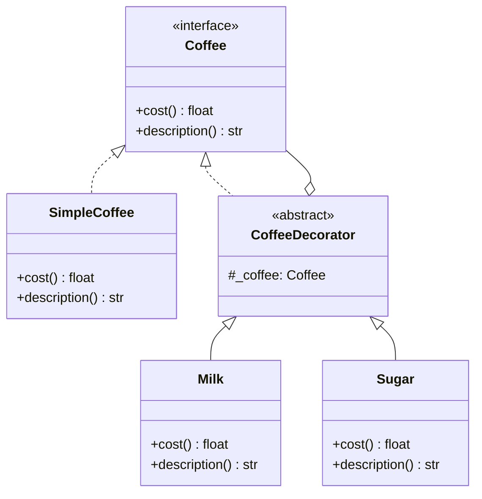
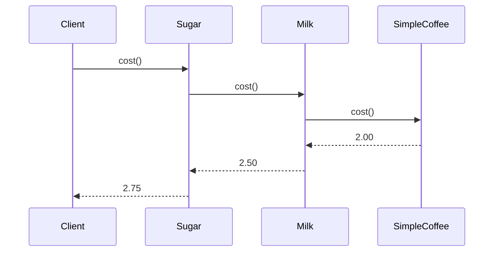

# Decorator Pattern

## Intent

Attach additional responsibilities to an object dynamically. Decorators provide a flexible alternative to subclassing for extending functionality.

This demo wraps **SimpleCoffee** with **Milk** and **Sugar** decorators. Each decorator implements the same **Coffee** interface and delegates to the wrapped object, stacking behavior and cost transparently.

## Class Diagram



## Sequence Diagram



## Flowchart

```mermaid
flowchart TD
    A[Client requests decorated coffee] --> B[Wrap SimpleCoffee]
    B --> C{Add decorators?}
    C -->|Milk| D[Milk wraps inner Coffee]
    C -->|Sugar| E[Sugar wraps inner Coffee]
    D --> F[Stack: Sugar(Milk(SimpleCoffee))]
    E --> F
    F --> G[Client calls cost / description]
    G --> H[Outermost decorator delegates inward]
    H --> I[Each layer adds its price and label]
```

## Run Instructions

```bash
cd PyPatterns
python3 structural/decorator/demo.py
```

Prints three drink variants with stacked descriptions and cumulative prices.

## Pros / Cons

| Pros | Cons |
| ---- | ---- |
| Compose behavior at runtime in any order | Many small wrapper classes |
| Open/Closed — new decorators without changing core | Hard to remove a decorator from the middle of a stack |
| Single Responsibility per decorator | Debugging deep decorator chains can be confusing |

## Distributed Environments

Decorators map to **middleware pipelines** and **cross-cutting wrappers**:

- **HTTP middleware** — auth, logging, rate limiting, and compression layers wrap a handler without modifying it.
- **gRPC interceptors** and **OpenTelemetry spans** decorate RPC calls with tracing and metrics.
- **Caching decorators** wrap database or remote service clients to add TTL-based memoization.

In a service mesh (Istio, Linkerd), sidecar proxies effectively decorate network calls with retries, mTLS, and circuit breaking — the application service remains unchanged while behavior is stacked at the infrastructure layer.

## References

- [Decorator — Refactoring.Guru](https://refactoring.guru/design-patterns/decorator)
- [Decorator pattern — Wikipedia](https://en.wikipedia.org/wiki/Decorator_pattern)
