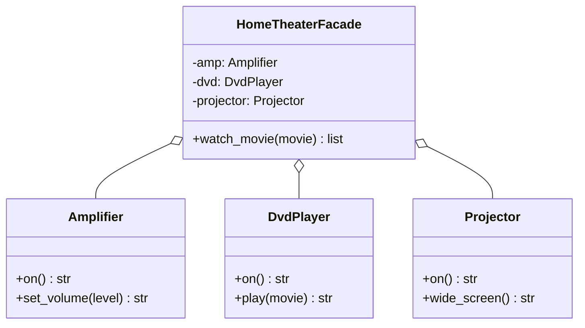
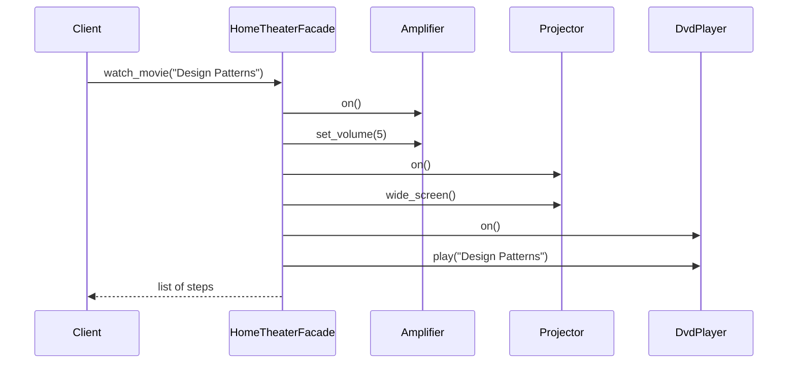
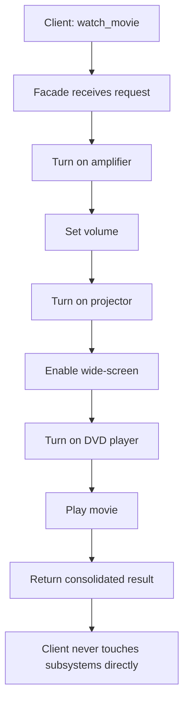

# Facade Pattern

## Intent

Provide a unified interface to a set of interfaces in a subsystem. Facade defines a higher-level interface that makes the subsystem easier to use.

This demo's **HomeTheaterFacade** coordinates **Amplifier**, **DvdPlayer**, and **Projector** so the client calls a single `watch_movie()` instead of six individual startup steps.

## Class Diagram



## Sequence Diagram



## Flowchart



## Run Instructions

```bash
cd PyPatterns
python3 structural/facade/demo.py
```

Prints the ordered startup sequence for a home theater movie session from one facade call.

## Pros / Cons

| Pros | Cons |
| ---- | ---- |
| Simplifies client code dramatically | Facade can become a "god object" if it grows unchecked |
| Decouples clients from subsystem churn | Does not prevent direct subsystem access |
| Promotes layered architecture | Extra indirection for power users who need fine control |

## Distributed Environments

Facades are the backbone of **API simplification** in distributed systems:

- **BFF (Backend for Frontend)** — one facade per client platform aggregating calls to many microservices.
- **GraphQL gateways** — a single schema hides dozens of REST/gRPC backends.
- **Cloud SDK high-level clients** — `boto3.client()` vs resource-oriented facades that wrap S3, DynamoDB, and SQS setup.

When onboarding a mobile app to twelve internal services, a facade service orchestrates auth, catalog, cart, and payment in one `checkout()` RPC — reducing round trips, retries, and error-handling burden on the client.

## References

- [Facade — Refactoring.Guru](https://refactoring.guru/design-patterns/facade)
- [Facade pattern — Wikipedia](https://en.wikipedia.org/wiki/Facade_pattern)
