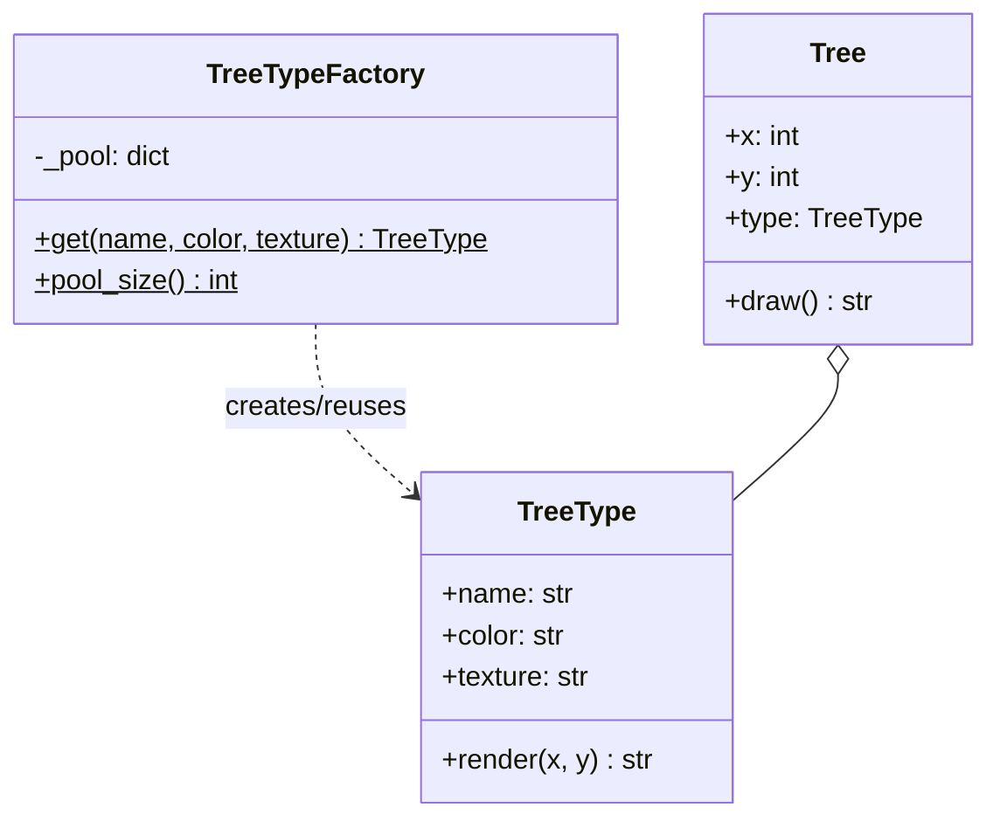
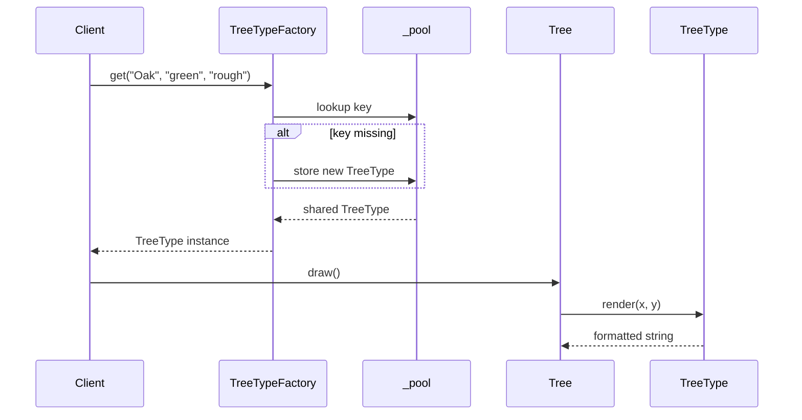
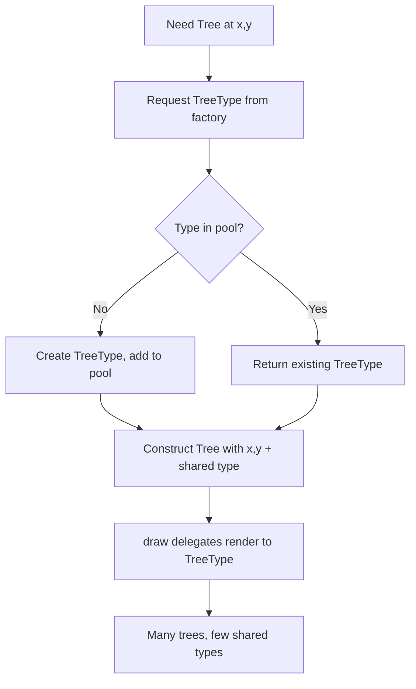

# Flyweight Pattern

## Intent

Use sharing to support large numbers of fine-grained objects efficiently by separating intrinsic (shared) state from extrinsic (per-instance) state.

This demo places thousands of forest **Tree** instances that share **TreeType** objects (name, color, texture) through a **TreeTypeFactory** pool. Position `(x, y)` stays extrinsic on each tree.

## Class Diagram



## Sequence Diagram



## Flowchart



## Run Instructions

```bash
cd PyPatterns
python3 structural/flyweight/demo.py
```

Shows factory creating two shared types while four trees are placed — demonstrating memory savings at scale.

## Pros / Cons

| Pros | Cons |
| ---- | ---- |
| Dramatic memory reduction for many similar objects | Requires careful split of intrinsic vs extrinsic state |
| Centralized factory simplifies deduplication | Thread-safe pools need locking in concurrent code |
| Transparent to clients using shared objects | Extrinsic state must be passed in — slightly more complex API |

## Distributed Environments

Flyweight thinking applies wherever **shared immutable data** reduces duplication across nodes:

- **CDN edge caches** — one cached asset (intrinsic) served to millions of requests (extrinsic context: user region, headers).
- **Connection / schema pools** — database connection pools and Avro/Protobuf schema registries share heavy metadata across lightweight message instances.
- **Icon and font caches** in front-end build pipelines — glyph definitions shared, placement computed per component.

In game servers or simulation clusters, tree/plant/tile **archetypes** live in a shared registry (Redis, read-only memory map) while each game shard only stores coordinates and entity IDs — the same flyweight split that keeps a forest of 100k trees from loading 100k texture blobs.

## References

- [Flyweight — Refactoring.Guru](https://refactoring.guru/design-patterns/flyweight)
- [Flyweight pattern — Wikipedia](https://en.wikipedia.org/wiki/Flyweight_pattern)
