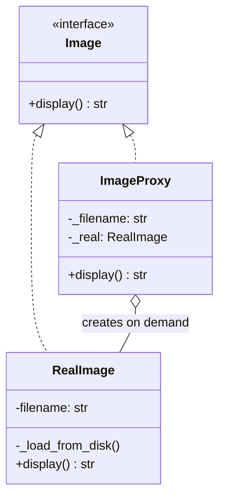
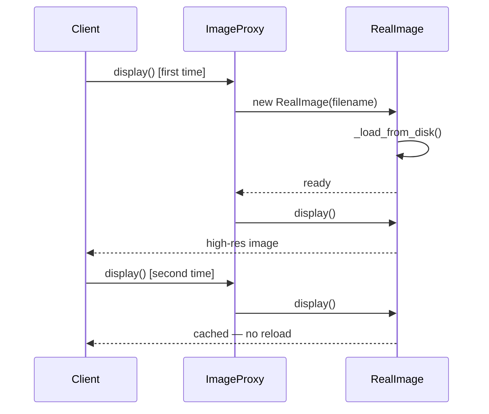
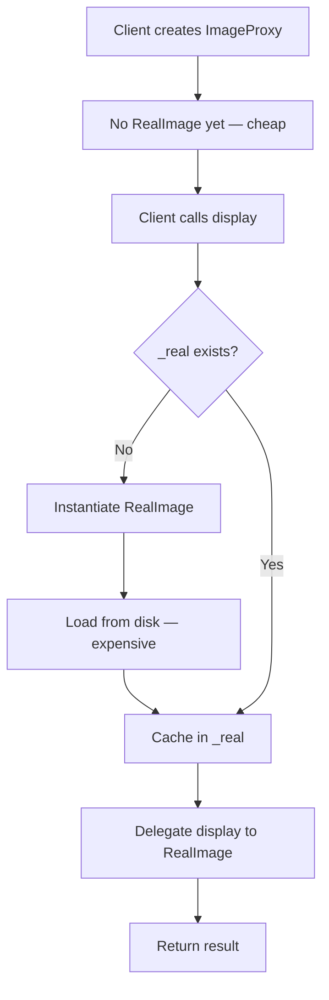

# Proxy Pattern

## Intent

Provide a surrogate or placeholder for another object to control access to it.

This demo's **ImageProxy** implements the same **Image** interface as **RealImage** but delays the expensive disk load until the first `display()` call. Subsequent calls reuse the cached real object.

## Class Diagram



## Sequence Diagram



## Flowchart



## Run Instructions

```bash
cd PyPatterns
python3 structural/proxy/demo.py
```

First display triggers disk load; second display reuses the cached image without reloading.

## Pros / Cons

| Pros | Cons |
| ---- | ---- |
| Lazy initialization saves startup time and memory | Adds latency on first access |
| Transparent to clients — same interface | Must keep proxy in sync with real subject API |
| Enables access control, logging, and caching variants | Indirection can complicate object identity checks |

## Distributed Environments

Proxies are everywhere in **remote and cached access**:

- **Reverse proxies** (nginx, Envoy) stand in for application servers — TLS termination, load balancing, caching.
- **Database connection proxies** (PgBouncer, RDS Proxy) pool and defer expensive connections.
- **Lazy-loading gRPC stubs** and **GraphQL DataLoader** batch remote fetches until fields are actually requested.

In object storage, a metadata service returns lightweight **ImageProxy** handles (URL + etag); the full blob streams only when the client renders — mirroring this demo's lazy `RealImage` load across the network boundary.

## References

- [Proxy — Refactoring.Guru](https://refactoring.guru/design-patterns/proxy)
- [Proxy pattern — Wikipedia](https://en.wikipedia.org/wiki/Proxy_pattern)
