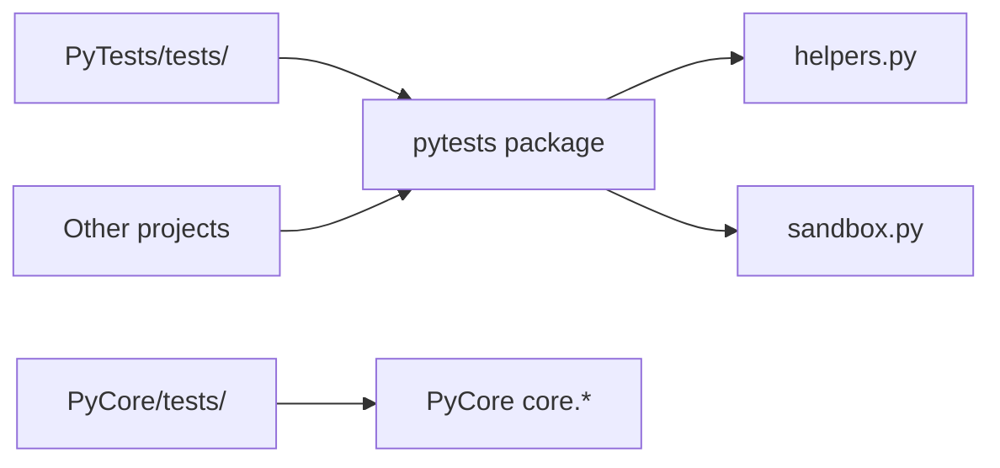

# PyTests

Installable shared test package for the PySuite monorepo — pytest utilities, monorepo-wide test discovery, and a scratch sandbox for ad-hoc experiments.

## 🚀 Quick Start

Install in editable mode from this directory, then run pytest:

```bash
cd PyTests
pip install -e .
python -m pytest tests/ -v
```

Import from other projects after install:

```python
from pytests import assert_exception
from pytests.helpers import assert_exception
```

Formal unit tests for individual libraries (e.g. PyCore `ContextStack`) stay in each project's own `tests/` folder — [PyCore/tests/test_context.py](../PyCore/tests/test_context.py) is the reference example.

### Usage

```bash
# Install (editable — recommended for monorepo dev)
pip install -e PyTests

# Run PyTests package tests
python -m pytest PyTests/tests/ -v

# Scratch / ad-hoc experiments (stdlib only)
python -m pytests.sandbox

# With coverage (optional)
pip install -e "PyTests[dev]"
python -m pytest PyTests/tests/ --cov=pytests
```

Use from another module:

```python
from pytests.helpers import assert_exception

with assert_exception(KeyError):
    {}["missing"]
```

### Output

pytest prints pass/fail results to stdout. The sandbox module prints scratch output when you add code to `pytests/sandbox.py`.

## ✨ Features

- **Installable package** — `pip install -e PyTests` exposes the `pytests` import
- **Shared helpers** — `assert_exception` and other utilities in `pytests/helpers.py`
- **Sandbox** — `python -m pytests.sandbox` for quick stdlib-only experiments
- **Monorepo pytest root** — `tests/` collects cross-project tests; `pyproject.toml` adds `../PyCore` to `pythonpath`
- **Project-local tests** — PyCore, PhotoMixer, etc. keep their own `tests/` directories

## 📋 Prerequisites & Dependencies

- Python `3.12+`

| Source | Purpose |
| ------ | ------- |
| [`requirements.txt`](requirements.txt) | Same as `pyproject.toml` runtime deps (`pytest>=7.0`) |
| [`pyproject.toml`](pyproject.toml) | Package metadata and pytest configuration |
| Project under test | Install that project's deps (e.g. [PyCore/requirements.txt](../PyCore/requirements.txt)) |

### Install

```bash
pip install -e PyTests
# or
pip install -r PyTests/requirements.txt
```

## ⚙️ Build & Configuration

### Build

```bash
cd PyTests
pip install -e .
```

`pyproject.toml` configures:

- **Package name (PyPI-style):** `pysuite-pytests`
- **Import name:** `pytests`
- **pytest `pythonpath`:** `.` and `../PyCore` so tests can import `core.*` when needed

No `.env` file is required.

## 📁 Project Layout

Three names, three roles:

| Name | Role |
| ---- | ---- |
| **`PyTests/`** | Monorepo folder / project root (this directory) |
| **`src/pytests/`** | Installable Python package — `import pytests` |
| **`tests/`** | pytest test files — **not** importable as a package |

We use the **[src layout](https://packaging.python.org/en/latest/discussions/src-layout-vs-flat-layout/)**: library code lives under `src/`, tests stay at the project root. That keeps `tests/` (pytest) separate from `pytests` (import name) and ensures other projects import the **installed** package after `pip install -e .`, not a stray folder on disk.

```
PyTests/
├── pyproject.toml          # pip install -e .
├── requirements.txt
├── src/
│   └── pytests/            # importable package
│       ├── __init__.py
│       ├── helpers.py      # assert_exception, shared utilities
│       └── sandbox.py      # ad-hoc scratch runner
├── tests/                  # pytest modules (test the package)
│   ├── __init__.py
│   └── test_package.py
└── README.md               ← you are here
```

| Path | Purpose |
| ---- | ------- |
| `src/pytests/` | Importable library — `import pytests` |
| `src/pytests/helpers.py` | Shared test helpers for any PySuite project |
| `src/pytests/sandbox.py` | Manual scratch pad (`python -m pytests.sandbox`) |
| `tests/` | pytest collection for the `pytests` package itself |

## 🏗️ Architecture



- **`pytests`** — installable helpers consumed by any monorepo project
- **`PyTests/tests/`** — tests for the `pytests` package itself
- **`PyCore/tests/`**, **`PhotoMixer/`**, etc. — project-specific unit tests (not moved here)

## 🧪 Testing

```bash
pip install -e PyTests
python -m pytest PyTests/tests/ -v
python -c "import pytests; print(pytests.__version__)"
```

Run PyCore tests separately:

```bash
cd PyCore
PYTHONPATH=. python3 -m pytest tests/test_context.py -v
```

## 🛠️ Troubleshooting

**`ModuleNotFoundError: No module named 'pytests'`**

- **Cause:** Package not installed
- **Fix:** `pip install -e PyTests` from the repo root or `PyTests/` directory

**`ModuleNotFoundError: No module named 'core'`**

- **Cause:** PyCore tests run without `PYTHONPATH`
- **Fix:** `cd PyCore && PYTHONPATH=. python3 -m pytest tests/`

| Issue | Fix |
| ----- | --- |
| pytest not found | `pip install -e PyTests` |
| Sandbox prints placeholder only | Add code to `pytests/sandbox.py` |
| Need formal PyCore tests | Use [PyCore/tests/](../PyCore/tests/) — not the sandbox |

## 📚 References

### In this repository

| README / Link | Description |
| ------------- | ----------- |
| [PySuite (root)](../README.md) | Monorepo index |
| [PyCore](../PyCore/README.md) | Primary library under test |
| [PyCore/tests/test_context.py](../PyCore/tests/test_context.py) | Example project-local unit tests |

### External Documentation

| Link | Description |
| ---- | ----------- |
| [pytest](https://docs.pytest.org/) | Test framework |
| [setuptools editable installs](https://setuptools.pypa.io/en/latest/userguide/development_mode.html) | `pip install -e` |

## 📄 License

[Add your license here]

## 👤 Author

- **Rohtash Lakra** — [@rslakra](https://github.com/rslakra)
