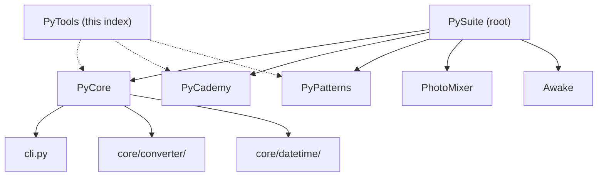

# PyTools

Index and migration guide for Python utilities in the PySuite monorepo. The original single-tree layout (`core/`, `learning/`, root `cli.py`) has been split into focused projects — use this README to find where each tool lives today.

## 🚀 Quick Start

Most utilities now live in **PyCore**. Start there for document conversion, time helpers, and office tooling:

```bash
cd PyCore
just setup-venv
source venv/bin/activate
just install-packages

just list
just convert -i README.md
```

Learning scripts are in **PyCademy**; design patterns are in **PyPatterns**. See **📁 Where things moved** below.

### Usage

Document converter (from **PyCore/**):

```bash
python cli.py -h
python cli.py --list
python cli.py -i report.pdf --out report.docx
python cli.py -i notes.docx pdf
python cli.py -i notes.docx -f pdf
just convert -i README.md md
just convert-to notes.docx pdf
```

Time utilities demo:

```bash
cd PyCore
just time-demo
```

Learning examples (from **PyCademy/**):

```bash
cd PyCademy
python acronym.py
python lists.py
```

Design patterns (from **PyPatterns/**):

```bash
cd PyPatterns
just singleton
```

### Output

- **PyCore converter** — writes beside the input file unless `--out PATH` is given; format via trailing argument (`pdf`, `md`, …) or `-f` / `--format`
- **PyCademy / PyPatterns** — print demos to stdout

## ✨ Features

Tools are grouped by project in the monorepo:

| Area | Project | Examples |
| ---- | ------- | -------- |
| Document conversion | [PyCore](../PyCore/) | `cli.py`, markdown / Word / PDF |
| Time & leap seconds | [PyCore](../PyCore/) | `core/datetime/time.py`, `TimeUtils` |
| HTTP exceptions, I/O | [PyCore](../PyCore/) | `core/exceptions/`, `core/io/` |
| Office / Excel | [PyCore](../PyCore/) | `office/main.py` |
| Learning scripts | [PyCademy](../PyCademy/) | `acronym.py`, `lists.py`, `story.py` |
| Design patterns | [PyPatterns](../PyPatterns/) | `creational/singleton.py` |
| Image blending | [PhotoMixer](../PhotoMixer/) | `photo_mixer.py` |
| macOS menubar | [Awake](../Awake/) | sleep prevention app |

## 📋 Prerequisites & Dependencies

- Python `3.12+`
- [Just](https://github.com/casey/just) (optional — task runners in PyCore, PyPatterns, PhotoMixer, and at repo root)
- **Microsoft Word** (macOS or Windows only) — required for `docx → pdf` in PyCore via `docx2pdf`

| Source | Purpose |
| ------ | ------- |
| [PyCore/requirements.txt](../PyCore/requirements.txt) | Converter, time, and office dependencies |
| [PySuite README](../README.md) | Monorepo setup and root Justfile |
| PyCademy / PyPatterns | Standard library only (except Twisted for `TCPServer.py`) |

### Installing Just

```bash
# macOS
brew install just

# Linux
curl --proto '=https' --tlsv1.2 -sSf https://just.systems/install.sh | bash -s -- --to ~/bin
```

## ⚙️ Build & Configuration

### Build

PyTools itself has no install step — open the project that matches what you need:

```bash
# PyCore (recommended for utilities)
cd PyCore && just setup-venv && source venv/bin/activate && just install-packages

# Or root venv (optional, mirrors PyCore deps)
cd .. && just setup-venv && source venv/bin/activate && just install-packages
```

### Document converter CLI flags (PyCore)

| Flag / form | Purpose |
| ----------- | ------- |
| `-i` / `--input PATH` | Input file |
| `FORMAT` (trailing) | Target format — e.g. `just convert -i file.docx pdf` |
| `-f` / `--format FORMAT` | Explicit format when not using a trailing argument |
| `--out PATH` | Explicit output file path |
| `--list` | Supported conversion pairs |

Default output when format is omitted:

| Input | Default output |
| ----- | -------------- |
| `.md` / `.markdown` | `.docx` |
| `.pdf` | `.docx` |
| `.docx` | `.md` |

### Just commands (repo root)

| Command | Description |
| ------- | ----------- |
| `just pycore list` | Supported document conversions |
| `just pycore convert -i FILE pdf` | Convert a document |
| `just pycore time-demo` | UTC/TAI demo |
| `just pypatterns singleton` | Singleton pattern demo |
| `just photomixer run BG FG` | Blend two images |
| `just help` | All projects |

## 📁 Where things moved

Legacy monolith paths and their current locations:

```
PySuite/                         (monorepo root — was the old “PyTools/PySuite” tree)
├── PyCore/                      ← core/, cli.py, requirements.txt
│   ├── cli.py
│   ├── core/
│   │   ├── converter/
│   │   ├── datetime/time.py     ← was core/time/time.py
│   │   ├── exceptions/
│   │   └── io/
│   └── office/
├── PyCademy/                    ← was learning/
│   ├── acronym.py
│   ├── lists.py
│   └── …
├── PyPatterns/                  ← design pattern examples
├── PhotoMixer/
├── Awake/
├── tests/
├── Justfile
└── README.md
```

| Old path | New location |
| -------- | ------------ |
| `cli.py` | [PyCore/cli.py](../PyCore/cli.py) |
| `core/converter/` | [PyCore/core/converter/](../PyCore/core/converter/) |
| `core/time/time.py` | [PyCore/core/datetime/time.py](../PyCore/core/datetime/time.py) |
| `learning/*.py` | [PyCademy/](../PyCademy/) |
| Root `Justfile` (venv, convert) | [PyCore/Justfile](../PyCore/Justfile) and [root Justfile](../Justfile) |

## 🏗️ Architecture



PyTools is documentation-only in this repository — run code from the linked project directories.

## 🧪 Testing

```bash
cd PyCore
source venv/bin/activate
just list
just convert -i README.md docx

cd ../PyPatterns
just singleton

# Shared tests (when present)
cd ..
source venv/bin/activate
python -m pytest tests/
```

## 🛠️ Troubleshooting

**Looking for `python cli.py` at repo root**

- **Cause:** The CLI moved into PyCore during the monorepo split
- **Fix:** `cd PyCore` or `just pycore convert -i FILE pdf` from the repo root

**`docx → pdf` fails or Word opens**

- **Cause:** PyCore uses `docx2pdf`, which automates Microsoft Word on macOS/Windows
- **Fix:** Install Word, or convert via markdown instead — see [PyCore/README.md](../PyCore/README.md)

**Import errors (`core.time`, `learning`)**

- **Cause:** Old module paths from the pre-split layout
- **Fix:** Use `core.datetime.time` in PyCore and scripts under `PyCademy/`

| Issue | Fix |
| ----- | --- |
| Stale `--to` / `-o` flags | Use trailing format, `-f` / `--format`, and `--out` — see PyCore CLI help |
| Empty PyTools folder | Expected — utilities live in sibling projects |

## 📚 References

### In this repository

| README / Link | Description |
| ------------- | ----------- |
| [PySuite (root)](../README.md) | Monorepo index |
| [PyCore](../PyCore/README.md) | Document converter, time utils, office CLI |
| [PyCademy](../PyCademy/README.md) | Learning scripts |
| [PyPatterns](../PyPatterns/README.md) | Design pattern demos |
| [PhotoMixer](../PhotoMixer/README.md) | Image blending |
| [Awake](../Awake/README.md) | macOS menubar app |
| [README-TEMPLATE.md](../README-TEMPLATE.md) | README structure template |

### External Documentation

| Link | Description |
| ---- | ----------- |
| [Just](https://github.com/casey/just) | Command runner |
| [python-docx](https://python-docx.readthedocs.io/) | Word documents (PyCore) |
| [Design Patterns (GoF)](https://en.wikipedia.org/wiki/Design_Patterns) | PyPatterns catalog |

## 📄 License

[Add your license here]

## 👤 Author

- **Rohtash Lakra** — [@rslakra](https://github.com/rslakra)
