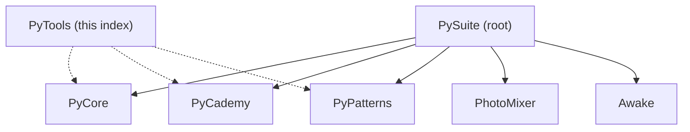

# PyTools

Index and migration guide for Python utilities in the PySuite monorepo. The original single-tree layout (`core/`, `learning/`, root `cli.py`) has been split into focused projects — use this README to find where each tool lives today.

## 🚀 Quick Start

Most utilities now live in **PyCore**. Start there for document conversion, time helpers, and office tooling:

```bash
cd PyCore
just setup-venv
source venv/bin/activate
just install-packages

just list
just convert -i README.md
```

Learning scripts are in **PyCademy**; design patterns are in **PyPatterns**. See **📁 Where things moved** below.

Install this package to use the programmatic migration index (`from pytools import PROJECT_INDEX`).

```bash
cd PyTools
just install-packages
just index
```

### Usage

Document converter (from **PyCore/**):

```bash
python -m core.cli -h
python -m core.cli --list
python -m core.cli -i report.pdf --out report.docx
python -m core.cli -i notes.docx pdf
just convert -i README.md md
```

Time utilities demo:

```bash
cd PyCore
just time-demo
```

Learning examples (from **PyCademy/**):

```bash
cd PyCademy
just install-packages
python -m pycademy.acronym
python -m pycademy.lists
```

Migration index (from **PyTools/**):

```bash
python -c "from pytools import resolve_path; print(resolve_path('cli.py'))"
just index
```

Design patterns (from **PyPatterns/**):

```bash
cd PyPatterns
just singleton
```

### Output

- **PyCore converter** — writes beside the input file unless `--out PATH` is given; format via trailing argument (`pdf`, `md`, …) or `-f` / `--format`
- **PyCademy / PyPatterns** — print demos to stdout

## ✨ Features

Tools are grouped by project in the monorepo:

| Area | Project | Examples |
| ---- | ------- | -------- |
| Document conversion | [PyCore](../PyCore/) | `core.cli`, markdown / Word / PDF |
| Time & leap seconds | [PyCore](../PyCore/) | `core/datetime/time.py`, `TimeUtils` |
| HTTP exceptions, I/O | [PyCore](../PyCore/) | `core/exceptions/`, `core/io/` |
| Office / Excel | [PyCore](../PyCore/) | `office/main.py` |
| Learning scripts | [PyCademy](../PyCademy/) | `pycademy.acronym`, `pycademy.lists`, … |
| Design patterns | [PyPatterns](../PyPatterns/) | `creational/singleton.py` |
| Image blending | [PhotoMixer](../PhotoMixer/) | `photomixer.cli` |
| Migration index | [PyTools](../PyTools/) | `pytools.index.PROJECT_INDEX` |
| Shared tests | [PyTests](../PyTests/) | pytest package |
| macOS menubar | [Awake](../Awake/) | sleep prevention app |

## 📋 Prerequisites & Dependencies

- Python `3.12+`
- [Just](https://github.com/casey/just) (optional — task runners in PyCore, PyPatterns, PhotoMixer, and at repo root)

| Source | Purpose |
| ------ | ------- |
| [`requirements.txt`](requirements.txt) | Editable install (`-e .`) for the migration index package |
| [PyCore/requirements.txt](../PyCore/requirements.txt) | Converter, time, and office dependencies |

### Installing Just

```bash
# macOS
brew install just

# Linux
curl --proto '=https' --tlsv1.2 -sSf https://just.systems/install.sh | bash -s -- --to ~/bin
```

## ⚙️ Build & Configuration

### Build

PyTools is a lightweight index package. Install it for programmatic path lookup; run utilities from sibling projects:

```bash
# PyTools index
cd PyTools && just install-packages && just index

# PyCore (recommended for utilities)
cd PyCore && just setup-venv && source venv/bin/activate && just install-packages
```

Code lives under **`src/pytools/`** (`index.py` with `PROJECT_INDEX` and `resolve_path()`).

### Document converter CLI flags (PyCore)

| Flag / form | Purpose |
| ----------- | ------- |
| `-i` / `--input PATH` | Input file |
| `FORMAT` (trailing) | Target format — e.g. `just convert -i file.docx pdf` |
| `-f` / `--format FORMAT` | Explicit format |
| `--out PATH` | Explicit output file path |
| `--list` | Supported conversion pairs |

### Just commands (repo root)

| Command | Description |
| ------- | ----------- |
| `just pycore list` | Supported document conversions |
| `just pycore convert -i FILE pdf` | Convert a document |
| `just pycore time-demo` | UTC/TAI demo |
| `just pypatterns singleton` | Singleton pattern demo |
| `just photomixer run BG FG` | Blend two images |
| `just pycademy acronym` | Run a learning script |
| `just pytools index` | Print legacy → current path map |
| `just help` | All projects |

## 📁 Project Layout

```
PyTools/
├── src/
│   └── pytools/
│       ├── __init__.py
│       └── index.py       # PROJECT_INDEX, resolve_path()
├── pyproject.toml
├── requirements.txt       # -e .
├── Justfile
└── README.md              ← you are here
```

## 📁 Where things moved

Legacy monolith paths and their current locations:

```
PySuite/                         (monorepo root)
├── PyCore/                      ← src/core/, src/office/
│   ├── cli.py                   # shim → core.cli
│   └── src/core/converter/
├── PyCademy/                    ← was learning/ → src/pycademy/
├── PyTools/                     ← migration index → src/pytools/
├── PyPatterns/
├── PhotoMixer/                  ← src/photomixer/
├── PyTests/                     ← src/pytests/
├── Awake/
├── Justfile
└── README.md
```

| Old path | New location |
| -------- | ------------ |
| `cli.py` | [PyCore/src/core/cli.py](../PyCore/src/core/cli.py) |
| `core/converter/` | [PyCore/src/core/converter/](../PyCore/src/core/converter/) |
| `core/time/time.py` | [PyCore/src/core/datetime/time.py](../PyCore/src/core/datetime/time.py) |
| `learning/*.py` | [PyCademy/src/pycademy/](../PyCademy/src/pycademy/) |
| `photo_mixer.py` | [PhotoMixer/src/photomixer/cli.py](../PhotoMixer/src/photomixer/cli.py) |
| Root `Justfile` (venv, convert) | [PyCore/Justfile](../PyCore/Justfile) and [root Justfile](../Justfile) |

## 🏗️ Architecture



PyTools provides both this README and a small **`pytools`** package (`PROJECT_INDEX`, `resolve_path`) for programmatic lookups. Run actual utilities from the linked project directories.

## 🧪 Testing

```bash
cd PyCore
source venv/bin/activate
just list
just convert -i README.md docx

cd ../PyPatterns
just singleton

pip install -r PyTests/requirements.txt
python -m pytest PyTests/
```

## 🛠️ Troubleshooting

**Looking for `python cli.py` at repo root**

- **Cause:** The CLI moved into PyCore during the monorepo split
- **Fix:** `cd PyCore` or `just pycore convert -i FILE pdf` from the repo root

**`docx → pdf` fails or Word opens**

- **Cause:** PyCore uses `docx2pdf`, which automates Microsoft Word on macOS/Windows
- **Fix:** Install Word, or convert via markdown — see [PyCore/README.md](../PyCore/README.md)

**Import errors (`core.time`, `learning`)**

- **Cause:** Old module paths from the pre-split layout
- **Fix:** Use `core.datetime.time` in PyCore and scripts under `PyCademy/`

| Issue | Fix |
| ----- | --- |
| Stale `--to` / `-o` flags | Use trailing format, `-f` / `--format`, and `--out` — see PyCore CLI help |
| `KeyError` from `resolve_path` | Use a key from `PROJECT_INDEX` — run `just index` |

## 📚 References

### In this repository

| README / Link | Description |
| ------------- | ----------- |
| [PySuite (root)](../README.md) | Monorepo index |
| [PyCore](../PyCore/README.md) | Document converter, time utils, office CLI |
| [PyCademy](../PyCademy/README.md) | Learning scripts |
| [PyPatterns](../PyPatterns/README.md) | Design pattern demos |
| [PhotoMixer](../PhotoMixer/README.md) | Image blending |
| [PyTests](../PyTests/README.md) | Shared test package |
| [Awake](../Awake/README.md) | macOS menubar app |

### External Documentation

| Link | Description |
| ---- | ----------- |
| [Just](https://github.com/casey/just) | Command runner |
| [python-docx](https://python-docx.readthedocs.io/) | Word documents (PyCore) |

## 📄 License

[Add your license here]

## 👤 Author

- **Rohtash Lakra** — [@rslakra](https://github.com/rslakra)
