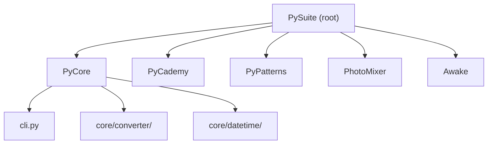

# PySuite

A Python monorepo of utilities, learning exercises, and small tools — document conversion, time handling, design patterns, image mixing, and macOS helpers.

## 🚀 Quick Start

Get the shared virtual environment ready from the repository root, then open any child project.

```bash
git clone https://github.com/rslakra/PySuite
cd PySuite

# PyCore (recommended — self-contained)
cd PyCore && just setup-venv && source venv/bin/activate && just install-packages

# Or use the root Justfile for Awake / shared venv
cd .. && just setup-venv && source venv/bin/activate && just install-packages
```

For project-specific setup and usage, see the README in each subdirectory below.

### Usage

Run a child project after activating the venv:

```bash
# Document conversion (PyCore)
cd PyCore && python cli.py --list

# Photo mixing (PhotoMixer)
cd PhotoMixer && just run bg.jpg fg.jpg

# Awake menubar app
just run-awake
```

### Output

Each project writes artifacts to its own directory (converted documents beside the input file, mixed images under `PhotoMixer/images/mixed/`, etc.). See the child README for details.

## ✨ Features

- **PyCore** — CLI document converter (markdown, Word, PDF) and UTC/TAI time utilities with leap-second support
- **PyCademy** — Standalone Python learning scripts and small exercises
- **PyPatterns** — Reference implementations of common design patterns
- **PhotoMixer** — Blend two images with configurable opacity and blend modes
- **Awake** — macOS menubar app that prevents system sleep

## 📋 Prerequisites & Dependencies

- Python `3.12+`
- [Just](https://github.com/casey/just) command runner (optional but recommended)

| Source | Purpose |
| ------ | ------- |
| [`PyCore/requirements.txt`](PyCore/requirements.txt) | PyCore runtime packages (installed via `just install-packages` in `PyCore/`) |
| [`requirements.txt`](requirements.txt) | Same deps at repo root (for root Justfile) |
| [`PhotoMixer/requirements.txt`](PhotoMixer/requirements.txt) | Pillow and deps for PhotoMixer |
| [`Awake/requirements.txt`](Awake/requirements.txt) | rumps and deps for the menubar app |

### Installing Just

```bash
# macOS
brew install just

# Linux
curl --proto '=https' --tlsv1.2 -sSf https://just.systems/install.sh | bash -s -- --to ~/bin

# Windows
cargo install just
```

## ⚙️ Build & Configuration

### Build

```bash
just setup-venv
source venv/bin/activate
just install-packages        # PyCore / root deps
just install-awake             # Awake-only deps (optional)
```

PhotoMixer has its own Justfile — see [PhotoMixer/README.md](PhotoMixer/README.md).

### Just commands

Run from the **repository root**:

| Command | Description |
| ------- | ----------- |
| `just setup-venv` | Create root `venv/` |
| `just install-packages` | Install root `requirements.txt` |
| `just pycore ARGS...` | Delegate to [PyCore/Justfile](PyCore/Justfile) |
| `just photomixer ARGS...` | Delegate to [PhotoMixer/Justfile](PhotoMixer/Justfile) |
| `just pypatterns ARGS...` | Delegate to [PyPatterns/Justfile](PyPatterns/Justfile) |
| `just install-awake` | Install Awake deps into root venv |
| `just run-awake` | Run Awake menubar app |
| `just build-awake` | Build `Awake.app` bundle |
| `just clean` | Remove root virtual environment |
| `just help` | Show all commands by project |

PyCore, PhotoMixer, and PyPatterns each have project-specific commands — see their READMEs or run `just pycore help`, `just photomixer help`, `just pypatterns help`.

## 📁 Project Layout

```
PySuite/
├── PyCore/           # Document converter CLI and time utilities
├── PyCademy/         # Learning scripts and exercises
├── PyPatterns/       # Design pattern examples
├── PhotoMixer/       # Image blending tool
├── Awake/            # macOS sleep-prevention menubar app
├── tests/            # Shared test package
├── requirements.txt  # PyCore dependencies
├── Justfile          # Root task automation
└── README.md         ← you are here
```

| Path | Description |
| ---- | ----------- |
| [PyCore/](PyCore/) | Core libraries and `cli.py` entry point |
| [PyCademy/](PyCademy/) | Runnable Python learning examples |
| [PyPatterns/](PyPatterns/) | Creational, behavioral, and structural patterns |
| [PhotoMixer/](PhotoMixer/) | CLI photo compositing |
| [Awake/](Awake/) | macOS menubar utility |

## 🏗️ Architecture



Child projects are independent Python packages or scripts. They share the root `venv/` when you use the root Justfile; PhotoMixer and Awake can also manage their own environments.

## 🧪 Testing

```bash
source venv/bin/activate
python -m pytest tests/    # when tests are present
```

Individual projects may include local test scripts (e.g. under `Awake/test/`).

## 🛠️ Troubleshooting

**`just: command not found`**

- **Cause:** Just is not installed or not on your `PATH`
- **Fix:** Install Just (see **📋 Prerequisites & Dependencies**) or run equivalent `python3 -m venv` / `pip install` commands manually

**Import errors when running PyCore**

- **Cause:** Dependencies not installed or venv not activated
- **Fix:** `source venv/bin/activate` then `just install-packages` from the repo root

| Issue | Fix |
| ----- | --- |
| `docx -> pdf` fails | Requires Microsoft Word on macOS or Windows (`docx2pdf`) |
| Awake icon not visible | Build and run the `.app` bundle — see [Awake/README.md](Awake/README.md) |

## 📚 References

### In this repository

| README / Link | Description |
| ------------- | ----------- |
| [PyCore](PyCore/README.md) | Document converter and time utilities |
| [PyCademy](PyCademy/README.md) | Learning examples |
| [PyPatterns](PyPatterns/README.md) | Design pattern implementations |
| [PyTools](PyTools/README.md) | Migration index — where monolith tools moved |
| [PhotoMixer](PhotoMixer/README.md) | Image blending CLI |
| [Awake](Awake/README.md) | macOS menubar sleep prevention |
| [README-TEMPLATE.md](README-TEMPLATE.md) | README structure template |

### External Documentation

| Link | Description |
| ---- | ----------- |
| [Just](https://github.com/casey/just) | Command runner used by root Justfile |
| [python-docx](https://python-docx.readthedocs.io/) | Word document library used by PyCore |

## 📄 License

[Add your license here]

## 👤 Author

- **Rohtash Lakra** — [@rslakra](https://github.com/rslakra)
