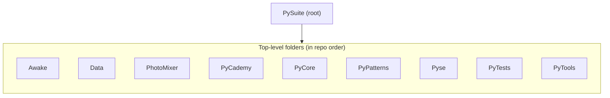

# PySuite

A Python monorepo of utilities, learning exercises, design patterns, image tools, and macOS helpers. Every project is self-contained: **run commands from inside the project folder** and follow that project's README. This file only covers what is shared across the repo.

## 🚀 Quick Start

```bash
git clone https://github.com/rslakra/PySuite
cd PySuite
```

Then pick a module, `cd` into it, and follow its **Quick Start**. Not sure where to begin? Start with **PyCore** (the main utility library).

| Module | Description | Run from | Setup & usage |
| ------ | ----------- | -------- | ------------- |
| [Awake](Awake/) | macOS menubar app that prevents system sleep | `Awake/` scripts, or `just run-awake` at the repo root | [Awake › Quick Start](Awake/README.md#quick-start) |
| [Data](Data/) | Sample documents and conversion artifacts (md, docx, pdf) | — (data only, nothing to run) | [Data › Quick Start](Data/README.md#-quick-start) |
| [PhotoMixer](PhotoMixer/) | Blend two images with opacity and blend modes | `PhotoMixer/` with `just` | [PhotoMixer › Quick Start](PhotoMixer/README.md#-quick-start) |
| [PyCademy](PyCademy/) | Standalone Python learning scripts and Jupyter notebooks | `PyCademy/` with `just` | [PyCademy › Quick Start](PyCademy/README.md#-quick-start) |
| [PyCore](PyCore/) | Document converter CLI, UTC/TAI time utils, HTTP exceptions, office/Excel tooling | `PyCore/` with `just` | [PyCore › Quick Start](PyCore/README.md#-quick-start) |
| [PyPatterns](PyPatterns/) | 75 patterns — GoF, concurrency, and software architecture demos | `PyPatterns/` with `just` | [PyPatterns › Quick Start](PyPatterns/README.md#-quick-start) |
| [Pyse](Pyse/) | `Amey-Pyse` library — context stack, enums, I/O and HTTP helpers (`import pyse`) | `Pyse/` with `make` | [Pyse › Quick Start](Pyse/README.md#-quick-start) |
| [PyTests](PyTests/) | Shared pytest package for monorepo tests | `PyTests/` with `pip` / `pytest` | [PyTests › Quick Start](PyTests/README.md#-quick-start) |
| [PyTools](PyTools/) | Migration index — where monolith utilities moved | `PyTools/` with `just` | [PyTools › Quick Start](PyTools/README.md#-quick-start) |

From the repo root you can also delegate to a project's Justfile, e.g. `just pycore list` — see [Just commands](#just-commands).

## ✨ Features

- **Independent projects** — each folder has its own README, dependencies and tooling
- **`src/` package layout** — PyCore, PhotoMixer, PyCademy, PyTools, PyTests and Pyse are installable with `pip install -e .`
- **Root task runner** — [Justfile](Justfile) delegates to project Justfiles and manages an optional shared venv
- **Mixed tooling** — `just` for most projects, `make` for Pyse, plain scripts for Awake

Module descriptions are in the [Quick Start](#-quick-start) table above.

## 📋 Prerequisites & Dependencies

- Python `3.12+` (Pyse supports `3.10+` — see its README)
- [Just](https://github.com/casey/just) (optional — task runners in PyCore, PhotoMixer, PyCademy, PyTools, PyPatterns, and at repo root)
- `make` (Pyse only)

Each project documents its own packages in its README and `requirements.txt` (where applicable). The root [requirements.txt](requirements.txt) mirrors PyCore for the optional shared venv via `just install-packages`.

### Installing Just

```bash
# macOS
brew install just

# Linux
curl --proto '=https' --tlsv1.2 -sSf https://just.systems/install.sh | bash -s -- --to ~/bin

# Windows
cargo install just
```

## ⚙️ Build & Configuration

Per-project build, install and configuration steps live in each project's **Build & Configuration** section — run them from that project's folder:

| Module | Build & configuration |
| ------ | --------------------- |
| Awake | [Awake › Building for Distribution](Awake/README.md#building-for-distribution) |
| Data | [Data › Build & Configuration](Data/README.md#-build--configuration) |
| PhotoMixer | [PhotoMixer › Build & Configuration](PhotoMixer/README.md#-build--configuration) |
| PyCademy | [PyCademy › Build & Configuration](PyCademy/README.md#-build--configuration) |
| PyCore | [PyCore › Build & Configuration](PyCore/README.md#-build--configuration) |
| PyPatterns | [PyPatterns › Commands](PyPatterns/README.md#-commands) |
| Pyse | [Pyse › Build & Configuration](Pyse/README.md#-build--configuration) |
| PyTests | [PyTests › Build & Configuration](PyTests/README.md#-build--configuration) |
| PyTools | [PyTools › Build & Configuration](PyTools/README.md#-build--configuration) |

No `.env` file is required at the monorepo level. Configuration is via CLI flags in each project.

### Root venv (optional)

A shared venv at the repo root for PyCore deps and Awake:

```bash
just setup-venv
source venv/bin/activate
just install-packages
```

### Just commands

Run from the **repository root**:

| Command                   | Description                                            |
| ------------------------- | ------------------------------------------------------ |
| `just setup-venv`         | Create root `venv/`                                    |
| `just install-packages`   | Install root `requirements.txt`                        |
| `just pycore ARGS...`     | Delegate to [PyCore/Justfile](PyCore/Justfile)         |
| `just photomixer ARGS...` | Delegate to [PhotoMixer/Justfile](PhotoMixer/Justfile) |
| `just pycademy ARGS...`   | Delegate to [PyCademy/Justfile](PyCademy/Justfile)     |
| `just pytools ARGS...`    | Delegate to [PyTools/Justfile](PyTools/Justfile)       |
| `just pypatterns ARGS...` | Delegate to [PyPatterns/Justfile](PyPatterns/Justfile) |
| `just install-awake`      | Install Awake deps into root venv                      |
| `just run-awake`          | Run Awake menubar app                                  |
| `just build-awake`        | Build `Awake.app` bundle                               |
| `just clean`              | Remove root virtual environment                        |
| `just help`               | Show all commands by project                           |

Pyse uses its own [Makefile](Pyse/Makefile). PyTests, Data, and Awake (except the root recipes above) have no project Justfile — run pytest or scripts directly. See each folder's README.

## 📁 Project Layout

```
PySuite/
├── Awake/            # macOS menubar sleep-prevention app
├── Data/             # Sample documents (md, docx, pdf)
├── PhotoMixer/       # src/photomixer — image blending CLI
├── PyCademy/         # src/pycademy — learning scripts and notebooks
├── PyCore/           # src/core, src/office — converter, time utils, office CLI
├── PyPatterns/       # GoF + concurrency + architecture patterns
├── Pyse/             # src/pyse — Amey-Pyse library (make-based, PyPI-published)
├── PyTests/          # src/pytests — shared pytest package
├── PyTools/          # src/pytools — migration index package
├── requirements.txt  # Root venv (PyCore deps)
├── Justfile          # Root task automation
└── README.md         ← you are here
```

Other root files: [README-TEMPLATE.md](README-TEMPLATE.md), [PYTHON-JWT-LIBRARIES.md](PYTHON-JWT-LIBRARIES.md).

## 🏗️ Architecture

The monorepo is a flat set of sibling folders — no shared runtime between projects except the optional root `venv/`:



PyCore, PhotoMixer, PyCademy, PyTools, PyTests, and Pyse use a `src/` package layout. PyPatterns is stdlib-only with runnable demos under category folders. Data holds sample conversion outputs (see [PyCore/README.md](PyCore/README.md) for converter internals).

## 🧪 Testing

Run tests from inside each project and follow its **Testing** section:

| Module | Testing |
| ------ | ------- |
| Awake | [Awake/test/](Awake/test/) scripts, see [Awake/README.md](Awake/README.md) |
| Data | [Data › Testing](Data/README.md#-testing) |
| PhotoMixer | [PhotoMixer › Testing](PhotoMixer/README.md#-testing) |
| PyCademy | [PyCademy › Testing](PyCademy/README.md#-testing) |
| PyCore | [PyCore › Testing](PyCore/README.md#-testing) |
| PyPatterns | [PyPatterns › Testing](PyPatterns/README.md#-testing) |
| Pyse | [Pyse › Testing](Pyse/README.md#-testing) |
| PyTests | [PyTests › Testing](PyTests/README.md#-testing) (shared monorepo tests) |
| PyTools | [PyTools › Testing](PyTools/README.md#-testing) |

## 🛠️ Troubleshooting

| Issue | Fix |
| ----- | --- |
| `just: command not found` | Just is not installed or not on your `PATH` — see [Installing Just](#installing-just), or run `python3 -m venv` / `pip install` manually |
| Import errors when running a project | Dependencies not installed or venv not activated — follow that project's **Build & Configuration** section (for PyCore: [PyCore › Quick Start](PyCore/README.md#-quick-start)) |
| `docx → pdf` fails | Requires Microsoft Word on macOS/Windows — see [PyCore/README.md](PyCore/README.md) |
| Awake icon not visible | Build and run the `.app` bundle — see [Awake/README.md](Awake/README.md) |
| Looking for root `cli.py` | Moved to [PyCore/src/core/cli.py](PyCore/src/core/cli.py) — see [PyTools/README.md](PyTools/README.md) |

More project-specific fixes are in each README's **Troubleshooting** section.

## 📚 References

### In this repository

Module READMEs are linked from the [Quick Start](#-quick-start) table.

| File | Description |
| ---- | ----------- |
| [Justfile](Justfile) | Root task automation |
| [requirements.txt](requirements.txt) | Root venv dependencies (mirrors PyCore) |
| [README-TEMPLATE.md](README-TEMPLATE.md) | README structure template |
| [PYTHON-JWT-LIBRARIES.md](PYTHON-JWT-LIBRARIES.md) | Notes on Python JWT libraries |

### External Documentation

| Link                                               | Description                   |
| -------------------------------------------------- | ----------------------------- |
| [Just](https://github.com/casey/just)              | Command runner                |
| [python-docx](https://python-docx.readthedocs.io/) | Word documents (PyCore)       |
| [Pillow](https://pillow.readthedocs.io/)           | Image processing (PhotoMixer) |

## 📄 License

[Add your license here]

## 👤 Author

- **Rohtash Lakra** — [@rslakra](https://github.com/rslakra)
